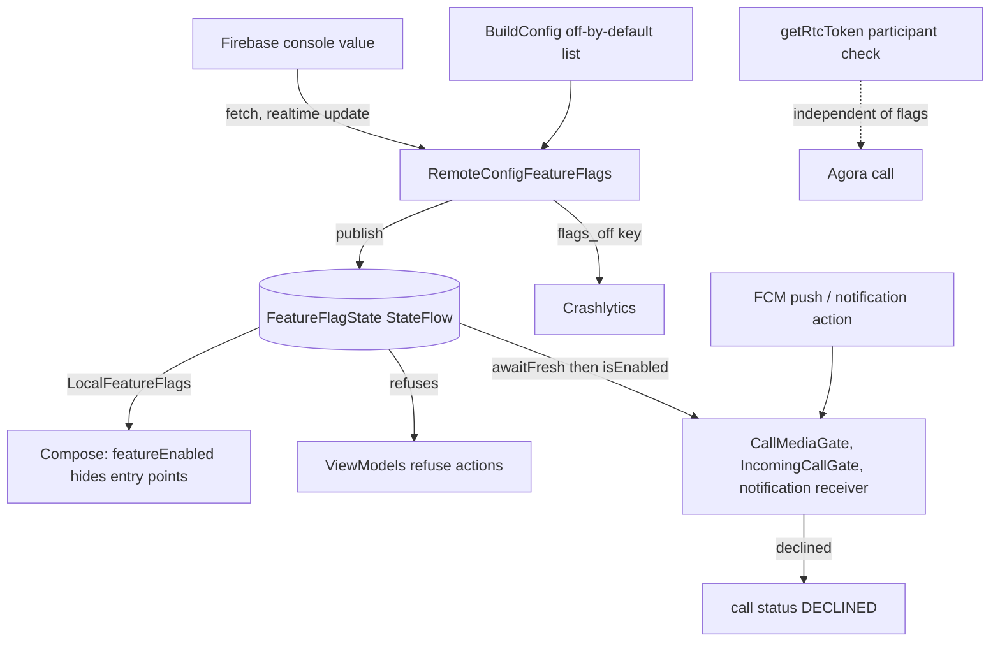

# Feature Flags and Remote Config

The app can switch individual features off from the Firebase console without shipping a new
build. A feature flag is a named boolean; Firebase Remote Config delivers the value, a small domain
type resolves it, and the same answer is read in three places: the Compose tree (to hide entry
points), the ViewModels (to refuse actions) and the call and notification code that runs without
any UI (to refuse work started by a push). Crashlytics sits next to it and records which flags were
off when a crash happened. This note covers how a flag is declared, how its value is resolved and
refreshed, and why hiding a button is never the only check.

Added on 2026-10-18 (commit `020711a`, with Crashlytics in `65115d0`), given a console template on
2026-10-21 (PR #22), and enforced below the UI on 2026-11-05 to 2026-11-07 (PR #68).

`path:line` refs are relative to `app/src/main/java/com/example/messenger/` unless the path starts
with a repo-root name (`remoteconfig.template.json`, `app/build.gradle.kts`, `functions/...`,
`database.rules.json`).

## What

- Remote Config: `com.google.firebase:firebase-config`, versioned by the Firebase BOM
  (`gradle/libs.versions.toml:92`, applied at `app/build.gradle.kts:159`). See
  [[Tech Stack and Versions]].
- Crashlytics: `firebase-crashlytics` (`gradle/libs.versions.toml:91`) plus its Gradle plugin
  (`app/build.gradle.kts:9`).
- The flag catalogue: `enum class FeatureFlag` in `domain/featureflag/FeatureFlag.kt:3`, 62
  entries, each with a Remote Config `key` and an optional `parent`.
- The value holder: the `FeatureFlags` interface (`domain/featureflag/FeatureFlags.kt:5`),
  implemented by `RemoteConfigFeatureFlags` (`data/remote/firebase/RemoteConfigFeatureFlags.kt:27`)
  and bound in `di/FeatureFlagModule.kt:16`.
- The console template: `remoteconfig.template.json` at the repo root, which lists every flag so
  the console shows them as named, grouped parameters.

## How we use it

### Declaring a flag

A flag is one line in the enum: a snake_case key (the Remote Config parameter name) and, if the
feature is a part of a bigger one, its parent. `CALLS_VIDEO("calls_video", CALLS)` is the shape
(`FeatureFlag.kt:5`). The parent link is what makes a single switch cascade: turning `calls` off
turns off every `calls_*` flag, turning `clip_playback` off turns off seek, mini player and playback
speed, and `clip_playback_speed` is itself a child of `clip_mini_player`, so the chain is two deep
(`FeatureFlag.kt:15` to `:18`). `FeatureFlagState.isEnabled` walks up the parent chain and answers
false as soon as any ancestor is off (`domain/featureflag/FeatureFlagState.kt:5`).

The enum also has three helpers for the build-time list described below: `fromKey` (`:79`),
`parseKeys` (`:84`) and `unknownKeys` (`:87`). A typo in that list does not crash; `start()` logs a
warning for each unknown key (`data/remote/firebase/RemoteConfigFeatureFlags.kt:39`).

What has no flag at all matters too: the enum contains nothing for login, logout, account deletion,
sending a text message, accepting, declining, muting or ending a call, or end-to-end encryption. The
commit that introduced the flags says the same ("not switchable"). Those paths cannot be turned off
remotely.

### Defaults before and after a fetch

Resolution is one rule, in `FeatureFlagState.resolve` (`FeatureFlagState.kt:21`): for each flag use
the Remote Config value if there is one, otherwise "on unless the build says off by default"
(`remoteValue(flag.key) ?: (flag !in offByDefault)`, `:26`).

- **Before anything arrives** the state is `FeatureFlagState.defaults(offByDefault)`
  (`RemoteConfigFeatureFlags.kt:33`). The "off by default" set comes from
  `BuildConfig.FEATURES_OFF_BY_DEFAULT` (`:32`), which `app/build.gradle.kts` fills per build type:
  an empty list for `debug` (and so for `e2e`, which copies it) at `:62`, and for `release` the
  `featuresOffInRelease` list (`:66`, list at `:29` to `:39`). At 0.2.2.4 that list holds nine
  unfinished features: `profile_edit_change_photo`, `accounts_switch`, `partner_profile_mute`,
  `partner_profile_block`, `settings_privacy_controls`, `settings_security_placeholders`,
  `settings_notification_controls`, `settings_data_storage` and `settings_language`. (The repo
  README says "ten"; the build file has nine, because `settings_security` was taken off the list so
  the Security row stays reachable in release builds, which is covered by a test at
  `app/src/test/.../data/remote/firebase/RemoteConfigFeatureFlagsTest.kt:168`.) So a debug build
  has every switch on, a release build has nine off, and both are correct while the phone is offline
  or Remote Config has never answered.
- **After a fetch** a console value wins in both directions: it can turn a default-on flag off, and
  publishing `true` turns a release-off flag on (the template's Settings group says "All are off in
  release builds unless you publish true"). The hook is `remoteValue` (`:85`): it returns a value
  only when Remote Config reports the source as `VALUE_SOURCE_REMOTE` (`:87`). A parameter left at
  the in-app default, or one that is not a boolean, is ignored and the build default stands
  (tests: `an in-app default value is ignored`, `a console value that is not a boolean keeps the
  build default`).

### Fetch and activation lifecycle

`MessengerApplication.onCreate` calls `featureFlags.start()` first, before images, sync or push are
set up (`MessengerApplication.kt:71`). `start()` is idempotent (an `AtomicBoolean` guard, `:35` and
`:38`) and does four things (`RemoteConfigFeatureFlags.kt:37` to `:58`):

1. Sets the minimum fetch interval: zero in debug builds, 900 seconds otherwise (`:44`, `:94`).
2. `ensureInitialized()` and, when it completes, `publish()`, so values already saved on the device
   from an earlier run are used straight away (`:47`).
3. `fetchAndActivate()` and `publish()` when it completes (`:48`).
4. A realtime listener, `addOnConfigUpdateListener`: when the console publishes a change, the
   listener calls `activate()` and `publish()` (`:49` to `:52`); a listener error only logs.

`publish()` (`:79`) recomputes the whole `FeatureFlagState` from the current Remote Config values,
stores it into the `StateFlow` and writes the Crashlytics custom key described below.

Code that must not act on a stale value uses `awaitFresh()` (`:60`): wait up to 1 second for
initialisation, then up to 1.5 seconds to `fetch(300)` (accept values up to five minutes old) and
`activate()`, then `publish()`. Every `Task` is awaited through `awaitQuietly`, which logs a failure
but rethrows cancellation (`:69`), and the timeouts mean a missing network delays the caller by at
most a moment and then falls back to whatever is already published. This is the call used by the
incoming-call gate, the push handler and the notification action receiver, below.

### How the UI reads flags

`MainActivity` collects `featureFlags.state` with `collectAsStateWithLifecycle` and provides it as
`LocalFeatureFlags` around the whole app (`presentation/MainActivity.kt:99` to `:103`);
`BubbleActivity`, which hosts a chat in a notification bubble, does the same
(`presentation/BubbleActivity.kt:53`, `:58`). `presentation/featureflag/LocalFeatureFlags.kt`
declares the local with `FeatureFlagState.defaults()` as its fallback (`:9`) and the reader
`featureEnabled(flag)` (`:13`), a `@ReadOnlyComposable` that asks the current state. About 33
composable files call it (72 call sites at 0.2.2.4), for example the chat top bar's call buttons
(`presentation/components/chat/ChatTopBar.kt:131`), the swipe-to-reply gesture
(`presentation/components/chat/ChatSwipeGestures.kt:64`) and the tab bar's search
(`presentation/navigation/graph/MainDisplay.kt:223`). Because the state is a `StateFlow` that
`publish()` replaces, a flag flipped in the console recomposes the open screen.

Hiding is a convenience, not a guarantee, which is why the next two sections exist.

### How ViewModels enforce flags

The guard is a tiny extension, `FeatureFlags.refuses(flag)` (`domain/featureflag/FeatureFlagGuard.kt:5`):
it returns true, after logging "Refused: <key> is switched off", when the flag is off. A ViewModel
asks it at the top of the method it protects and returns early.

- Intent-routed ViewModels do it once, centrally. `ChatViewModel.handleIntent` first maps the
  intent to the flag it needs (`requiredFlag`, `presentation/screens/chat/ChatViewModel.kt:230`):
  reply to `message_reply`, jump to `message_reply_jump`, delete to
  `message_delete_for_me` / `message_delete_for_everyone`, media download, viewer download, cancel
  to the media flags, recording to `voice_messages` or `video_notes` according to the current clip
  mode, and so on; then refuses before the `when` runs (`:190` to `:192`). Playing a clip that is
  already playing is exempt, so pause still works.
- Method-style ViewModels guard each public method. Examples: `ChatsViewModel` for delete, delete
  for everyone, mark read and pull to refresh (`presentation/screens/chats/ChatsViewModel.kt:198`,
  `:206`, `:214`, `:248`), `AppearanceViewModel` for each preference
  (`presentation/screens/settings/appearance/AppearanceViewModel.kt:56` to `:115`),
  `ProfileViewModel`, `EditProfileViewModel`, `ChangeAccountViewModel`, `MediaPickerViewModel`,
  `EditChatViewModel`, `EditContactDataViewModel`, `SearchUsersViewModel`, `ClipPlayerViewModel`
  and `ChatUserProfileViewModel`.
- `CallViewModel` checks calls at the source: `outgoingAllowed` requires `calls`, and `calls_video`
  too for a video call (`presentation/screens/call/CallViewModel.kt:177`); `startOutgoing` sends
  `CallExit.Unavailable` instead of placing the call (`:181` to `:185`); turning the speaker, the
  camera or the camera flip on is refused individually (`:229`, `:235`, `:240`).

This is PR #68 (`b23b783` adds the guard; the ViewModel commits follow it on 2026-11-05). It is
tested with `FakeFeatureFlags` (`app/src/test/.../testutil/fakes/FakeFeatureFlags.kt`).

### How the call service and the call gates enforce them

Calls start and end in a foreground service and in push handlers, not in a screen, so hiding the
call button cannot protect them.

- `CallMediaGate` (`data/remote/call/CallMediaGate.kt`) is the one place that turns "the call asked
  for video" into "what this build allows": `media(requestedVideo, cameraGranted)` (`:16`) downgrades
  a video call to audio-only when `calls_video` is off, and turns the speaker on for a video call
  only when `calls_speaker` allows it; `allowsVideo`, `allowsSpeaker` and `allowsFlipCamera` (`:25` to `:29`) answer the single
  questions, and `showsRemoteVideo` (`:31`) hides the partner's video tile. `CallForegroundService`
  injects it (`data/remote/call/CallForegroundService.kt:56`) and asks it when starting an outgoing
  call (`:133`), accepting an incoming one (`:229`, in `handleAccept`), toggling the speaker (`:313`), turning video on
  (`:335`, `:337`), flipping the camera (`:350`) and showing remote video (`:702`).
- `IncomingCallGate` (`data/remote/call/IncomingCallGate.kt`) guards the other door, an incoming
  call. `admit(calleeId, callId)` (`:22`) first calls `awaitFresh()` (`:23`), so a call arriving from
  a cold push is judged on current flags; if `calls` is on it records the call id and returns true,
  which also makes a call that arrives by two paths ring once (`:20`, `:24`). If `calls` is off it
  writes status `DECLINED` to the signalling service with a 3 second bound (`:40`) and returns
  false, so the caller is told instead of left ringing. Both paths go through it: the foreground
  listener `IncomingCallCoordinator` (`data/remote/call/IncomingCallCoordinator.kt:56`) and the FCM
  handler `MyFirebaseMessagingService.handleCallPayload`, which reaches the gate through its Hilt
  entry point and `runBlocking` (`data/remote/firebase/MyFirebaseMessagingService.kt:152`); see
  [[Dependency Injection (Hilt)]]. Turning off only `calls_video` still lets a call ring, as a
  voice call (test `calls still ring when only video calls are switched off`).
- `MainActivity` applies the same flags to picture-in-picture without the Compose local: it only
  asks for PiP when `calls_pip` is on and only offers the video and speaker PiP actions when their
  flags allow (`presentation/MainActivity.kt:187`, `:216`, `:224`).

The server side has a matching rule that is not a flag but the same idea. PR #64 made the Cloud
Function `getRtcToken` refuse a token unless the caller is that call's `callerId` or `calleeId`: the
caller writes `callChannels/<channel>` with both ids in the same multi-path update as the signal
(`callSignalUpdate`, `data/remote/call/FirebaseCallSignalingService.kt:159`), the function reads that
record and answers `permission-denied` to anyone else (`functions/src/index.ts:259`, check in
`functions/src/callAccess.ts:9`), and `database.rules.json:44` only lets the caller write it. The
caller therefore fetches its token only after the signal is written
(`signalThenJoin`, `CallForegroundService.kt:1033`; test
`the caller fetches its token only after the call signal is written`). A modified client that skips
the UI still cannot join somebody else's call.

### Notifications

Notification features are flags too (`notification_inline_reply`, `notification_mark_read`,
`notification_shortcuts`, `notification_bubbles`). `ChatNotifier` builds the notification and asks
a flag through `UiEntryPoints.featureFlags()`; if that lookup throws it falls back to "on"
(`presentation/notification/ChatNotifier.kt:204` to `:208`), so a Hilt failure cannot silence a
message. The action receiver has no UI either: `NotificationReplyReceiver` calls `awaitFresh()` and
then `isEnabled` before it will send an inline reply or mark a conversation read, and otherwise just
refreshes the notification (`presentation/notification/NotificationReplyReceiver.kt:42` to `:60`).
The push handler also refreshes flags before it builds a clip label
(`data/remote/firebase/MyFirebaseMessagingService.kt:111`). See [[Notifications]].

### Enforcement in depth

The same switch is checked at several layers on purpose, because each layer covers a way in that
the previous one cannot:

| Layer | What it does | Why it is not enough alone |
|---|---|---|
| Remote Config value | The single source of truth, plus the release build's off-by-default list | It only decides; nothing is blocked by a value that nobody reads |
| UI (`featureEnabled`) | Removes the button, row or gesture | A hidden control is not a refused action: another screen, a notification action, a restored back stack or a state that was already in flight can still call the same method |
| ViewModel (`refuses`) | Refuses the intent or method whatever called it | Does not cover work that starts outside a screen |
| Service and gates (`CallMediaGate`, `IncomingCallGate`, receiver) | Refuse call media, incoming calls and notification actions that begin from a push or a broadcast, after `awaitFresh()` | Client-side only |
| Server (`getRtcToken` participant check, database and Firestore rules) | Refuses access to resources regardless of the client | Does not know about feature flags; it protects data, not features |

The first version (`020711a`) hid entry points in the UI ("Gated UI hides each feature's entry
points") and already gated incoming calls and the notification actions; the ViewModel guard and
`CallMediaGate` came afterwards in PR #68, for exactly the reason in the table.

### Crashlytics

- Switch: collection is a manifest meta-data value, `firebase_crashlytics_collection_enabled =
  ${crashlyticsCollectionEnabled}` (`app/src/main/AndroidManifest.xml:42`, `:43`). The build file
  sets the placeholder to `false` for `debug` (`app/build.gradle.kts:61`, which `e2e` inherits) and
  `true` for `release` (`:65`), so only release builds send reports. No feature flag controls
  Crashlytics.
- Instance: `FirebaseCrashlytics.getInstance()` is provided to Hilt by
  `di/FirebaseModule.kt:59`. The app source has no explicit initialiser call.
- User id: `CrashlyticsUserSync.start()` (called from `MessengerApplication.kt:114`) registers a
  Firebase Auth state listener that sets the Crashlytics user id to the signed-in uid, or to an
  empty string on sign-out (`data/remote/firebase/CrashlyticsUserSync.kt:14` to `:16`). It is the
  uid only, no phone number or name.
- Flag state: every `publish()` writes a custom key `flags_off` with the comma-separated keys that
  are currently off (`RemoteConfigFeatureFlags.kt:82`, key name at `:93`), so a crash report says
  which kill switches were active. A test checks it (`flags turned off are reported to
  Crashlytics`).
- What is reported: automatic crash reports, nothing more. The source has no `recordException`,
  `log` or other manual Crashlytics call. The app's own uncaught-exception handler
  (`MessengerApplication.kt:103` to `:107`) logs the crash and then hands it to the handler that was
  installed before it; whether that earlier handler is Crashlytics's depends on initialisation order,
  which was not checked here.

### The Remote Config template

`remoteconfig.template.json` is not read by the app. It exists so the console shows every flag with
a description and a group. Its 62 parameters sit in twelve `parameterGroups` (Calls, Voice and video
messages, Clip playback, Media, Messages, Chat list, Search, Your profile, Partner profile,
Appearance, Settings, Notifications). Every parameter is `valueType` `BOOLEAN` with
`defaultValue.useInAppDefault = true` and no conditional values, and each description says what
turning it off does (for example `calls`: "hides every call button, blocks outgoing calls and
declines incoming calls. A call already in progress is not ended"). Because the template always says
"use the in-app default", publishing it changes nothing; you then edit a parameter in the console to
set `false` (or `true`, for a release-off flag).

The template is kept in step with the enum by a unit test: `RemoteConfigTemplateTest`
(`app/src/test/.../domain/featureflag/RemoteConfigTemplateTest.kt`) asserts that the template lists
every flag key exactly once and nothing else, and that every parameter keeps the in-app default.
`app/build.gradle.kts:113` declares the template as an input of the unit-test task so editing it
re-runs the tests. Adding a flag therefore means three edits: the enum line, the template entry, and
(only if it should start off in release) the `featuresOffInRelease` list.

## Why this choice

What the source and commit messages record, and what they do not. The first two bullets are stated
in the commit that added the flags; the next two describe what the design allows, not a recorded
motive:

- A flag is a kill switch: turn a feature off for everyone without a release, including for
  installed builds. The commit that added them calls them "remote kill switches" and lists the
  paths deliberately left out (login, sending, call control, encryption).
- The build-time list gives unfinished features a safe default in release builds before Remote
  Config has ever answered, and lets a console value turn one on later.
- A `StateFlow` of an immutable value lets the Compose tree and any non-UI code read the same
  answer synchronously (`isEnabled`) while still reacting to change (`state`).
- A parent hierarchy keeps the console short: one switch for calls instead of six.
- Why Remote Config rather than another delivery mechanism was not recorded in the source or
  commit messages.

## Alternatives considered

- Build-time only (`BuildConfig.FEATURES_OFF_BY_DEFAULT` with no Remote Config). This is still the
  starting point, but on its own it needs a new release to change anything.
- Hiding entry points only. This is how the UI half of the first version worked, and it is the
  alternative the later ViewModel and call-media checks (PR #68) move away from; see Enforcement in
  depth.
- Per-user or conditional rollout. The template has no conditions (`"conditions": []`) and a test
  forbids conditional values, so every flag is global for now.

## Visualization

## Related

[[Architecture Overview]] - [[Dependency Injection (Hilt)]] - [[Presentation Layer (MVI)]] -
[[Domain Layer]] - [[Data Layer]] - [[Async and Reactivity]] - [[Calls (Voice and Video)]] -
[[Notifications]] - [[Tech Stack and Versions]] - [[Build, CI and Releases]]
