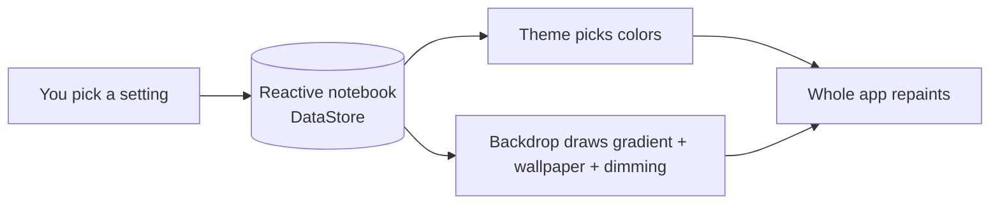

# Appearance and Theming - Explained Simply

The plain-language version of [[Appearance and Theming]]. How the app changes its look the instant
you flip a setting, and why the wallpaper slider stays smooth.

(Teaching comments only; the real source has none.)

---

## The big idea in one sentence

The app keeps your look choices (theme, background, dimness) in a tiny reactive notebook; the whole
screen watches that notebook, so the moment you change a choice, everything repaints itself.

Analogy: a thermostat. You turn the dial (a setting), and every radiator in the house reacts on its
own - you do not walk room to room adjusting each one.

---

## The three choices

1. Theme mode - Light, Dark, or "follow the system". The app turns this into "is it dark right
   now?" and picks the matching colors.
2. Background - one of six built-in gradients (Neutral, Aurora, Plum, Teal, Midnight, Mono), or a
   photo you import yourself.
3. Intensity - how much the background is dimmed so text stays easy to read on top of it.

---

## Picture: how a change reaches the screen

---

## Why the slider feels smooth

If every tiny drag of the intensity slider saved to disk, it would stutter. So the app splits it in
two: while you drag, it only updates a live value the background watches (instant, nothing saved);
when you let go, it writes the final value to the notebook. Smooth to drag, saved once.

---

## A worked example

- You open Appearance and switch to Dark. The app reads "dark = true", swaps to the dark color set,
  and every screen - chat, list, settings - repaints dark at once. No restart.
- You pick the Aurora background. The backdrop swaps to Aurora's dark gradient (because you are in
  dark mode).
- You import a holiday photo. The app copies it into its own folder, throws away the old wallpaper,
  and shows your photo behind the app.
- The photo is busy, so you drag Intensity down. The dimming grows under your finger in real time;
  when you release, that dimness is saved and is still there next launch.

---

## Why, in one line each

- Why a reactive notebook (DataStore)? So a setting change repaints the app by itself, with no
  manual "refresh the theme" call.
- Why keep only one imported wallpaper? To avoid piling up big image files - each import replaces
  the last.
- Why split the slider into preview vs save? So dragging is smooth (no disk write per frame) but the
  released value is remembered.
- Why read the wallpaper store through an "entry point"? Because the backdrop is a drawing, not a
  screen with its own ViewModel, so it borrows the store directly - see
  [[Dependency Injection (Hilt)]].

---

## Related

[[Appearance and Theming]] - [[Appearance and Theming - Code]] -
[[Appearance and Theming - Basic Example]] - [[Settings - Explained Simply]] -
[[Reading the Code - Simple Patterns]] - [[Home]]
