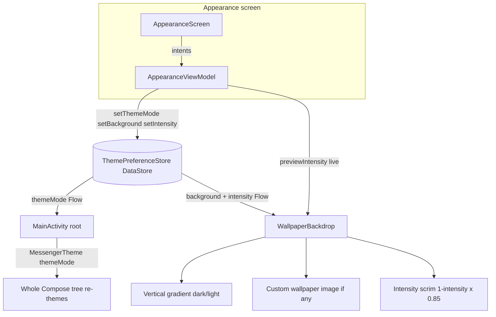
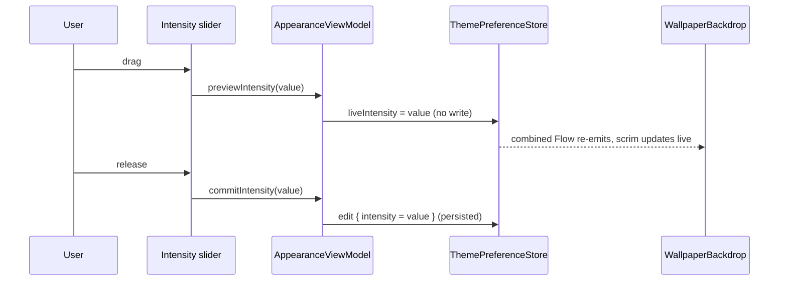

# Appearance and Theming

The look of the app: light/dark/system theme mode, a choice of gradient backgrounds (plus a
user-imported wallpaper), a background intensity slider, the Material 3 design-token layer, and the
reusable motion modifiers. All of it is persisted with DataStore and applied at the top of the
Compose tree, so a change re-themes the whole app live. This is the design work merged to master on
2026-07-19; the theme-preference basics also appear under [[Settings]].

## Pieces

- `AppearanceViewModel` (`presentation/viewmodel/AppearanceViewModel.kt:21`) - `@HiltViewModel`,
  exposes `themeMode` / `background` / `intensity` as `StateFlow`s and the write actions
  (`setDarkTheme`, `setBackground`, `previewIntensity`, `commitIntensity`, `importWallpaper`).
- `ThemePreferenceStore` (`data/local/prefs/ThemePreferenceStore.kt:17`) - `@Singleton` over
  `preferencesDataStore("theme_prefs")`, three keys: `theme_mode`, `app_background`,
  `theme_intensity`.
- `MessengerTheme` (`presentation/screens/ui/theme/Theme.kt:41`) - maps `ThemeMode` to a
  light/dark `ColorScheme` and token set and provides `LocalMessengerTokens`.
- `AppBackgrounds` (`presentation/screens/ui/theme/AppBackgrounds.kt:14`) - the six gradient
  presets, `appBackgroundFor`, `CUSTOM_BACKGROUND_PREFIX`, and `customWallpaperFile`.
- `WallpaperBackdrop` / `WallpaperBackground`
  (`presentation/components/common/WallpaperBackground.kt:35`, `:89`) - draw the gradient, optional
  imported image, and intensity scrim behind content.
- `MotionModifiers` (`presentation/components/common/MotionModifiers.kt:16`) - `MotionSprings`,
  `Modifier.pressScale`, `Modifier.springEnter`.
- UI: `AppearanceScreen` (`presentation/screens/settings/AppearanceScreen.kt`). Manual DI seam:
  `UiEntryPoints` (`di/UiEntryPoints.kt:11`).

## Theme mode (system / light / dark)

`MessengerTheme` (`Theme.kt:41`) resolves the mode to a boolean and picks the scheme and tokens:

```kotlin
val darkTheme = when (themeMode) {
    ThemeMode.SYSTEM -> isSystemInDarkTheme()
    ThemeMode.LIGHT  -> false
    ThemeMode.DARK   -> true
}
```

The composition root collects the persisted mode and passes it in, so writing the preference
re-themes the entire tree with no manual invalidation
(`MainActivity.kt:65` reads `themePreferenceStore.themeMode`, `:67` calls
`MessengerTheme(themeMode = themeMode)`). The `AppearanceViewModel` writes it via `setDarkTheme`
(`AppearanceViewModel.kt:35`). The stateIn/DataStore mechanics are the same as [[Settings]] and are
distilled in [[Appearance and Theming - Basic Example]].

## Backgrounds and imported wallpaper

`AppBackgrounds` (`AppBackgrounds.kt:14`) is six presets (`neutral`, `aurora`, `plum`, `teal`,
`midnight`, `mono`), each with a dark and a light color list. `WallpaperBackdrop`
(`WallpaperBackground.kt:35`) paints `Brush.verticalGradient(colors)` choosing the dark or light
list from `tokens.isDark`, then overlays a Coil `AsyncImage` when a custom wallpaper file exists.

A user can import their own image: `importWallpaper` (`AppearanceViewModel.kt:57`) copies the picked
`Uri` into `filesDir/wallpapers/wallpaper_<timestamp>.jpg` on `Dispatchers.IO`, deletes any previous
wallpaper file, and sets the background key to `"custom:<timestamp>"`. `customWallpaperFile`
(`AppBackgrounds.kt:58`) resolves that key back to the file; a non-`custom:` key returns null and
the preset gradient shows instead.

## Background intensity

Intensity dims the background so foreground content stays legible over a busy wallpaper.
`WallpaperBackdrop` computes a scrim (`WallpaperBackground.kt:76`):

```kotlin
val scrimAlpha = ((1f - intensity) * 0.85f).coerceIn(0f, 1f)   // 1.0 = no scrim, 0.0 = 85% dim
```

The scrim is black in dark mode and white in light mode. The slider uses a two-stage write so
dragging is smooth but only the released value is persisted: `previewIntensity`
(`AppearanceViewModel.kt:47`) sets a `liveIntensity` `MutableStateFlow` that is `combine`d over the
stored value (`ThemePreferenceStore.kt:39`), and `commitIntensity` (`:51`) writes it to DataStore.

## Design tokens and motion

`MessengerTheme` provides `LocalMessengerTokens` (read anywhere as `messengerTokens`) so components
read app colors (`trackFill`, `pillFill`, `accent`, `isDark`, ...) alongside the Material scheme.
`MotionModifiers.kt` supplies the reusable per-widget motion the redesign uses everywhere:
`MotionSprings` (`:16`) are the shared spring specs; `Modifier.pressScale` (`:22`) shrinks a widget
while pressed and springs back; `Modifier.springEnter` (`:38`) fades and scales a widget in on first
composition. Both are `Modifier.composed { }` so each call site gets its own animation state.

## Why this design

- DataStore gives each setting as a cold `Flow`, so theme/background/intensity changes propagate
  through Compose with no manual invalidation - the same reactive-preference reason as [[Settings]].
- Reading the wallpaper store from a composable through a Hilt `@EntryPoint` (`UiEntryPoints`) keeps
  `WallpaperBackdrop` usable outside any ViewModel while still going through the DI graph - see
  [[Dependency Injection (Hilt)]].
- The live-preview overlay on intensity separates "what I am dragging" from "what is saved", so the
  slider is smooth without a DataStore write per frame.
- Centralising motion in `MotionModifiers` keeps every pressable surface consistent and cheap to
  apply (`Modifier.pressScale(interaction)`), instead of re-deriving animations per component.

## Visualization





## Related

[[Settings]] - [[Appearance and Theming - Code]] - [[Appearance and Theming - Explained Simply]] -
[[Appearance and Theming - Basic Example]] - [[Dependency Injection (Hilt)]] -
[[Async and Reactivity]] - [[Presentation Layer (MVI)]]
