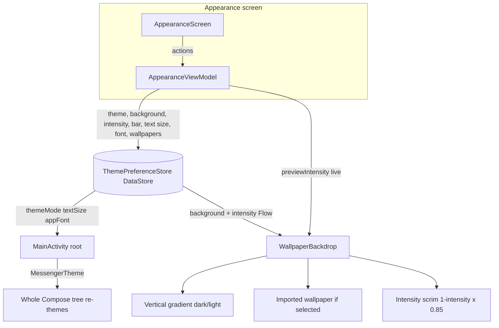

# Appearance and Theming

The look of the app: light/dark/system theme mode, gradient backgrounds plus a library of
user-imported wallpapers, a background intensity slider, tab-bar position, text size and font,
the Material 3 design-token layer, the reusable motion modifiers, and the WCAG contrast suite that
guards readability. All settings are persisted with DataStore and applied at the top of the
Compose tree, so a change re-themes the whole app live. The theme-preference basics also appear
under [[Settings]].

## Pieces

- `AppearanceViewModel` (`presentation/viewmodel/AppearanceViewModel.kt:25`) - `@HiltViewModel`,
  exposes `themeMode`, `background`, `intensity`, `barPosition`, `textSize`, `appFont` and
  `wallpapers` as `StateFlow`s and the write actions (`setDarkTheme`, `setBackground`,
  `previewIntensity`, `commitIntensity`, `setBarPosition`, `setTextSize`, `setAppFont`,
  `importWallpaper`, `renameWallpaper`, `deleteWallpaper`).
- `ThemePreferenceStore` (`data/local/prefs/ThemePreferenceStore.kt:27`) - `@Singleton` over
  `preferencesDataStore("theme_prefs")`, keys `theme_mode`, `app_background`, `theme_intensity`,
  `bar_position`, `text_size`, `app_font`, and `wallpapers_json` (the saved-wallpaper list).
- `MessengerTheme` (`presentation/screens/ui/theme/Theme.kt:45`) - maps `ThemeMode` to a
  light/dark `ColorScheme` and token set, scales typography by text size and font, and provides
  `LocalMessengerTokens` and `LocalContentColor`.
- `AppBackgrounds` (`presentation/screens/ui/theme/AppBackgrounds.kt:8`) - the six gradient
  presets, `appBackgroundFor`, `CUSTOM_BACKGROUND_PREFIX`, `backgroundKeyFor`, `wallpaperIdOf`,
  `wallpaperFileById` and `customWallpaperFile`.
- `WallpaperBackdrop` / `WallpaperBackground`
  (`presentation/components/common/WallpaperBackground.kt:35`, `:89`) - draw the gradient,
  optional imported image, and intensity scrim behind content.
- `MotionModifiers` (`presentation/components/common/MotionModifiers.kt`) - `Modifier.pressScale`,
  `Modifier.springEnter`; the springs live in `MotionSprings`
  (`presentation/components/common/model/MotionSprings.kt:6`).
- UI: `presentation/screens/settings/appearance/` (`AppearanceScreen`, `WallpaperGrid`,
  `BackgroundTile`, `SavedWallpaperTile`, `RenameWallpaperDialog`, `IntensityCard`,
  `LabeledSegmented`). Manual DI seam: `UiEntryPoints` (`di/UiEntryPoints.kt:12`).

## Theme mode (system / light / dark)

`MessengerTheme` (`Theme.kt:45`) resolves the mode to a boolean and picks the scheme and tokens:

```kotlin
val darkTheme = when (themeMode) {
    ThemeMode.SYSTEM -> isSystemInDarkTheme()
    ThemeMode.LIGHT -> false
    ThemeMode.DARK -> true
}
```

The composition root collects the persisted settings and passes them in, so writing a preference
re-themes the entire tree with no manual invalidation (`MainActivity.kt:83` reads
`themePreferenceStore.themeMode`, `:91` calls
`MessengerTheme(themeMode = themeMode, textSize = textSize, appFont = appFont)`). The
`AppearanceViewModel` writes it via `setDarkTheme` (`AppearanceViewModel.kt:51`). The
stateIn/DataStore mechanics are the same as [[Settings]] and are distilled in
[[Appearance and Theming - Basic Example]].

## Backgrounds and imported wallpapers

`AppBackgrounds` (`AppBackgrounds.kt:8`) is six presets (`neutral`, `aurora`, `plum`, `teal`,
`midnight`, `mono`), each with a dark and a light color list. `WallpaperBackdrop`
(`WallpaperBackground.kt:35`) paints `Brush.verticalGradient(colors)` choosing the dark or light
list from `tokens.isDark`, then overlays a Coil `AsyncImage` when the background key points at an
imported wallpaper.

Imported wallpapers form a library. `importWallpaper` (`AppearanceViewModel.kt:81`) copies the
picked `Uri` into `filesDir/wallpapers/wallpaper_<id>.jpg` on `Dispatchers.IO` (the id is the
current time), adds `SavedWallpaper(id, "Wallpaper N")` to the stored list and selects it with the
key `"custom:<id>"`. `renameWallpaper` and `deleteWallpaper` edit the list; deleting the selected
one falls back to `neutral`. `customWallpaperFile` (`AppBackgrounds.kt:64`) resolves a `custom:`
key back to its file; any other key returns null and the preset gradient shows instead.

## Background intensity

Intensity dims the background so foreground content stays legible over a busy wallpaper.
`WallpaperBackdrop` computes a scrim (`WallpaperBackground.kt:76`):

```kotlin
val scrimAlpha = ((1f - intensity) * 0.85f).coerceIn(0f, 1f)
```

1.0 means no scrim, 0.0 an 85% dim; the scrim is black in dark mode and white in light mode. The
slider uses a two-stage write so dragging is smooth but only the released value is persisted:
`previewIntensity` (`AppearanceViewModel.kt:61`) sets a `liveIntensity` `MutableStateFlow` that is
`combine`d over the stored value (`ThemePreferenceStore.kt:74`), and `commitIntensity` (`:65`)
writes it to DataStore.

## Layout, text size and font

`barPosition` (top or bottom) moves the floating tab bar; screens read it through
`LocalTabBarPosition` and pad their content accordingly (for example the chat list's bottom
padding). `textSize` scales the whole typography and `appFont` swaps the font family, both
through `messengerTypography(scale, family)` in `MessengerTheme`.

## Design tokens and motion

`MessengerTheme` provides `LocalMessengerTokens` (read anywhere as `messengerTokens`) so components
read app colors (`trackFill`, `pillFill`, `accent`, `textPrimary`, `textMuted`, `isDark`, ...)
alongside the Material scheme. `MotionModifiers.kt` supplies the reusable per-widget motion:
`Modifier.pressScale` shrinks a widget while pressed and springs back (`MotionSprings.press`);
`Modifier.springEnter` fades and scales a widget in on first composition
(`MotionSprings.settle`). Both are `Modifier.composed { }` so each call site gets its own
animation state.

## Readability: the WCAG contrast suite

0.1.13.1 added an instrumented harness in `app/src/androidTest/.../presentation/contrast/`
(`ContrastHarness`, `BitmapTextProbe`, `ContrastMath`, `ContrastFixtures`) and contrast tests for
list, common, chat (including the voice bubble, recording bar, draft bar and mini player), auth
and call components. Each test renders a component in both themes over its real backdrop,
captures the bitmap, and checks every text node's contrast ratio against what is actually
behind it: the background is the most common color in the node's region, the foreground the
color whose luminance is furthest from it while covering at least 0.5% of the region, which
ignores antialiasing.

Bugs it found and that were fixed:

- `MessengerTheme` never provided `LocalContentColor`, and no screen wraps content in a
  `Surface`, so every `Text` without an explicit color was black - 1.15:1 on the dark background.
  It now provides `tokens.textPrimary`.
- `PillButton` forced its translucent container opaque, turning it solid white under a white
  label (1.00:1).
- `AccountRow` used the field-ink color on the dark background (1.00:1).
- `AuthModeToggle` hardcoded white labels on a white-tinted track (1.39:1 in light theme).
- `CallControlButton` used the theme text color on the always-black call surface (1.11:1 in
  light theme).
- `ContactRow`, `SearchUserItem`, `ForwardConversationRow` and `EditChatRow` drew their own grey
  avatar and hardcoded black/grey text; they now use `MessengerAvatar` and tokens.
- Grey placeholders on white fills (3.54:1) now use `OnSurfaceMuted` (4.83:1), and
  `TextLightMuted` went from alpha `0x99` to `0xA6` to clear 4.5:1 on the light background.

Remaining failures are avatar-palette, accent-token and sent-bubble colors, which are design
decisions left for a follow-up; the voice bubbles fail on the same shared tokens as the text
bubble. The suite runs with `adb shell am instrument`, never `connectedDebugAndroidTest` on a
personal device (that uninstalls the app and wipes its data and keys).

## Why this design

- DataStore gives each setting as a cold `Flow`, so appearance changes propagate through Compose
  with no manual invalidation - the same reactive-preference reason as [[Settings]].
- Reading the wallpaper store from a composable through a Hilt `@EntryPoint` (`UiEntryPoints`)
  keeps `WallpaperBackdrop` usable outside any ViewModel while still going through the DI graph -
  see [[Dependency Injection (Hilt)]].
- The live-preview overlay on intensity separates "what I am dragging" from "what is saved", so
  the slider is smooth without a DataStore write per frame.
- Centralising motion in `MotionModifiers` keeps every pressable surface consistent and cheap to
  apply, instead of re-deriving animations per component.
- Measuring contrast from rendered pixels over the real backdrop catches what token review
  misses (inherited black text, opaque-by-accident fills) without an exemption list.

## Visualization



## Related

[[Settings]] - [[Appearance and Theming - Code]] - [[Appearance and Theming - Explained Simply]] -
[[Appearance and Theming - Basic Example]] - [[Dependency Injection (Hilt)]] -
[[Async and Reactivity]] - [[Presentation Layer (MVI)]] - [[Voice Messages]]
