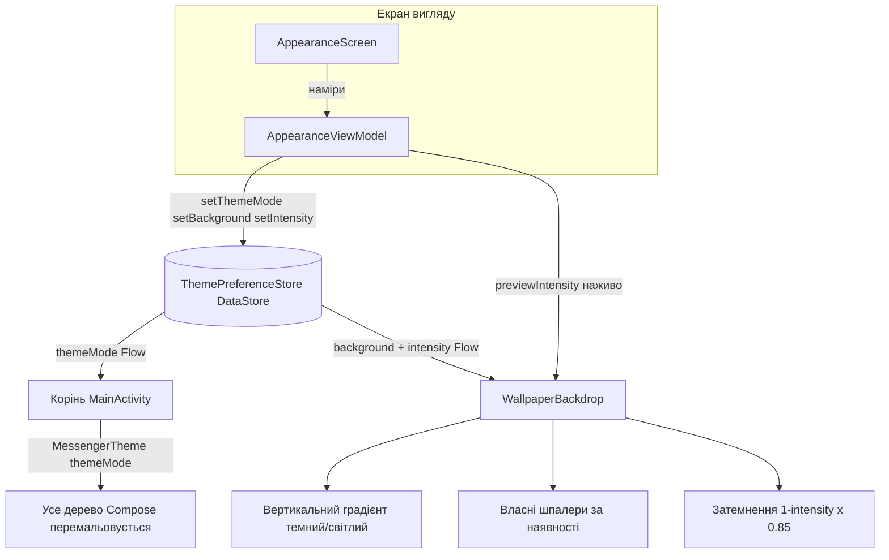

# Вигляд і теми

Зовнішній вигляд застосунку: режим теми (світла/темна/системна), вибір градієнтних фонів (плюс
власні шпалери користувача), повзунок інтенсивності фону, шар токенів дизайну Material 3 та
багаторазові модифікатори анімації. Усе це зберігається через DataStore і застосовується на вершині
дерева Compose, тож зміна перемальовує тему всього застосунку наживо. Це дизайнерська робота, злита
в master 2026-07-19; основи налаштування теми також описані в [[Settings]].

## Складові

- `AppearanceViewModel` (`presentation/viewmodel/AppearanceViewModel.kt:21`) - `@HiltViewModel`,
  віддає `themeMode` / `background` / `intensity` як `StateFlow` та дії запису (`setDarkTheme`,
  `setBackground`, `previewIntensity`, `commitIntensity`, `importWallpaper`).
- `ThemePreferenceStore` (`data/local/prefs/ThemePreferenceStore.kt:17`) - `@Singleton` над
  `preferencesDataStore("theme_prefs")`, три ключі: `theme_mode`, `app_background`,
  `theme_intensity`.
- `MessengerTheme` (`presentation/screens/ui/theme/Theme.kt:41`) - зіставляє `ThemeMode` зі
  світлою/темною `ColorScheme` та набором токенів і надає `LocalMessengerTokens`.
- `AppBackgrounds` (`presentation/screens/ui/theme/AppBackgrounds.kt:14`) - шість градієнтних
  пресетів, `appBackgroundFor`, `CUSTOM_BACKGROUND_PREFIX` і `customWallpaperFile`.
- `WallpaperBackdrop` / `WallpaperBackground`
  (`presentation/components/common/WallpaperBackground.kt:35`, `:89`) - малюють градієнт,
  необовʼязкове імпортоване зображення та затемнення інтенсивності під контентом.
- `MotionModifiers` (`presentation/components/common/MotionModifiers.kt:16`) - `MotionSprings`,
  `Modifier.pressScale`, `Modifier.springEnter`.
- Інтерфейс: `AppearanceScreen` (`presentation/screens/settings/AppearanceScreen.kt`). Ручний шов
  DI: `UiEntryPoints` (`di/UiEntryPoints.kt:11`).

## Режим теми (системна / світла / темна)

`MessengerTheme` (`Theme.kt:41`) зводить режим до булевого значення й обирає схему та токени:

```kotlin
val darkTheme = when (themeMode) {
    ThemeMode.SYSTEM -> isSystemInDarkTheme()
    ThemeMode.LIGHT  -> false
    ThemeMode.DARK   -> true
}
```

Корінь композиції збирає збережений режим і передає його всередину, тож запис налаштування
перемальовує тему всього дерева без ручної інвалідизації (`MainActivity.kt:65` читає
`themePreferenceStore.themeMode`, `:67` викликає `MessengerTheme(themeMode = themeMode)`).
`AppearanceViewModel` записує його через `setDarkTheme` (`AppearanceViewModel.kt:35`). Механіку
stateIn/DataStore викладено в [[Appearance and Theming - Basic Example]].

## Фони та імпортовані шпалери

`AppBackgrounds` (`AppBackgrounds.kt:14`) - це шість пресетів (`neutral`, `aurora`, `plum`, `teal`,
`midnight`, `mono`), у кожного свій список кольорів для темної та світлої теми. `WallpaperBackdrop`
(`WallpaperBackground.kt:35`) малює `Brush.verticalGradient(colors)`, обираючи темний чи світлий
список за `tokens.isDark`, а потім накладає Coil `AsyncImage`, коли існує файл власних шпалер.

Користувач може імпортувати власне зображення: `importWallpaper` (`AppearanceViewModel.kt:57`)
копіює обраний `Uri` у `filesDir/wallpapers/wallpaper_<timestamp>.jpg` на `Dispatchers.IO`, видаляє
попередній файл шпалер і встановлює ключ фону `"custom:<timestamp>"`. `customWallpaperFile`
(`AppBackgrounds.kt:58`) розвʼязує цей ключ назад у файл; ключ без префікса `custom:` повертає null,
і показується градієнт пресету.

## Інтенсивність фону

Інтенсивність затемнює фон, щоб контент на передньому плані лишався читабельним поверх насиченого
зображення. `WallpaperBackdrop` обчислює затемнення (`WallpaperBackground.kt:76`):

```kotlin
val scrimAlpha = ((1f - intensity) * 0.85f).coerceIn(0f, 1f)   // 1.0 = без затемнення, 0.0 = 85%
```

Затемнення чорне в темній темі та біле у світлій. Повзунок використовує дворівневий запис, тож
перетягування плавне, але зберігається лише відпущене значення: `previewIntensity`
(`AppearanceViewModel.kt:47`) задає `MutableStateFlow` `liveIntensity`, який `combine` над збереженим
значенням (`ThemePreferenceStore.kt:39`), а `commitIntensity` (`:51`) записує його в DataStore.

## Токени дизайну та анімація

`MessengerTheme` надає `LocalMessengerTokens` (читається будь-де як `messengerTokens`), тож
компоненти беруть кольори застосунку (`trackFill`, `pillFill`, `accent`, `isDark`, ...) поряд зі
схемою Material. `MotionModifiers.kt` дає багаторазову анімацію окремих віджетів, яку скрізь
використовує новий дизайн: `MotionSprings` (`:16`) - спільні пружинні специфікації;
`Modifier.pressScale` (`:22`) стискає віджет під час натискання й повертає пружиною;
`Modifier.springEnter` (`:38`) проявляє й масштабує віджет під час першої композиції. Обидва - це
`Modifier.composed { }`, тож кожен виклик має власний стан анімації.

## Чому такий дизайн

- DataStore віддає кожне налаштування як холодний `Flow`, тож зміни теми/фону/інтенсивності
  поширюються крізь Compose без ручної інвалідизації - та сама причина реактивних налаштувань, що й
  у [[Settings]].
- Читання сховища шпалер із композабла через Hilt `@EntryPoint` (`UiEntryPoints`) дає змогу
  використовувати `WallpaperBackdrop` поза будь-якою ViewModel, лишаючись у графі DI - див.
  [[Dependency Injection (Hilt)]].
- Шар живого попереднього перегляду інтенсивності відокремлює "що я тягну" від "що збережено", тож
  повзунок плавний без запису в DataStore на кожен кадр.
- Централізація анімації в `MotionModifiers` тримає кожну натискну поверхню однаковою й дешевою у
  застосуванні (`Modifier.pressScale(interaction)`), замість повторного виведення анімацій у
  кожному компоненті.

## Візуалізація



## Повʼязане

[[Settings]] - [[Appearance and Theming - Code]] - [[Appearance and Theming - Explained Simply]] -
[[Appearance and Theming - Basic Example]] - [[Dependency Injection (Hilt)]] -
[[Async and Reactivity]] - [[Presentation Layer (MVI)]]
