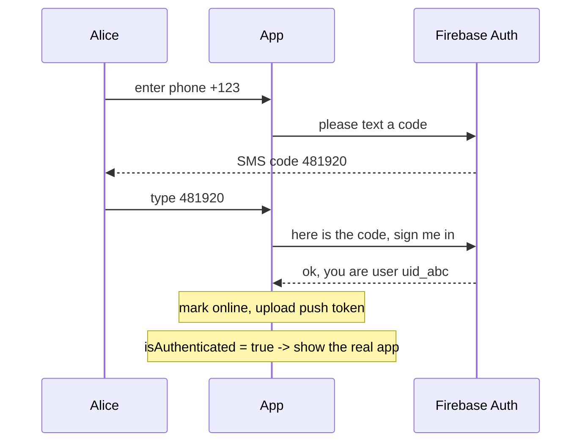

# Authentication - Explained Simply

The plain-language version of [[Authentication]]. How logging in actually works, step by step.

(The comments in the code are teaching comments for this doc only. The real source has none.)

---

## The big idea in one sentence

You prove you own a phone number by typing a code that gets texted to you; once proven, the whole
app switches from the login screen to the real app - automatically.

Analogy: it is like getting into a building with a one-time code. The front desk texts you a
number, you type it in, the door unlocks. You never picked a password.

---

## Step by step: what happens to the data

Alice opens the app and wants to register with phone `+123` and username `alice`.

1. Alice types her number and taps send. The screen fires an "intent" (a described action):
   `AuthIntent.SendVerificationCode(...)`. The ViewModel receives it in `handleIntent`
   (`presentation/viewmodel/AuthViewModel.kt:52`).

2. The app asks Firebase to text a code: `firebaseAuthService.sendVerificationCode(...)`
   (`data/remote/auth/FirebaseAuthService.kt:41`). The screen shows a spinner
   (`isLoading = true`) and then an OTP box (`codeSent = true`).

3. Alice gets the SMS and types the 6-digit code. The screen fires
   `AuthIntent.VerifyOtpAndLogin(code)`.

4. The app turns the code into proof (`verifyCode` -> a `PhoneAuthCredential`) and signs in:
   `signInWithPhone` (`AuthViewModel.kt:166`) calls `loginWithPhoneNumberUseCase`.

5. The rules run (`AuthRepositoryImpl.loginWithPhone`,
   `data/repository/AuthRepositoryImpl.kt:23`): if this is a brand-new number and Alice chose
   register, it creates her profile in Firebase. (If the number already existed, or she picked
   login for an unknown number, it politely refuses.)

6. On success the app "wakes up" the session: marks her online, uploads her push token, and fires
   a one-time event `AuthEffect.AuthSucceeded`.

7. The whole app flips. Navigation watches one boolean, `isAuthenticated`; the moment it becomes
   true, the login screen is replaced by the main app - no manual "go to home screen" call.

---

## Picture: the login handshake



---

## The code, with plain-English comments

The app-wide on/off switch (`AuthViewModel.kt:66`):

```kotlin
private fun observeAuthStatus() {
    viewModelScope.launch {
        // Listen to "is someone signed in?" forever.
        observeAuthStateUseCase().collectLatest { user ->
            // Just flip one boolean. Navigation reacts to it and swaps the whole screen tree.
            setState { copy(isAuthenticated = user != null) }
        }
    }
}
```

Turning Firebase's old-style callbacks into a clean `suspend` call
(`data/remote/auth/FirebaseAuthService.kt:41`):

```kotlin
suspend fun sendVerificationCode(phoneNumber, activity) = suspendCancellableCoroutine { cont ->
    // Firebase reports the outcome through THREE possible callbacks.
    // suspendCancellableCoroutine lets us "wait here" and resume once, with whichever fires.
    val callbacks = object : OnVerificationStateChangedCallbacks() {
        override fun onCodeSent(id, token) { cont.resume(CodeSent(id)) }        // normal: code texted
        override fun onVerificationCompleted(cred) { cont.resume(AutoVerified(cred)) } // phone auto-read the SMS
        override fun onVerificationFailed(e) { cont.resume(failure(e)) }        // something went wrong
    }
    PhoneAuthProvider.verifyPhoneNumber(options.setCallbacks(callbacks))
}
```

---

## A worked example

- Alice, new user, phone `+123`, username `alice`, picks Register.
- Firebase texts `481920`. Alice types it.
- `loginWithPhone` sees no existing profile + register -> creates `users/uid_abc` with
  `username = alice`. Success.
- App marks her online, uploads her push token, shows the chat list.
- Bob later logs in with an existing number, picks Login -> profile exists -> straight in.
- If Bob had typed a number with no account and picked Login, the app refuses ("register first")
  and deletes the just-created empty auth record so nothing dangles.

---

## Why, in one line each

- Why a texted code instead of a password? Firebase handles it; the app stores no passwords.
- Why flip `isAuthenticated` instead of navigating? One source of truth - login and logout both
  just change the boolean, and the UI follows.
- Why mark online + upload push token right after login? So the session is fully ready
  (visible to others, reachable by notifications) the instant you are in.

---

## Related

[[Authentication]] - [[Authentication - Code]] - [[Reading the Code - Simple Patterns]] -
[[Presence and Typing - Explained Simply]] - [[Notifications - Explained Simply]] - [[Home]]
