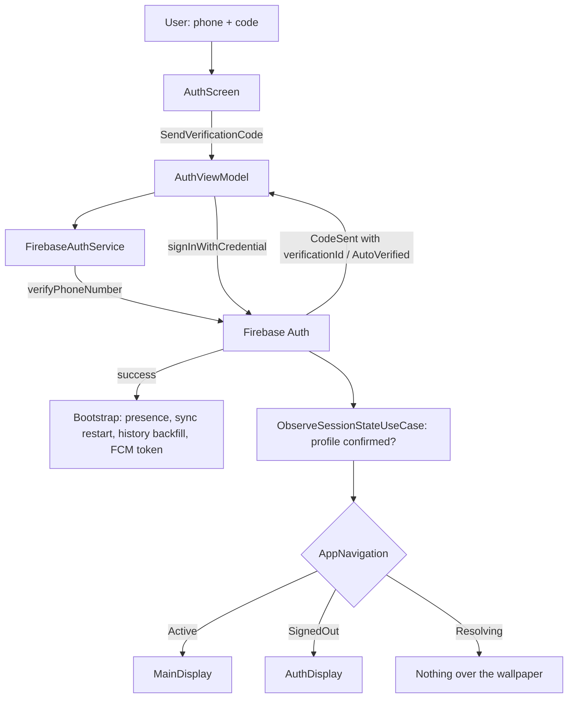

# Authentication

Phone-number sign-in with SMS one-time code, backed by Firebase Auth. Also supports linking a
phone number to an existing account. Whether the main UI is shown is decided by a resolved
session (Firebase identity plus a confirmed Firestore profile), not by the Firebase flag alone.

## Pieces

- `AuthViewModel` (`presentation/viewmodel/AuthViewModel.kt:34`) - MVI ViewModel
  (`MviViewModel<AuthUiState, AuthIntent, AuthEffect>`).
- `FirebaseAuthService` (`data/remote/auth/FirebaseAuthService.kt`) - wraps
  `FirebaseAuth` phone verification.
- Use cases (`domain/usecase/auth/`): `LoginWithPhoneNumberUseCase`, `LinkPhoneUseCase`,
  `LogoutUseCase`, `ObserveAuthStateUseCase`, `ObserveSessionStateUseCase`,
  `GetCurrentUserUseCase`; plus `BackfillRecentHistoryUseCase` in `domain/usecase/sync/`.
- `AuthRepositoryImpl` (`IAuthRepository`) - repository seam over the auth service.
- `IAuthFlowGate` / `InMemoryAuthFlowGate` (`data/service/InMemoryAuthFlowGate.kt`) - marks a
  register or login as in flight so the session gate waits.
- `PhoneAuthErrors.kt` (`presentation/base/PhoneAuthErrors.kt:8`) - maps Firebase phone-auth
  error codes to user-facing strings.
- UI: `presentation/screens/auth/` (`AuthScreen`, `AuthScreenContent`, `AuthScreenPreviews`) with
  components in `presentation/components/auth/` (`AuthComponents`, `AuthModeToggle`,
  `CountryCodePicker`, `Countries`).

## Sign-in flow

1. The user enters phone number and (on register) username. `AuthScreen` resolves the host
   Activity with `LocalActivity.current` (`presentation/screens/auth/AuthScreen.kt:40`) and
   dispatches `AuthIntent.SendVerificationCode(activity, phoneNumber, username, isRegister)`.
   `handleIntent` (`AuthViewModel.kt:64`) routes it to `sendVerificationCode`. (It used to cast
   `LocalContext.current as? Activity`, which is null behind any `ContextWrapper`, so the button
   silently did nothing.)
2. `sendVerificationCode` (`AuthViewModel.kt:112`) stashes `pendingUsername`/`pendingIsRegister`,
   sets `isLoading`, and calls `firebaseAuthService.sendVerificationCode(phoneNumber, activity)`.
   The result is a `VerificationResult`:
   - `CodeSent(verificationId)` -> set `codeSent = true` and store `verificationId` in
     `AuthUiState` (`presentation/state/AuthUiState.kt:14`); the UI shows the OTP field.
   - `AutoVerified(credential)` -> Android auto-retrieved the SMS; go straight to
     `signInWithPhone` (`AuthViewModel.kt:212`).
3. The user types the code; the UI dispatches `AuthIntent.VerifyOtpAndLogin(otp)`.
   `verifyOtpAndLogin` (`AuthViewModel.kt:187`) calls
   `firebaseAuthService.verifyCode(otp, currentState.verificationId)` to build a
   `PhoneAuthCredential`, then `signInWithPhone`.
4. `signInWithPhone` (`AuthViewModel.kt:212`) calls
   `loginWithPhoneNumberUseCase(credential, pendingUsername, pendingIsRegister)`, which signs in
   and, on first registration, creates the Firestore user profile. On `Resource.Success` it:
   - brings presence online: `presenceManager.goOnline(viewModelScope)` (see
     [[Presence and Typing]]),
   - restarts the one-shot sync (`syncCoordinator.restart()`) and restores recent history
     (`restoreRecentHistory`, below),
   - syncs the FCM token: `syncFcmTokenForCurrentUser` (`AuthViewModel.kt:259`) fetches the
     token via `FirebaseMessagingManager` and writes it to Firestore (see [[Notifications]]),
   - updates state with `currentUser`,
   - emits `AuthEffect.AuthSucceeded`.

`resendCode` (`AuthViewModel.kt:153`) mirrors step 2 for the resend button and passes the stored
`verificationId`, so the matching resend token is used.

## One verification id per flow

`verificationId` and the resend token used to be mutable fields on the singleton
`FirebaseAuthService`, shared by `AuthViewModel` and `ChangePhoneViewModel`. Starting a
change-phone verification while a sign-in was in flight (or the reverse) overwrote the other
flow's id, so the surviving flow built its credential from the wrong session. Now each flow keeps
the id it was given in its own UiState (`AuthUiState.verificationId`,
`ChangePhoneUiState.verificationId`) and passes it to `verifyCode(code, verificationId)`
(`FirebaseAuthService.kt:89`). Resend tokens live in a map keyed by verification id
(`resendTokens`, `FirebaseAuthService.kt:32`), cleared on logout.

The received SMS code and the verification id are no longer written to logcat. Together they
are the phone-auth credential, and they were logged unconditionally, not only in debug builds.

## The session gate

`AuthViewModel.observeSession` (`AuthViewModel.kt:78`) collects `ObserveSessionStateUseCase` and
stores the result as `AuthUiState.session`. `AppNavigation` shows `MainDisplay` only for
`SessionState.Active`, `AuthDisplay` for `SignedOut`, and nothing while `Resolving`. `Active`
requires the Firestore profile to be confirmed; a register or login in flight keeps the state at
`Resolving` (`InMemoryAuthFlowGate`), so the OTP screen is never torn down mid-flow. A profile that
the server says is missing, or one marked deleted, yields `SignedOut` with a reason, and
`endInvalidSession` (`AuthViewModel.kt:87`) signs the device out and shows
`auth_error_account_not_found` or `auth_error_account_deleted`. A cache miss while offline keeps
the session on the Firebase identity, so an offline start never forces a logout. Full detail in
[[Navigation]].

## Restoring history on sign-in

Logout wipes ObjectBox, and `SyncCoordinator.start()` only ran from `Application.onCreate`, so a
logout followed by a login in the same process left a chat list of empty conversations. On
success `signInWithPhone` now calls `syncCoordinator.restart()` (`data/sync/SyncCoordinator.kt:31`)
and `restoreRecentHistory` (`AuthViewModel.kt:251`), which runs `BackfillRecentHistoryUseCase`
(`domain/usecase/sync/BackfillRecentHistoryUseCase.kt`): sync the conversation list, then pull
the 50 most recent messages for each of the 30 most recent conversations through
`backfillRecentMessages`, which respects the per-user `clearedAt` cutoff and local read state. A
failed conversation counts as zero instead of aborting the run.

## Linking a phone to an existing account

`AuthIntent.VerifyOtpAndLink` -> `verifyOtpAndLink` (`AuthViewModel.kt:201`) -> `linkPhone`
(`AuthViewModel.kt:277`) collects `LinkPhoneUseCase(credential)` and emits
`AuthEffect.PhoneLinked` on success. Used by the change-phone flow (`ChangePhoneScreen`,
`ChangePhoneViewModel`), which keeps its own verification id.

## Logout

`logout` (`AuthViewModel.kt:103`) stops the sync coordinator, disconnects presence
(`presenceManager.disconnect(viewModelScope)`, which now also cancels the collector it used to
leak), runs `LogoutUseCase()` and resets state to a fresh `AuthUiState()`. `LogoutUseCase`
(`domain/usecase/auth/LogoutUseCase.kt`) marks the user offline, runs
`sessionCleaner.clearOnLogout(uid)`, signs out of Firebase and resets ObjectBox once (the
duplicate `resetDB()` inside `FirebaseAuthService.logout()` was removed).
`AndroidSessionCleaner.clearOnLogout` (`data/service/AndroidSessionCleaner.kt:31`):

- stops voice playback and cancels any recording on the main thread, then clears voice drafts,
- deletes the FCM token in Firestore and on the device, cancels all notifications,
- wipes the decrypted media cache, the voice-clip outbox and drafts, and Coil's disk cache
  (`:47`-`:50`).

Work that outlives the screen also stops: `ChatsViewModel` runs its conversation listener inside
`flatMapLatest` over auth state (`presentation/viewmodel/ChatsViewModel.kt:84`), so signing out
cancels it instead of letting it write the old account's conversations back after the reset, and
`SyncWorker` returns early when nobody is signed in (`data/sync/SyncWorker.kt:21`). Because the
session becomes `SignedOut`, the app returns to `AuthDisplay`.

The "Add account" row on the change-account screen was removed: it pushed `AuthRoute` onto
`MainDisplay`'s back stack, which has no entry for it, so it crashed on tap. Multi-account is a
stub and the ObjectBox store is single-tenant, so the row stays out until that is built.

## Error handling

Every failure becomes a `UiText` in state. Phone-verification failures go through
`Throwable.toPhoneAuthUiText()` (`presentation/base/PhoneAuthErrors.kt:8`), which maps
`FirebaseTooManyRequestsException` and `FirebaseAuthException` error codes (cancelled reCAPTCHA,
web context already presented, app not verified, quota exceeded, invalid number, invalid code,
...) to string resources; unmapped codes still show the exception message, and a null falls back
to `auth_error_verification_failed`. A bad OTP sets
`UiText.StringResource(R.string.auth_error_invalid_code)` (`AuthViewModel.kt:196`). The screen
resolves it at render time. See [[Presentation Layer (MVI)]] for `UiText`.

## Why this design

- Firebase phone auth handles SMS delivery, auto-retrieval, and credential management, so the
  app carries no OTP backend.
- Keeping presence, sync and FCM-token side effects inside the success branch of
  `signInWithPhone` means a session is fully bootstrapped (online, history restored, reachable by
  push) the moment login completes.
- Driving navigation from an observed, resolved session avoids imperative navigate-on-login and
  keeps a single source of truth, while never showing the main UI for an account without a
  profile.
- Per-flow verification ids remove shared mutable state from a singleton that two screens use.

Alternatives (email/password, Google sign-in) are not present in the code; phone-number is the
only implemented method.

## Visualization

## Related

[[Presentation Layer (MVI)]] - [[Presence and Typing]] - [[Notifications]] - [[Navigation]] -
[[Data Layer]] - [[Settings]] - [[Voice Messages]] - [[Authentication - Basic Example]]
