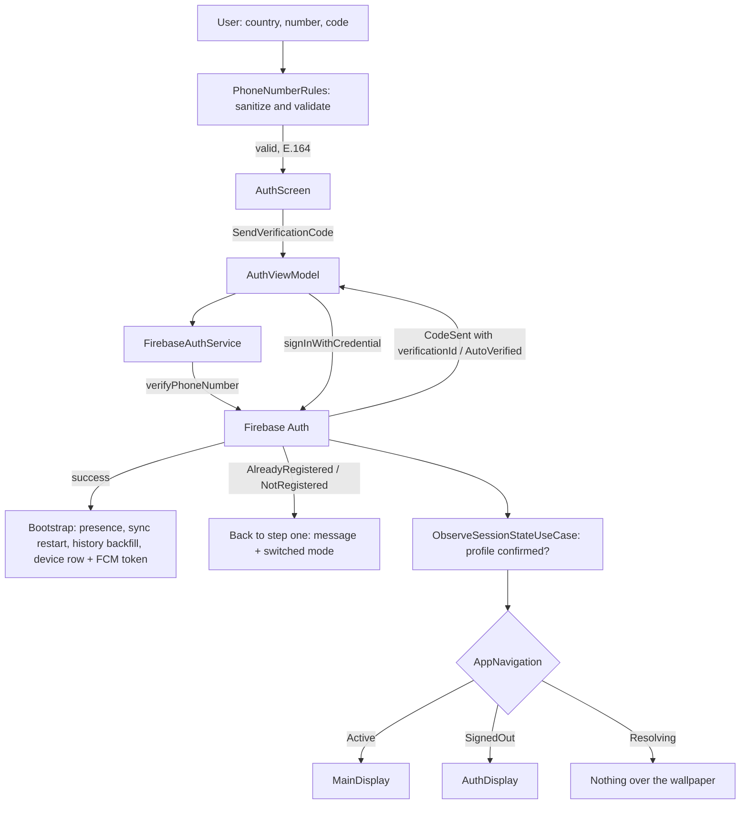

# Authentication

Phone-number sign-in with SMS one-time code, backed by Firebase Auth. Also supports linking a
phone number to an existing account. Whether the main UI is shown is decided by a resolved
session (Firebase identity plus a confirmed Firestore profile), not by the Firebase flag alone.

## Pieces

- `AuthViewModel` (`presentation/screens/auth/AuthViewModel.kt:37`) - MVI ViewModel
  (`MviViewModel<AuthUiState, AuthIntent, AuthEffect>`).
- `FirebaseAuthService` (`data/remote/auth/FirebaseAuthService.kt`) - wraps
  `FirebaseAuth` phone verification.
- Use cases (`domain/usecase/auth/`): `LoginWithPhoneNumberUseCase`, `LinkPhoneUseCase`,
  `LogoutUseCase`, `ObserveAuthStateUseCase`, `ObserveSessionStateUseCase`,
  `GetCurrentUserUseCase`; plus `BackfillRecentHistoryUseCase` in `domain/usecase/sync/`.
- `AuthRepositoryImpl` (`IAuthRepository`) - repository seam over the auth service.
- `IAuthFlowGate` / `InMemoryAuthFlowGate` (`data/service/InMemoryAuthFlowGate.kt`) - marks a
  register or login as in flight so the session gate waits.
- `PhoneNumberRules` (`presentation/components/auth/PhoneNumberRules.kt:11`) - per-country phone
  input rules (sanitising, length cap, validity, E.164), built on libphonenumber.
- `AuthAccountException` (`domain/model/AuthAccountException.kt:3`) - the typed failure for a
  register/login number mismatch (`AlreadyRegistered`, `NotRegistered`).
- `DeviceRegistry` (`data/device/DeviceRegistry.kt:14`) - records this device (and its FCM token)
  under the user after sign-in and marks it signed out on logout.
- `PhoneAuthErrors.kt` (`presentation/base/PhoneAuthErrors.kt:8`) - maps Firebase phone-auth
  error codes to user-facing strings.
- UI: `presentation/screens/auth/` (`AuthScreen`, `AuthScreenContent`) with
  components in `presentation/components/auth/` (`AuthComponents`, `AuthModeToggle`,
  `CountryCodePicker`, `Countries`).

## Sign-in flow

1. The user picks a country and types the national number and (on register) a username. The form
   lives in `AuthUiState` (`country`, `nationalNumber`, `phoneValid`, `username`, `otp`, `mode`),
   updated through `SelectMode`, `SelectCountry`, `ChangeNationalNumber`, `ChangeUsername`,
   `ChangeOtp` and `EditPhoneNumber` (see "Phone input" below). When the user taps send, `AuthScreen`
   converts the number to E.164 with `phoneRules.toE164` and does nothing if it is not valid
   (`presentation/screens/auth/AuthScreen.kt:74`-`:75`), resolves the host Activity with
   `LocalActivity.current` (`:32`) and dispatches
   `AuthIntent.SendVerificationCode(activity, phoneNumber, username, isRegister)`.
   `handleIntent` (`AuthViewModel.kt:73`) routes it to `sendVerificationCode`. (It used to cast
   `LocalContext.current as? Activity`, which is null behind any `ContextWrapper`, so the button
   silently did nothing.)
2. `sendVerificationCode` (`AuthViewModel.kt:154`) stashes `pendingUsername`/`pendingIsRegister`,
   sets `isLoading`, and calls `firebaseAuthService.sendVerificationCode(phoneNumber, activity)`.
   The result is a `VerificationResult`:
   - `CodeSent(verificationId)` -> set `codeSent = true` and store `verificationId` in
     `AuthUiState` (`presentation/screens/auth/AuthUiState.kt:11`); the UI shows the OTP field.
   - `AutoVerified(credential)` -> Android auto-retrieved the SMS; go straight to
     `signInWithPhone` (`AuthViewModel.kt:254`).
   While the code is pending `AuthScreen` runs a 120 s countdown ring (`AuthScreen.kt:34`-`:44`);
   when it runs out the screen offers resend.
3. The user types the code; the UI dispatches `AuthIntent.VerifyOtpAndLogin(otp)`.
   `verifyOtpAndLogin` (`AuthViewModel.kt:229`) calls
   `firebaseAuthService.verifyCode(otp, currentState.verificationId)` to build a
   `PhoneAuthCredential`, then `signInWithPhone`.
4. `signInWithPhone` (`AuthViewModel.kt:254`) calls
   `loginWithPhoneNumberUseCase(credential, pendingUsername, pendingIsRegister)`, which signs in
   and, on first registration, creates the Firestore user profile. On `Resource.Success` it:
   - brings presence online: `presenceManager.goOnline(viewModelScope)` (see
     [[Presence and Typing]]),
   - restarts the one-shot sync (`syncCoordinator.restart()`) and restores recent history
     (`restoreRecentHistory`, below),
   - syncs the FCM token: `syncFcmTokenForCurrentUser` (`AuthViewModel.kt:323`) fetches the
     token via `FirebaseMessagingManager` and hands it to `DeviceRegistry.register`, which writes
     this device's row under `users/{uid}/devices/{deviceId}` (name, platform, app version,
     `lastSeenAt`, `fcmToken`) and also keeps the legacy `fcmToken` field on the user document
     updated (`data/device/DeviceRegistry.kt:20`-`:24`, `:41`-`:55`, `:75`; see [[Notifications]]),
   - updates state with `currentUser`,
   - emits `AuthEffect.AuthSucceeded`.
   A `Resource.Failure` carrying an `AuthAccountException` is handled separately (next section).

`resendCode` (`AuthViewModel.kt:195`) mirrors step 2 for the resend button and passes the stored
`verificationId`, so the matching resend token is used.

## Phone input and validation

Since PR #39 (merged 2026-11-03) the phone field is validated per country instead of accepting any
digits. `AuthViewModel.updatePhone` (`AuthViewModel.kt:98`) runs every country or digit change
through `PhoneNumberRules`: `sanitize` strips non-digits and caps the length at the longest
possible number for the country's calling code, allowing for a leading trunk prefix
(`PhoneNumberRules.kt:15`-`:28`); `isValid` asks libphonenumber whether the parsed number is valid
for the region (`:30`, `:35`-`:36`), and the result becomes `AuthUiState.phoneValid`, which enables
the send button. `toE164` (`:32`) produces the `+...` string passed to Firebase. Once a code has
been sent the country picker and the number field are disabled (`enabled = !codeSent`,
`presentation/screens/auth/AuthScreenContent.kt:140`, `:148`) and a "Change number" link
dispatches `AuthIntent.EditPhoneNumber`, which clears `codeSent`, the error and the code
(`AuthViewModel.kt:94`) so the number can be edited again.

The form survives process death: mode, country ISO code, number and username are mirrored into
`SavedStateHandle` (`AuthViewModel.kt:77`, `:83`, `:100`-`:101`) and rebuilt by `restoreForm`
(`:344`) when the ViewModel is recreated; logout clears those keys (`:149`). The text-field
contrast fix from the same PR is covered in [[Appearance and Theming]].

## Register/login number mismatch

PR #53 (merged 2026-11-03) replaced two bare error strings with a typed failure.
`AuthRepositoryImpl.performLoginWithPhone` (`data/repository/AuthRepositoryImpl.kt:36`) runs inside
`authFlowGate.withAuthFlow` (`:32`) and now returns
`Resource.Failure(AuthAccountException.AlreadyRegistered())` when someone chooses Register with a
number that already has a profile (it signs the fresh session out first), and
`Resource.Failure(AuthAccountException.NotRegistered())` when someone chooses Login with a number
that has none (it deletes the orphaned Firebase user, and signs out if that delete fails).
`signInWithPhone` maps them (`AuthViewModel.kt:284`-`:304`): `AlreadyRegistered` shows
`auth_error_number_registered` and switches to `AuthMode.LOGIN`; `NotRegistered` shows
`auth_error_number_not_registered` and switches to `AuthMode.REGISTER`. In both cases it also
returns to the first step (`codeSent = false`, `verificationId = null`, `otp = ""`) and saves the new
mode, so the user is told what happened and can retry with the right mode instead of staring at a
dead OTP screen. Other failures keep showing the exception message (`:305`-`:308`).

## One verification id per flow

`verificationId` and the resend token used to be mutable fields on the singleton
`FirebaseAuthService`, shared by `AuthViewModel` and `ChangePhoneViewModel`. Starting a
change-phone verification while a sign-in was in flight (or the reverse) overwrote the other
flow's id, so the surviving flow built its credential from the wrong session. Now each flow keeps
the id it was given in its own UiState (`AuthUiState.verificationId`,
`ChangePhoneUiState.verificationId`) and passes it to `verifyCode(code, verificationId)`
(`FirebaseAuthService.kt:89`, resend at `:210`). Resend tokens live in a map keyed by verification id
(`resendTokens`, `FirebaseAuthService.kt:32`), cleared on logout.

The received SMS code and the verification id are no longer written to logcat. Together they
are the phone-auth credential, and they were logged unconditionally, not only in debug builds.

## The session gate

`AuthViewModel.observeSession` (`AuthViewModel.kt:111`) collects `ObserveSessionStateUseCase` and
stores the result as `AuthUiState.session`. `AppNavigation` shows `MainDisplay` only for
`SessionState.Active`, `AuthDisplay` for `SignedOut`, and nothing while `Resolving`. `Active`
requires the Firestore profile to be confirmed; a register or login in flight keeps the state at
`Resolving` (`InMemoryAuthFlowGate`), so the OTP screen is never torn down mid-flow. A profile that
the server says is missing, or one marked deleted, yields `SignedOut` with a reason, and
`endInvalidSession` (`AuthViewModel.kt:120`) disconnects presence, runs `LogoutUseCase` and shows
`auth_error_account_not_found` or `auth_error_account_deleted`. A cache miss while offline keeps
the session on the Firebase identity, so an offline start never forces a logout. Full detail in
[[Navigation]].

## Restoring history on sign-in

Logout wipes ObjectBox, and `SyncCoordinator.start()` only ran from `Application.onCreate`, so a
logout followed by a login in the same process left a chat list of empty conversations. On
success `signInWithPhone` now calls `syncCoordinator.restart()` (`data/sync/SyncCoordinator.kt:31`)
and `restoreRecentHistory` (`AuthViewModel.kt:315`), which runs `BackfillRecentHistoryUseCase`
(`domain/usecase/sync/BackfillRecentHistoryUseCase.kt`): sync the conversation list, then pull
the 50 most recent messages for each of the 30 most recent conversations through
`backfillRecentMessages`, which respects the per-user `clearedAt` cutoff and local read state. A
failed conversation counts as zero instead of aborting the run.

## Linking a phone to an existing account

`AuthIntent.VerifyOtpAndLink` -> `verifyOtpAndLink` (`AuthViewModel.kt:243`) -> `linkPhone`
(`AuthViewModel.kt:363`) collects `LinkPhoneUseCase(credential)` and emits
`AuthEffect.PhoneLinked` on success. Used by the change-phone flow (`ChangePhoneScreen`,
`ChangePhoneViewModel`), which keeps its own verification id.

## Logout

`logout` (`AuthViewModel.kt:144`) stops the sync coordinator, disconnects presence
(`presenceManager.disconnect(viewModelScope)`, which now also cancels the collector it used to
leak), runs `LogoutUseCase()` and resets state to a fresh `AuthUiState()`. `LogoutUseCase`
(`domain/usecase/auth/LogoutUseCase.kt`) marks the user offline, runs
`sessionCleaner.clearOnLogout(uid)`, signs out of Firebase and resets ObjectBox once (the
duplicate `resetDB()` inside `FirebaseAuthService.logout()` was removed).
`AndroidSessionCleaner.clearOnLogout` (`data/service/AndroidSessionCleaner.kt:35`):

- stops clip playback and cancels any voice or video recording on the main thread, then clears
  clip drafts and stops E2EE bootstrap (`:36`-`:42`),
- signs this device out in Firestore (`DeviceRegistry.signOut`: removes the device row's
  `fcmToken` and stamps `signedOutAt`, and drops the legacy token field if it still holds this
  token), deletes the FCM token on the device and cancels all notifications (`:44`-`:51`),
- wipes the decrypted media cache, the clip outbox and drafts, and Coil's disk cache
  (`:53`-`:56`).

Work that outlives the screen also stops: `ChatsViewModel` runs its conversation listener inside
`flatMapLatest` over auth state (`presentation/screens/chats/ChatsViewModel.kt:87`), so signing out
cancels it instead of letting it write the old account's conversations back after the reset, and
`SyncWorker` returns early when nobody is signed in (`data/sync/SyncWorker.kt:21`). Because the
session becomes `SignedOut`, the app returns to `AuthDisplay`.

The "Add account" row on the change-account screen was removed: it pushed `AuthRoute` onto
`MainDisplay`'s back stack, which has no entry for it, so it crashed on tap. Multi-account is a
stub and the ObjectBox store is single-tenant, so the row stays out until that is built.

## Error handling

Every failure becomes a `UiText` in state. Phone-verification failures go through
`Throwable.toPhoneAuthUiText()` (`presentation/base/PhoneAuthErrors.kt:8`), which maps
`FirebaseTooManyRequestsException` and `FirebaseAuthException` error codes (cancelled reCAPTCHA,
web context already presented, app not verified, quota exceeded, invalid number, invalid code,
...) to string resources; unmapped codes still show the exception message, and a null falls back
to `auth_error_verification_failed`. A bad OTP sets
`UiText.StringResource(R.string.auth_error_invalid_code)` (`AuthViewModel.kt:238`). The screen
resolves it at render time. See [[Presentation Layer (MVI)]] for `UiText`.

## Feature flag

Sign-in, register and logout are not behind a feature flag: no `FeatureFlag` entry is read by
`AuthViewModel`, `AuthScreen` or `AuthScreenContent` (see [[Feature Flags and Remote Config]]).
Two neighbouring account features are flagged, both only in the UI: `PROFILE_CHANGE_PHONE` hides
the "Change" button that starts the change-phone flow
(`presentation/screens/editprofile/EditProfileScreenContent.kt:75`), and `ACCOUNTS_SWITCH` hides the
"Switch account" row (`EditProfileScreenContent.kt:86`) and makes `ChangeAccountViewModel.selectAccount`
return early (`presentation/screens/changeaccount/ChangeAccountViewModel.kt:32`). No ViewModel check
of `PROFILE_CHANGE_PHONE` was found in `ChangePhoneViewModel`.

## Why this design

- Firebase phone auth handles SMS delivery, auto-retrieval, and credential management, so the
  app carries no OTP backend.
- Keeping presence, sync and FCM-token side effects inside the success branch of
  `signInWithPhone` means a session is fully bootstrapped (online, history restored, reachable by
  push) the moment login completes.
- Driving navigation from an observed, resolved session avoids imperative navigate-on-login and
  keeps a single source of truth, while never showing the main UI for an account without a
  profile.
- Per-flow verification ids remove shared mutable state from a singleton that two screens use.
- Typed `AuthAccountException` failures (instead of strings) let the ViewModel decide what to do
  next (switch mode, return to step one) rather than just print text.

Alternatives (email/password, Google sign-in) are not present in the code; phone-number is the
only implemented method.

## Visualization

## Related

[[Presentation Layer (MVI)]] - [[Presence and Typing]] - [[Notifications]] - [[Navigation]] -
[[Data Layer]] - [[Settings]] - [[Voice Messages]] - [[Authentication - Basic Example]]
