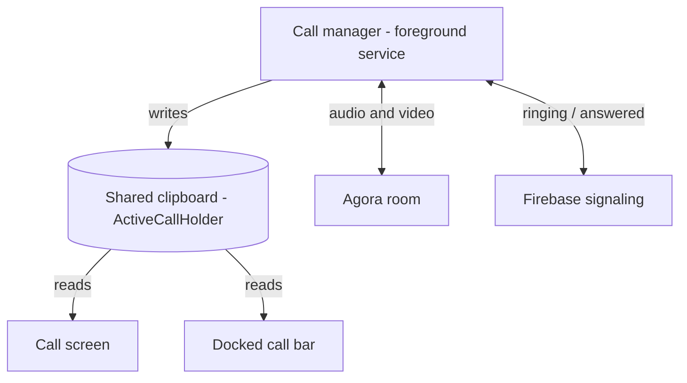

# Calls (Voice and Video) - Explained Simply

The plain-language version of [[Calls (Voice and Video)]]. Who is actually in charge during a
call, and why the screen and the notification never disagree.

(Teaching comments only; the real source has none.)

---

## The big idea in one sentence

A background "call manager" (a foreground service) runs the whole call and writes the current
call status onto one shared clipboard; every screen, bar, and notification just reads that
clipboard, so they always show the same thing.

Analogy: one air-traffic controller (the service) runs the flight and updates one big board. The
pilots, the gate, and the app screen all just read the board. Nobody keeps their own separate
version.

The actual audio and video is carried by Agora (a calling library); the manager just tells Agora
"join this room", "mute", "turn on camera".

---

## Step by step: what happens during a call

1. You tap call. `CallViewModel.startOutgoing` starts the call manager service with the details
   (who, video or not).

2. The manager (`CallForegroundService`) puts the call on the shared clipboard
   (`ActiveCallHolder`), shows the ongoing-call notification, tells Agora to join the audio/video
   room, and sends a "ringing" signal to the other person over Firebase.

3. Every screen reads the clipboard. `CallViewModel.observeActiveCall` copies the clipboard into
   the call screen; the docked call bar reads the same clipboard. So there is never a
   "screen says ringing, bar says connected" mismatch.

4. When the other side answers, Agora reports "remote user joined" -> the manager marks the call
   active on the clipboard -> every reader updates, the timer starts.

5. The manager also arms timers: no answer in 60s, no network for 20s, peer app closed - each
   ends the call cleanly.

6. When the call ends (either side hangs up, or a timer fires), the manager cancels every timer,
   leaves the Agora room, clears the clipboard, and stops itself. Because the clipboard is now
   empty, all the screens/bars disappear.

---

## Picture: one manager, many readers



---

## The code, with plain-English comments

The one shared clipboard (`data/remote/call/ActiveCallHolder.kt:37`):

```kotlin
// PRIVATE: only the call manager service may write.
private val _state = MutableStateFlow<ActiveCall?>(null)
// PUBLIC read-only: every screen/bar reads this. null means "no call right now".
val state: StateFlow<ActiveCall?> = _state.asStateFlow()
```

The screen just mirrors the clipboard (`presentation/viewmodel/CallViewModel.kt:113`):

```kotlin
private fun observeActiveCall() {
    viewModelScope.launch {
        ActiveCallHolder.state.collectLatest { active ->
            // No call logic here at all - just copy the clipboard into the screen's state.
            _uiState.value = CallUiState(
                partnerName = active.partnerName, isActive = active.isActive,
                seconds = active.seconds, muted = active.muted, /* ...etc... */
            )
        }
    }
}
```

Buttons are just messages to the manager (`CallViewModel.kt:220`):

```kotlin
fun toggleMute() = sendAction(CallForegroundService.ACTION_TOGGLE_MUTE)
// sendAction just does context.startService(intent) - the manager does the real work.
```

Nothing leaks when it ends (`CallForegroundService.kt:905`):

```kotlin
override fun onDestroy() {
    scope.coroutineContext[Job]?.cancel()  // cancel EVERY timer/job at once
    super.onDestroy()
}
```

---

## The bar gesture (swipe it around)

While a call runs, a small bar sits at the top. Drag it:
- up past a threshold -> it hides,
- down past a threshold -> it shrinks into a floating bubble,
- not far enough -> it springs back to its spot.

The decision is a simple `when` on how far you dragged (`ActiveCallBar.kt:116`); see
[[Calls (Voice and Video)]] for the code.

---

## A worked example

- You call Bob (video). The manager starts, shows the notification, joins the Agora room, and
  rings Bob.
- Bob answers -> Agora says "remote joined" -> the clipboard flips to active -> the timer starts
  on both the full screen and the little bar at once.
- You swipe the bar down -> it becomes a bubble you can drag around while you use other screens.
- Bob's phone dies mid-call -> he vanishes from Agora and from the call presence; after the 20s
  reconnect window the manager ends the call, records it in your history, and clears the
  clipboard, so every call UI disappears.

---

## Why, in one line each

- Why a background service, not the screen? A call must survive you leaving the screen or
  backgrounding the app; a screen cannot.
- Why one shared clipboard? So the screen, the bar, and the notification can never disagree.
- Why cancel the whole scope in `onDestroy`? So no leftover timer keeps running after the call
  is gone.

---

## Related

[[Calls (Voice and Video)]] - [[Calls (Voice and Video) - Code]] -
[[Notifications - Explained Simply]] - [[Reading the Code - Simple Patterns]] - [[Home]]
