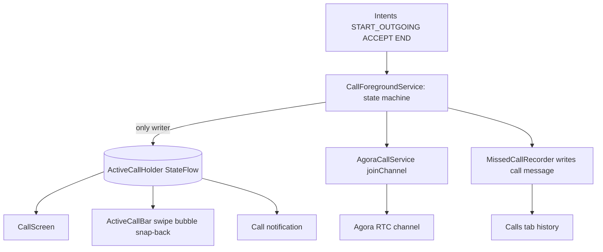

# Calls (Voice and Video)

One-to-one voice and video calls over Agora RTC, driven by a foreground service that owns the
call state machine. The UI - full-screen call, the docked active-call bar with
swipe/bubble/snap-back gestures, PiP video - is a pure reflection of a single global state
object. Missed/ended/unreached calls become chat messages and feed a call-history tab.

## Pieces

- `CallForegroundService` (`data/remote/call/CallForegroundService.kt:50`) - the state machine
  and lifecycle owner. `@AndroidEntryPoint`.
- `ActiveCallHolder` (`data/remote/call/ActiveCallHolder.kt:9`) - the single global
  `StateFlow<ActiveCall?>`.
- `AgoraCallService` (`data/remote/call/AgoraCallService.kt:21`) - the `ICallService` RTC
  wrapper.
- `FirebaseCallSignalingService` (`ICallSignalingService`) - call signaling over Realtime DB.
- `AgoraTokenProvider`, `CallUids`, `MissedCallRecorder`, `IncomingCallCoordinator`.
- Telecom integration: `data/remote/call/telecom/` (`TelecomCallManager`,
  `MessengerConnectionService`, `MessengerConnection`) for system phone-account/PiP behaviour.
- Presentation: `CallViewModel` (`presentation/viewmodel/CallViewModel.kt:38`), `CallScreen`,
  `CallsViewModel`/`CallsScreen`, and components in `presentation/components/call/`
  (`ActiveCallBar`, `CallBarPresenter`, `CallBubble`, `CallControls`, `IncomingCallBar`,
  `PipCallSurface`).

## Agora RTC

Dependency `io.agora.rtc:full-sdk:4.6.3` declared directly in `app/build.gradle.kts:174`
(not in the version catalog). The full SDK is used because video needs the native video
modules; the App ID resolves from `local.properties` -> Gradle property -> placeholder into
`BuildConfig.AGORA_APP_ID` (`app/build.gradle.kts:22`, `:43`).

`AgoraCallService` creates one `RtcEngine` in its `init` (`AgoraCallService.kt:106`) and adapts
the `IRtcEngineEventHandler` callbacks into the domain `CallEventListener`
(`AgoraCallService.kt:25`): `onUserJoined -> onRemoteUserJoined`, `onUserOffline` split into
intentional quit (`onRemoteUserLeft`) vs network drop (`onRemoteConnectionLost`),
`onConnectionStateChanged -> onConnectionStateChanged`, `onTokenPrivilegeWillExpire ->` token
renew. `joinChannel` (`:130`) sets `ChannelMediaOptions` (communication profile, broadcaster
role, publish mic, publish camera when video is on). Video is lazily enabled
(`ensureVideoModule`, `:238`) so audio-only calls never spin up the video pipeline.

## The state machine lives in the foreground service

`ActiveCallHolder` is an `object` with a `MutableStateFlow<ActiveCall?>`
(`ActiveCallHolder.kt:37`). Its `set`/`update`/`clear` are `internal` - only the service writes;
everything else reads `state` or `snapshot()`. This is the core architectural decision: the
service is the single writer of call state and the UI is a stateless mirror, so there is no way
for the screen and the notification and the bar to disagree.

`CallForegroundService` runs everything on `CoroutineScope(SupervisorJob() + Dispatchers.IO)`
(`CallForegroundService.kt:57`) and is driven by intent actions (`onStartCommand`, `:108`):
`START_OUTGOING`, `START_INCOMING`, `ACCEPT`, `DECLINE`, `END`, plus mute/speaker/camera
toggles. Highlights:

- Outgoing (`handleStartOutgoing`, `:128`): seeds `ActiveCallHolder`, starts foreground with a
  microphone (and camera, if video) service type, sends a `RINGING` `CallSignal`, acquires
  audio focus, joins the Agora channel, observes the remote status and the callee's ringing
  ack, and arms a "requesting" timeout.
- Incoming (`handleStartIncoming`, `:173`): if already on another call it declines the new one;
  otherwise it posts a full-screen ringing notification (or a silent one if the app is
  foreground), acks ringing, observes remote status, and arms a 60s ring timeout.
- Accept (`handleAccept`, `:221`): flips to active, upgrades the foreground service type to
  include mic/camera, writes `ACTIVE` status, joins the channel, starts the call timer and
  presence tracking.
- Terminate (`terminate`, `:267`): records an ended call if it was active, writes the terminal
  status with a 2s timeout, clears the signaling nodes, then `stopSelfClean`.

Timeouts and reconnection are explicit jobs: ring (60s), requesting (30s), outgoing/no-answer
(65s), and a 20s reconnect window (`startReconnectTimeout`, `:510`) that ends the call if it is
not fully connected (`isFullyConnected` = active + remote present + Agora CONNECTED). Presence
of the peer is tracked over signaling (`startPresence`, `:591`) so if the peer's app dies the
call ends after the reconnect window.

Cleanup discipline: `stopSelfClean` (`:544`) cancels every job, stops the ringback tone, leaves
the Agora channel, releases audio focus, clears `ActiveCallHolder`, disconnects the Telecom
connection through `ActiveConnectionHolder.disconnect` (see [[#PiP and Telecom]]), and stops the
foreground service. `onDestroy` (`:932`) is the safety net: it disconnects *all* remaining Telecom
connections (`disconnectAll`), clears `ActiveCallHolder`, and cancels the whole scope via
`scope.coroutineContext[Job]?.cancel()`, so no timeout job - or stray system "ongoing call" - can
outlive the service. This is the worked example of service scope management referenced in
[[Async and Reactivity]].

## The UI mirrors the state

`CallViewModel` (`presentation/viewmodel/CallViewModel.kt:38`) is a plain `AndroidViewModel`
with a `MutableStateFlow<CallUiState>`. `observeActiveCall` (`:103`) collects
`ActiveCallHolder.state` with `collectLatest` and copies each field into `CallUiState`; when the
holder goes null it plays a short "call ended" state and routes the exit via a
`Channel<CallExit>` (`receiveAsFlow()`, `:52`) - Pop, or OpenChat for an answered incoming call.
User actions are thin `startService` intents to the foreground service (`acceptCall`,
`endCall`, `toggleMute`, `switchCamera`, ...). Video surfaces bind directly to Agora via
`bindLocalVideo`/`bindRemoteVideo` (`AgoraCallService.kt:200`, `:206`). Starting an outgoing call
(`startOutgoing`, `CallViewModel.kt:174`) builds a `TelecomCallMeta`, starts the foreground service, and places
the call through Telecom.

`observePartnerAvatar` (`CallViewModel.kt:89`) cancels the previous avatar observer job before resubscribing to
a new partner id, so switching the tracked partner does not leak a stale `observeUser`
collector.

## The active-call bar: swipe, bubble, snap-back

While a call is active and not on the full call screen, a docked bar shows at the top (mounted
at the navigation root, `presentation/navigation/graph/MainDisplay.kt:600`, so it persists across
screens). `ActiveCallBar` (`presentation/components/call/ActiveCallBar.kt:149`) reads
`ActiveCallHolder.state` and `CallBarPresenter.mode`, and handles a vertical drag
(`ActiveCallBar.kt:191`):

```kotlin
detectVerticalDragGestures(
    onVerticalDrag = { change, delta -> change.consume(); scope.launch { dragY.snapTo(dragY.value + delta) } },
    onDragEnd = {
        when {
            offset <= -hideThresholdPx -> scope.launch { dragY.animateTo(-hideTargetPx, tween(160)); CallBarPresenter.hide() }
            offset >= bubbleThresholdPx -> { CallBarPresenter.bubbleOffset = null; CallBarPresenter.minimizeToBubble() }
            else -> scope.launch { dragY.animateTo(0f, tween(180)) }
        }
    },
    onDragCancel = { scope.launch { dragY.animateTo(0f, tween(180)) } },
)
```

- Swipe up past the threshold - animate off and `CallBarPresenter.hide()` (mode HIDDEN).
- Swipe down past the threshold - `minimizeToBubble()` (mode BUBBLE), rendered as a draggable
  `CallBubble` floating over content.
- Otherwise - `animateTo(0f)` snaps the bar back to its docked position.

`CallBarPresenter` (`presentation/components/call/CallBarPresenter.kt:9`) is a global `object`
holding a `MutableStateFlow<CallBarMode>` (BAR / HIDDEN / BUBBLE) plus the last bubble offset; it
resets to BAR when the call ends (`MainDisplay.kt:183`). The bar shows a live waveform and call
timer when connected, or a status label (`Requesting...`/`Ringing...`/`Connecting...`) otherwise
(`callBarStatus`, `ActiveCallBar.kt:94`), with inline mute and end-call buttons that post service
actions.

An `IncomingCallBar` is shown for a ringing incoming call, and a `CallBarOverlay` hosts the
floating bubble; all three are wired in `MainDisplay` (`MainDisplay.kt:587`-`:654`). See
[[Navigation]].

## PiP and Telecom

The `telecom/` package registers a self-managed phone account (`TelecomCallManager`,
registered in `MessengerApplication.onCreate`) so calls integrate with the system
(`MessengerConnectionService`, `MessengerConnection`), which is what enables system PiP/behaviour
for the call surface (`PipCallSurface`). Incoming FCM call payloads add a Telecom incoming
connection (see [[Notifications]]).

The system connection is what makes Android show a call as "ongoing", so tearing it down reliably
matters. Telecom creates the `Connection` *asynchronously* (`onCreateOutgoingConnection` /
`onCreateIncomingConnection` fire after `placeCall`/`addNewIncomingCall`), which can race a fast
hang-up and leave a phantom ongoing call. `ActiveConnectionHolder`
(`data/remote/call/telecom/ActiveConnectionHolder.kt`) is therefore idempotent and race-proof:

- `disconnect(callId, cause)` (`:28`) disconnects the connection if registered, otherwise records
  the callId in a bounded `pendingDisconnects` map.
- `put(callId, connection)` (`:12`) consults that map, so a connection that arrives *after*
  teardown disconnects itself immediately instead of lingering.
- `disconnectAll(cause)` (`:38`) drops every remaining connection - the `onDestroy` backstop.
- The busy branch of `handleStartIncoming` (`CallForegroundService.kt:173`) disconnects the
  rejected concurrent call's connection, and `stopSelfClean` routes teardown through `disconnect`
  rather than a one-shot lookup.

`MessengerConnection.markDisconnected` (`MessengerConnection.kt:60`) does the actual
`setDisconnected` + `destroy`.

## The screen during a call

Until 0.1.13.1 the display timed out mid-call because nothing held it awake. Now:

- `KeepScreenOn(enabled)` (`presentation/components/common/KeepScreenOn.kt:9`) is a
  `DisposableEffect` that adds `FLAG_KEEP_SCREEN_ON` to the host window while `enabled` and
  clears it on dispose. `CallScreenContent` uses it with `enabled = !state.callEnded`; the voice
  recorder's composer reuses it while recording (see [[Voice Messages]]).
- `IncomingCallActivity` sets the same flag next to `setShowWhenLocked(true)` when it is created.
- Proximity blanking: `CallForegroundService` collects `ActiveCallHolder.state` in `onCreate`
  (`CallForegroundService.kt:95`) and wants the lock while the call is active, not ended, with
  the local camera off and the speaker off - an earpiece audio call. `acquireProximityLock`
  (`:722`) takes a `PROXIMITY_SCREEN_OFF_WAKE_LOCK` (if the device supports it) so the screen
  turns off against the ear; switching to video or speaker, or ending the call, releases it with
  `RELEASE_FLAG_WAIT_FOR_NO_PROXIMITY` (`:735`), and `stopSelfClean` releases it as well. The
  lock is acquired with a 10-minute timeout and is only re-acquired when the call state changes.
  This needs the `WAKE_LOCK` permission.

`MainActivity` is declared with `android:screenOrientation="fullSensor"`, so the app rotates
freely, including the call screen.

## Call history

Ended/missed/unreached calls are recorded as call-type chat messages (`MissedCallRecorder`,
invoked from the service, e.g. `recordEndedCall`, `CallForegroundService.kt:413`). The calls tab
derives its log from those messages: `CallHistoryRepository.getCallHistory`
(`data/repository/CallHistoryRepository.kt:25`) queries `ObxMessage.type.oneOf(CALL_TYPES)`
(indexed - `ObxMessage.kt:24`), orders by timestamp desc, filters out deleted rows, batches the
needed conversations in a single `uid.oneOf(...)` query, and maps each row to a
`CallHistoryEntry` (partner, direction, duration, video flag). Returning a `Query.asFlow().map`
keeps the history live. `CallsViewModel` exposes it to `CallsScreen`; call-message bubbles in
chat render via `CallMessageCards`.

## Why this design

- A foreground service is the only component that reliably survives the app going to
  background/being swept during a call, so it owns the state machine; the UI cannot become the
  source of truth for something that must outlive it.
- A single global `StateFlow` as the one writer/many readers boundary removes an entire class of
  "the bar says connected but the screen says ringing" bugs.
- Explicit, named timeout jobs plus a reconnect window make the many call edge cases (no answer,
  peer app killed, network drop) deterministic rather than emergent.
- The bar/bubble/hidden presentation is decoupled into `CallBarPresenter` so gesture handling and
  rendering stay simple and the mode persists across navigation.

## Visualization



## Related

[[Async and Reactivity]] - [[Navigation]] - [[Notifications]] - [[Presence and Typing]] -
[[Data Layer]] - [[Architecture Overview]] - [[Calls (Voice and Video) - Basic Example]]
