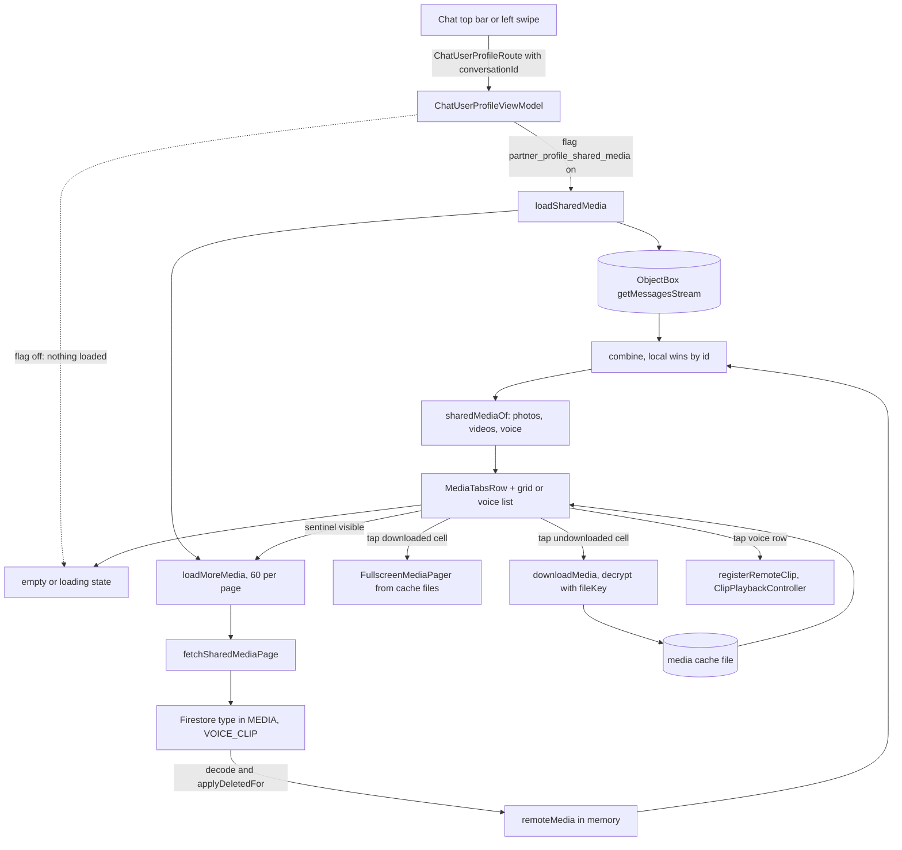

# Chat Profile and Shared Media

The partner's profile screen opened from a chat, and the Photos / Videos / Voice / Files tabs on
it that list everything the two of you have shared. Added by PR #54 (merged 2026-11-03).

`path:line` refs are relative to `app/src/main/java/com/example/messenger/` unless they start with
a repo-root name (`firestore.indexes.json`).

## Pieces

- `ChatUserProfileScreen` (`presentation/screens/chatuserprofile/ChatUserProfileScreen.kt:10`) -
  the thin screen: collects `ChatUserProfileViewModel.uiState` and `clipPlayback` and forwards
  callbacks.
- `ChatUserProfileScreenContent`
  (`presentation/screens/chatuserprofile/ChatUserProfileScreenContent.kt:64`) - the stateless UI:
  header, info card, safety number, then the shared-media tabs and list; also owns the two
  full-screen viewers (avatar photos and shared media).
- `ChatUserProfileViewModel` (`presentation/screens/chatuserprofile/ChatUserProfileViewModel.kt:38`)
  - a plain `ViewModel` (not the MVI base) holding a `MutableStateFlow<ChatUserProfileUiState>`.
- `ChatUserProfileUiState` (`presentation/screens/chatuserprofile/ChatUserProfileUiState.kt:8`) -
  adds `mediaTab`, `sharedMedia`, `mediaLoading`, `mediaEndReached`, `mediaPagesLoaded` and
  `transfers`.
- `SharedMedia`, `SharedMediaEntry` and `sharedMediaOf`
  (`presentation/screens/chatuserprofile/SharedMedia.kt:9`, `:15`, `:21`) - the pure function that
  turns a bag of messages into the three lists the tabs show. `MediaTab`
  (`presentation/screens/chatuserprofile/MediaTab.kt:3`) is the enum `PHOTO, VIDEO, VOICE, FILE`.
- `sharedMediaSection` and `MediaTabsRow`
  (`presentation/components/profile/ProfileSharedMedia.kt:62`,
  `presentation/components/profile/ChatUserProfileComponents.kt:188`) - the tab strip and the
  list/grid under it. The cell itself is the chat's `MediaCell`
  (`presentation/components/media/MediaAlbum.kt:205`), reused unchanged.
- Data: `IMessageRepository.fetchSharedMediaPage`
  (`domain/repository/IMessageRepository.kt:20`) -> `MessageRepositoryImpl.fetchSharedMediaPage`
  (`data/repository/MessageRepositoryImpl.kt:171`) -> `FirestoreService.fetchMessagesOfTypes`
  (`data/remote/firebase/FirestoreService.kt:317`); the composite index is in
  `firestore.indexes.json`.

## How the profile is reached

`ChatUserProfileRoute` gained an optional `conversationId`
(`presentation/navigation/Routes.kt:66`-`:70`). The chat's top bar (`ChatTopBar.kt:93`, `:106`) and its left-swipe gesture
(see [[Chat and Messaging]]) push the route with the open conversation's id
(`presentation/navigation/graph/MainDisplay.kt:508`-`:518`), and the nav entry hands it to the
ViewModel through `SavedStateHandle` (`MainDisplay.kt:449`-`:454`). When the profile is opened
from somewhere with no conversation (the contacts screen, `MainDisplay.kt:415`) the id is empty and the ViewModel
looks the conversation up itself: the first two-participant conversation that contains the
partner (`findConversationWith`, `ChatUserProfileViewModel.kt:140`). No conversation found means
no media: the section settles on the empty state immediately (`:122`-`:124`).

## Where the media comes from: two sources merged

Shared media is the union of what is already on the device and what is paged in from the server:

1. Local: `messageRepository.getMessagesStream(conversationId)` - the same reactive ObjectBox
   stream the chat uses, so anything already cached shows up first and live updates (a new photo
   arriving while the profile is open) appear without a refresh (`ChatUserProfileViewModel.kt:130`).
2. Remote: `loadMoreMedia` (`:147`) asks `fetchSharedMediaPage` for the next page of
   `MEDIA_PAGE_SIZE = 60` messages (`:197`). The Firestore query takes only `TYPE_MEDIA` and
   `TYPE_VOICE_CLIP` messages (`MessageRepositoryImpl.kt:249`), newest first by `timestamp`, and
   continues after the last message of the previous page (`startAfter` on that document,
   `FirestoreService.kt:335`). An anchor that no longer exists yields an empty page. Pages are held
   in memory only, in `remoteMedia` (`ChatUserProfileViewModel.kt:54`); nothing is written to
   ObjectBox, so closing the profile discards them.

The two are combined with `combine(local, remoteMedia)`; remote rows are laid down first and local
rows overwrite them by id, so a message that exists in both is shown once and the local copy (with
its real send state and cached files) wins (`:130`-`:132`). `sharedMediaOf` then drops deleted
messages, sorts newest first and splits the result: photos are `MediaItem`s of kind `IMAGE`,
videos are items of kind `VIDEO`, and voice is `Message.Clip` rows whose clip is `Clip.Voice`
(`SharedMedia.kt:21`-`:30`). A multi-photo album message contributes one entry per item, each
remembering its parent message. Video notes (`TYPE_VIDEO_CLIP`) are not requested and never
appear here.

Two rules keep the server query consistent with the chat:

- The query passes `cutoff = cutoffFor(conversationId)`, the conversation's `clearedAtForMe`
  (`MessageRepositoryImpl.kt:47`, `:180`), so media the user cleared with "clear for me" does
  not reappear from the server. See [[Conversations List]].
- Each fetched document goes through `applyDeletedFor(dto, codec.decode(dto))`
  (`FirestoreService.kt:340`): messages deleted for this user are marked deleted (and filtered out
  by `sharedMediaOf`), and encrypted messages are decrypted exactly as in the chat.

## Paging

`mediaEndReached` becomes true when a page returns fewer than 60 messages (`:160`) or the request
fails (`:166`) - a failure stops further paging rather than retrying in a loop. Only one page job
runs at a time (`pageJob`, `:150`). The count is of messages, not of items, so a page of 60
messages can hold more than 60 photos.

The trigger lives in the UI, not the ViewModel: at the end of the list `sharedMediaSection` shows,
in priority order, a spinner while `mediaLoading` is true, otherwise (when more pages exist) an
invisible sentinel item whose `LaunchedEffect(mediaPagesLoaded, mediaTab)` calls `onLoadMore`,
otherwise the empty state (`ProfileSharedMedia.kt:99`-`:106`). Because the key includes
`mediaPagesLoaded`, the sentinel fires again after each page lands as long as it is still composed
- so a tab with few matches (say Voice, when most pages are photos) keeps paging until the sentinel
is scrolled out of view or the history ends. All tabs share one paging cursor and one remote
cache.

## The grid and the voice list

- Photos and Videos use `mediaGrid` (`ProfileSharedMedia.kt:110`): entries are chunked into rows of
  `GRID_COLUMNS = 4` (`:60`, `:118`), each cell square (`aspectRatio(1f)`) with an 8 dp corner, and
  short rows are padded with spacers so cells keep their size. Rows are keyed by their first item's
  id.
- The cell is the chat's `MediaCell`: it shows the BlurHash placeholder until the file is cached,
  then the image (with a play badge for video); an undownloaded cell shows a download button, and a
  running transfer shows a progress scrim with cancel (`MediaAlbum.kt:224`-`:247`).
- Voice uses `SharedVoiceRow` (`ProfileSharedMedia.kt:147`): a play/pause/spinner/retry button, the
  sender ("You" or the partner's display name), and the date plus duration, replaced by the live
  waveform while that clip is the one playing.
- Files is always the empty state (`MediaTab.FILE -> true`, `:76`): the app cannot send generic
  files yet. Each tab has its own empty string, for example "No photos yet"
  (`emptyTextFor`, `:270`).

## Opening a photo or video

Tapping a cell sets `openMediaId` (`ChatUserProfileScreenContent.kt:182`); the screen then builds
the viewer sources from the current tab's entries (videos on the Videos tab, photos otherwise,
`:198`-`:218`) and shows `FullscreenMediaPager` starting at the tapped item. Only items whose file
is already in the media cache with non-zero length become pages (`:202`-`:203`), and a cell is only
clickable once it is downloaded and idle (`MediaAlbum.kt:227`), so the pager swipes through
downloaded media only; an undownloaded item must be downloaded from its cell first.

## Voice playback from the profile

Tapping a voice row calls `toggleVoice` (`ChatUserProfileViewModel.kt:171`). It registers every
voice clip in the list with the clip repository (`registerRemoteClip`,
`data/repository/ClipRepositoryImpl.kt:114`), which keeps server-only clips in an in-memory map
that `loadClip` falls back to (`:338`-`:339`), so `ensureLocal` can download a clip that was never
in ObjectBox (`:118`-`:132`) and `nextVoiceClip` can auto-advance across both cached and remote
clips (`:153`-`:160`). Then it hands a `ClipQueueItem` to the shared `ClipPlaybackController`
(`data/media/ClipPlaybackController.kt:192`), the same player the chat bubbles and the mini player
use, so playing from the profile pauses any other clip. See [[Voice Messages]].

## Encrypted media

Nothing in the profile code decrypts anything itself. Encrypted media works because the decryption
happens one layer down:

- The metadata and the per-file key travel inside the encrypted message payload.
  `E2eeMessageCodec.decode` puts each item's `fileKey` and `blurHash` back onto the `MediaItem`s
  (`data/crypto/E2eeMessageCodec.kt:103`-`:111`) and does the same for clips (`:113`-`:114`). Both
  the local stream and the Firestore page path decode before the ViewModel sees the message.
- Downloading calls `mediaRepository.downloadMedia(item)` (`MediaRepositoryImpl.kt:72`), which
  passes `item.fileKey` to `MediaFileTransfer.download`; with a key it downloads the ciphertext and
  decrypts it into the cache file, without one it just moves the plain file into place
  (`data/media/MediaFileTransfer.kt:46`-`:57`).
- A message that cannot be decrypted on this device comes back as an undecryptable placeholder
  (see [[End-to-End Encryption]]) and carries no usable file, so there is nothing to open.

The cache file is the only plaintext copy; the viewer reads that file.

## Empty and loading states

- First load: `mediaLoading = true` from the moment `loadSharedMedia` starts (`:119`), so the tab
  shows a spinner (`MediaLoading`, `ProfileSharedMedia.kt:241`) while the conversation is resolved
  and the first page is fetched.
- Nothing yet: after loading finishes with no entries for the tab, `MediaEmptyState`
  (`:257`) shows the tab's text.
- Page boundary: a trailing spinner while the next page loads; no spinner once `mediaEndReached`.
- No conversation, a failed first page, or the flag off: no spinner, just the empty state (or no
  section at all when the flag is off).

## Feature flag

`partner_profile_shared_media` (`FeatureFlag.PARTNER_PROFILE_SHARED_MEDIA`) controls the whole
section; see [[Feature Flags and Remote Config]]. It is enforced in two places:

- UI: `ChatUserProfileScreenContent.kt:81` reads it and the tabs row and `sharedMediaSection` are
  only emitted when it is on (`:177`-`:189`).
- ViewModel: `init` skips `loadSharedMedia` when `featureFlags.refuses(...)` (`:76`), and
  `loadMoreMedia` returns early (`:148`), so a switched-off section makes no Firestore reads even
  if something calls it.

Related child capabilities are gated separately: voice playback needs `CLIP_PLAYBACK`
(`ProfileSharedMedia.kt:163`, `:170`; `ChatUserProfileViewModel.kt:176`, which still allows
pausing a clip that is already playing); the cell's download button needs `MEDIA_DOWNLOAD`
(`MediaAlbum.kt:244`; `ChatUserProfileViewModel.kt:182`); and cancelling a transfer needs
`MEDIA_CANCEL_TRANSFER` (`MediaAlbum.kt:294`; `ChatUserProfileViewModel.kt:187`, `:192`). The
Remote Config description for the flag is "Off: hides the Photos, Videos, Voice and Files tabs on
the chat profile" (`remoteconfig.template.json:268`-`:271`).

## Why this design

- Local-first with a server tail: ObjectBox already holds recent chat media, so the tabs are
  instant and live, and Firestore is only used for the older history.
- In-memory remote pages avoid growing the local database with media the user may never look at,
  at the cost of re-fetching on each visit.
- Reusing `MediaCell`, `FullscreenMediaPager` and `ClipPlaybackController` keeps transfer
  progress, cancel, encryption and audio focus behaviour identical to the chat.
- Paging from the UI sentinel (keyed on `mediaPagesLoaded`) means the ViewModel needs no scroll
  state: it only knows "load the next page".

## Alternatives considered / rejected

- Writing fetched pages into ObjectBox: not done; the PR's commit message says older media is
  "held in memory only" (the reason is not stated there).
- A Files tab with real content: the tab exists but is a permanent empty state because the app
  cannot send files.

## Known limits

- Remote pages are lost when the profile closes; a second visit pages again from the server.
- Only photos, videos and voice messages are indexed; video notes and call cards are not listed.
- The viewer pages through downloaded media only.
- The single page cursor is shared by all tabs, so a rarely used tab (Voice) can pull many pages
  of other types before it fills.
- A failed page ends paging for that visit (`:166`), with no retry button.
- Firestore needs the composite index on `messages(type ASC, timestamp DESC)`
  (`firestore.indexes.json:20`-`:25`); without it the remote query fails and the tab shows only
  locally cached media.

## Visualization

## Related

[[Chat and Messaging]] - [[Voice Messages]] - [[Video Messages]] - [[End-to-End Encryption]] -
[[Conversations List]] - [[Feature Flags and Remote Config]] - [[Data Layer]] -
[[Async and Reactivity]] - [[Navigation]] - [[Chat Profile and Shared Media - Code]] -
[[Chat Profile and Shared Media - Explained Simply]] - [[Chat Profile and Shared Media - Basic Example]]
