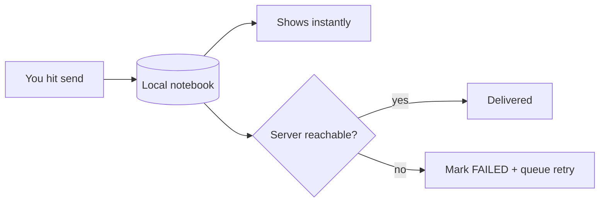

# Chat and Messaging - Explained Simply

The plain-language version of [[Chat and Messaging]]. How a message sends, arrives, and shows a
tick - and why it feels instant.

(Teaching comments only; the real source has none.)

---

## The big idea in one sentence

When you send a message, the app writes it into your phone's notebook first (so it appears
instantly), then tries to deliver it to the server; if the server is unreachable, it marks the
message failed and queues it to retry later.

Analogy: you write the note in your own notebook (done, you can see it), then drop a copy in the
mailbox. If the mailbox is jammed, you keep the note flagged "not sent yet" and try again later.

---

## Step by step: sending "hello"

1. You type and hit send. The screen fires `ChatIntent.SendMessage("hello")` -> `sendMessage`
   (`presentation/viewmodel/ChatViewModel.kt:373`).

2. `SendMessageUseCase` builds a `Message.Text` with a fresh id, status `SENDING`, and (if you
   were replying) a short snippet of the original.

3. `MessageRepositoryImpl.sendMessage` (`data/repository/MessageRepositoryImpl.kt:52`):
   - writes it to the ObjectBox notebook. Because the chat screen is reading that notebook as a
     live stream, "hello" pops on screen immediately.
   - then tries Firebase. On success it is delivered; on failure it flips the row to `FAILED` and
     adds it to a retry queue.

4. Meanwhile a background listener (`getRecentMessagesStream`) watches Firebase for the other
   person's messages and writes them into the same notebook, so incoming messages appear the same
   way.

5. Read ticks: when you actually see a message, the app tells the server, and only after the
   server confirms does it mark the message `READ`.

---

## Picture: the send path



---

## The code, with plain-English comments

Write-local-first (`data/repository/MessageRepositoryImpl.kt:52`):

```kotlin
suspend fun sendMessage(message: Message): Result<Unit> {
    messageBox.put(message.toObx())          // 1) save locally -> screen shows it right away
    updateConversationPreview(message)        // 2) update the chat-list preview text
    val result = firestoreService.sendMessage(message.withStatus(SENT)) // 3) try the server
    if (result.isFailure) {
        updateMessage(message.id) { it.status = FAILED.name } // couldn't send -> mark it
        enqueueRetry(message.id)                                // ...and try again later
    }
    return Result.success(Unit)
}
```

The live message stream the screen reads (`MessageRepositoryImpl.kt:34`):

```kotlin
fun getMessagesStream(conversationId): Flow<List<Message>> =
    messageBox.query(sameConversation AND notDeleted)
        .asFlow()                     // a live tap: re-emits the whole list on ANY local change
        .map { rows -> rows.map { it.toDomain() } }
        .flowOn(Dispatchers.Default)  // do the converting off the main thread
```

Deleting - two different meanings (`MessageRepositoryImpl.kt:90`):

```kotlin
suspend fun deleteMessageForEveryone(message): Result<Unit> {
    // Safety rule: you can only delete YOUR OWN message for everyone.
    if (message.senderId != currentUserId) return failure(SecurityException(...))
    updateMessage(message.id) { it.deleted = true }   // hide locally
    firestoreService.deleteMessage(message)            // server sets deleted = true for all
}
// "Delete for me" instead just adds YOUR id to a "deletedFor" list, so it disappears for you only.
```

---

## A worked example

- You send "hello" on a weak connection. It appears instantly with a "sending" clock.
- The server write times out -> the message turns to a red "failed" state and joins the retry
  queue. When signal returns, the `SyncWorker` retries it and it goes through.
- Bob reads it -> your tick turns to "read".
- You long-press your own "hello" and pick "Delete for everyone" -> it vanishes for both of you.
  If you picked "Delete for me", it vanishes only on your side.

---

## Why, in one line each

- Why save locally before sending? So the message is instant and the chat works offline.
- Why a retry queue? So a message sent with no signal is not lost - it goes out automatically
  later.
- Why mark READ only after the server confirms? So a tick never lies about delivery.
- Why the sender-only rule on "delete for everyone"? You should not be able to erase other
  people's messages.

---

## Related

[[Chat and Messaging]] - [[Chat and Messaging - Code]] - [[Conversations List - Explained Simply]] -
[[End-to-End Encryption - Explained Simply]] - [[Reading the Code - Simple Patterns]] - [[Home]]
