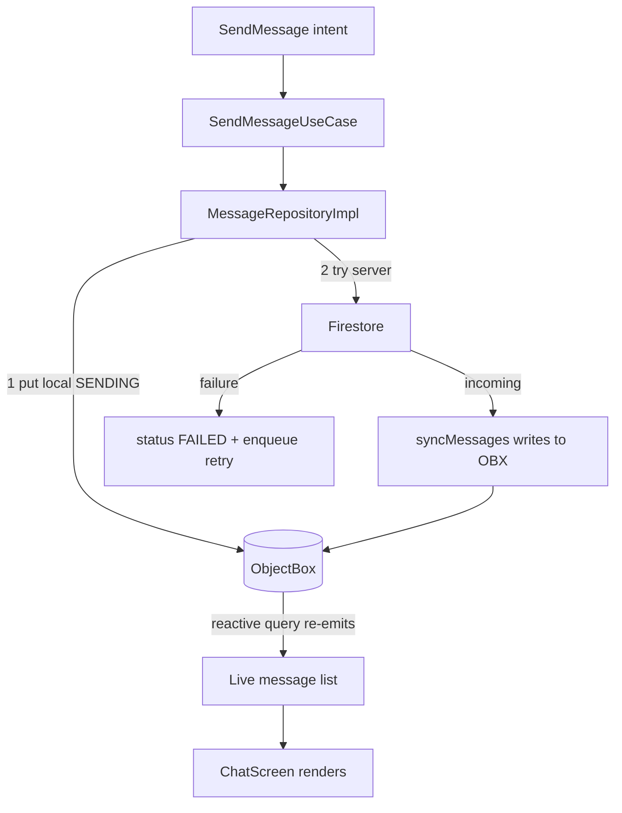

# Chat and Messaging

The chat screen: send/receive text and media, replies, read receipts, backward paging, and the
two message-deletion modes. This is the most feature-dense area of the app.

## Pieces

- `ChatViewModel` (`presentation/viewmodel/ChatViewModel.kt:60`) - MVI
  (`MviViewModel<ChatUiState, ChatIntent, ChatEffect>`).
- State/Intent/Effect: `ChatUiState` (`presentation/state/ChatUiState.kt:16`), `ChatIntent`
  (`presentation/intent/ChatIntent.kt:8`), `ChatEffect` (`presentation/effect/ChatEffect.kt:6`).
- `MessageRepositoryImpl` (`data/repository/MessageRepositoryImpl.kt`) and
  `MediaRepositoryImpl` (`data/repository/MediaRepositoryImpl.kt`).
- Use cases in `domain/usecase/message/`.
- UI: `ChatScreen` (`presentation/screens/ChatScreen.kt`) and components in
  `presentation/components/chat/` and `presentation/components/media/`.

## The reactive message list

The screen renders `ChatUiState.messages`, fed by `loadMessages`
(`presentation/viewmodel/ChatViewModel.kt:223`), which collects
`getMessagesUseCase(conversationId)` (a `Flow<Resource<List<Message>>>`). The source is the cold
ObjectBox stream `getMessagesStream` (`data/repository/MessageRepositoryImpl.kt:34`), so any
local write re-emits the whole ordered, non-deleted list. In parallel, `syncMessages`
(`ChatViewModel.kt:213`) collects the Firestore refresh stream to pull remote rows into
ObjectBox. Full stream analysis in [[Async and Reactivity]].

On each `Resource.Success` the reducer also computes the first-unread anchor once
(`ChatViewModel.kt:231`) and flattens media items for the in-chat gallery
(`conversationMedia`).

## Sending

`ChatIntent.SendMessage(text)` -> `sendMessage` (`ChatViewModel.kt:373`). If there are pending
attachments it routes to `sendMediaMessage`; otherwise it clears typing, sets `isSending`, and
collects `sendMessageUseCase(conversationId, text, replyTo)`. The repository writes to ObjectBox
first (message shows instantly), then attempts Firestore; on failure the row goes `FAILED` and a
retry is enqueued - see the end-to-end walkthrough in [[Architecture Overview]] and the
offline-first section of [[Data Layer]].

## Replies

`ChatIntent.SetReplyTo(message)` sets `replyingTo` in state (`ChatViewModel.kt:144`);
`SendMessageUseCase` captures a capped snippet of the replied-to message
(`domain/usecase/message/SendMessageUseCase.kt:47`, `REPLY_SNIPPET_MAX = 200`) plus
`replyToMessageId`/`replyToSenderId` so the bubble can render the quote and
`ChatIntent.JumpToMessage` can scroll to the original. `jumpToMessage`
(`ChatViewModel.kt:181`) pages backward (bounded by `MAX_JUMP_PAGES` and a per-page
`withTimeoutOrNull`) until the target is loaded, then highlights it for 2.5s.

## Media attachments

Attachments are staged then sent as a group:
- `ChatIntent.ToggleAttachment` / `AddAttachment` update `pendingAttachments`
  (`ChatViewModel.kt:352`).
- `sendMediaMessage` (`ChatViewModel.kt:396`) delegates to
  `mediaRepository.sendMediaMessage(conversationId, uris, caption)` and clears the staging.
- `MediaRepositoryImpl.sendMediaMessage` (`data/repository/MediaRepositoryImpl.kt:65`) runs on
  the repository's own app-scoped `CoroutineScope(SupervisorJob() + Dispatchers.IO)`
  (`:60`) so the upload survives leaving the chat screen. It builds a local `Message.Media`
  (copying each picked file into `MediaCache`, extracting width/height/duration/BlurHash via
  `MediaMetadata`), persists it as `SENDING`, then `uploadAndSend`.
- `uploadAndSend` (`:163`) uploads each item in parallel `launch`es inside a `coroutineScope`,
  bounded by `withTimeoutOrNull(SEND_TIMEOUT_MS = 35_000)` (`:200`); items that finish get their
  Storage `url` written back, then the message goes to Firestore. Partial success splits the
  failed items into a separate `FAILED` bubble (`splitFailed`, `:244`) so the user can retry
  just those (`ChatIntent.RetryMedia` -> `MediaRepositoryImpl.retry`, `:117`).
- Progress is a `StateFlow<Map<String, MediaTransfer>>` observed via
  `observeTransfers`/`ChatIntent` handlers, so per-item upload/download progress renders live.
- If the conversation is encryptable, each file is encrypted with a per-file key before upload
  (`MediaCipher.encrypt`, `MediaRepositoryImpl.kt:176`); the key travels inside the encrypted
  message payload. See [[End-to-End Encryption]].

Download is the mirror: `ChatIntent.DownloadMedia` -> `downloadMedia`
(`MediaRepositoryImpl.kt:75`), which downloads to a cache file and decrypts with the item's
`fileKey` when present.

## Read receipts

`ChatIntent.MessagesSeen(messages)` -> `onMessagesSeen` (`ChatViewModel.kt:261`) marks each
newly seen message read exactly once (guarded by `markedAsReadIds`) via
`MarkMessageAsReadUseCase` and, if anything changed, `markConversationRead`. The repository sets
`status = READ` locally only after the Firestore write succeeds
(`MessageRepositoryImpl.markMessageAsRead`, `data/repository/MessageRepositoryImpl.kt:124`), and
the read state is preserved when remote refreshes overwrite rows
(`putPreservingReadState`, `:169`). Status icons render from `MessageStatus`.

## Message deletion: for-me vs for-everyone

`ChatIntent.DeleteMessage(message, forEveryone)` -> `deleteMessage` (`ChatViewModel.kt:413`) ->
`DeleteMessageUseCase(message, forEveryone)`. The repository splits on the flag:

- For everyone - `MessageRepositoryImpl.deleteMessageForEveryone`
  (`data/repository/MessageRepositoryImpl.kt:90`). First it enforces authorization:
  ```kotlin
  if (currentUserId == null || message.senderId != currentUserId)
      return Result.failure(SecurityException("Only own messages can be deleted for everyone"))
  ```
  Only the sender may delete for everyone. It marks the local row `deleted = true` and calls
  `FirestoreService.deleteMessage` (`FirestoreService.kt:173`), which sets `deleted = true` on
  the document so every participant's stream hides it. On failure it enqueues a `DELETE` retry.
- For me - `deleteMessageForMe` (`MessageRepositoryImpl.kt:109`): marks the local row deleted
  and calls `FirestoreService.deleteMessageForMe` (`FirestoreService.kt:145`), which adds the
  current uid to the document's `deletedFor` array. On read, `applyDeletedFor`
  (`FirestoreService.kt:168`) marks the message deleted only for uids in `deletedFor`, so it
  vanishes for this user while remaining for the other. Fallback action `DELETE_FOR_ME`.

The local message query already filters `deleted = false` (`MessageRepositoryImpl.kt:36`), so a
deletion re-emits the list without the row.

## Typing indicator (outgoing side)

`ChatIntent.TextChanged` -> `onTextChanged` (`ChatViewModel.kt:324`) debounces: after 500ms of
typing it calls `typingService.setTyping`, and a 5s TTL job clears it; a blank field clears
immediately. The incoming side is documented in [[Presence and Typing]].

## Notification suppression while open

`ChatScreen` marks the conversation open via `CurrentConversationHolder`
(`presentation/screens/ChatScreen.kt:129`), which `MyFirebaseMessagingService` checks
(`data/remote/firebase/MyFirebaseMessagingService.kt:103`) to avoid notifying for the chat the
user is already looking at. See [[Notifications]].

## Why this design

- ObjectBox-as-truth makes send/delete/read feel instant and keeps the UI alive offline; the
  network reconciles behind it.
- Group media upload with per-item parallelism, a hard timeout, and failed-item splitting gives
  partial success instead of an all-or-nothing spinner.
- Two clearly separated deletion paths (`deleted` field vs `deletedFor` array), with a
  sender-only guard on for-everyone, match user expectations and are enforced in the repository,
  not just the UI.

## Visualization



## Related

[[Data Layer]] - [[Async and Reactivity]] - [[Presentation Layer (MVI)]] -
[[Presence and Typing]] - [[Notifications]] - [[End-to-End Encryption]] -
[[Conversations List]] - [[Chat and Messaging - Basic Example]]
