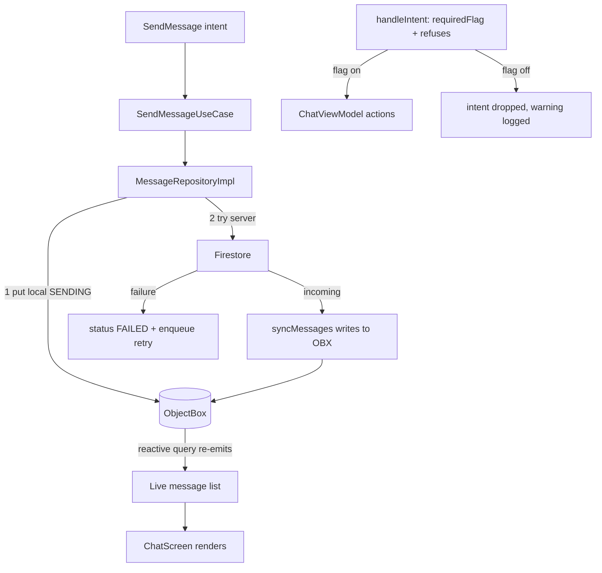

# Chat and Messaging

The chat screen: send/receive text and media, replies, read receipts, backward paging, and the
two message-deletion modes. This is the most feature-dense area of the app. Voice and video clips
share the screen but have their own pipeline, documented in [[Voice Messages]] and
[[Video Messages]].

## Pieces

- `ChatViewModel` (`presentation/screens/chat/ChatViewModel.kt:63`) - MVI
  (`MviViewModel<ChatUiState, ChatIntent, ChatEffect>`).
- State/Intent/Effect: `ChatUiState` (`presentation/screens/chat/ChatUiState.kt:16`), `ChatIntent`
  (`presentation/screens/chat/ChatIntent.kt:8`), `ChatEffect` (`presentation/screens/chat/ChatEffect.kt:6`).
- `MessageRepositoryImpl` (`data/repository/MessageRepositoryImpl.kt`),
  `MediaRepositoryImpl` (`data/repository/MediaRepositoryImpl.kt`) and, for voice clips,
  `ClipRepositoryImpl` (`data/repository/ClipRepositoryImpl.kt`).
- Use cases in `domain/usecase/message/`.
- UI: `presentation/screens/chat/` (`ChatScreenWithNav`, `ChatScreenContent`, `MessageBubble`,
  `MessageComposer`, `VoiceBubble`, `VideoNoteBubble`, ...) and components in `presentation/components/chat/` and
  `presentation/components/media/`.

## The reactive message list

The screen renders `ChatUiState.messages`, fed by `loadMessages`
(`presentation/screens/chat/ChatViewModel.kt:429`), which collects
`getMessagesUseCase(conversationId)` (a `Flow<Resource<List<Message>>>`). The source is the cold
ObjectBox stream `getMessagesStream` (`data/repository/MessageRepositoryImpl.kt:34`), so any
local write re-emits the whole ordered, non-deleted list. In parallel, `syncMessages`
(`ChatViewModel.kt:419`) collects the Firestore refresh stream to pull remote rows into
ObjectBox. Full stream analysis in [[Async and Reactivity]].

On each `Resource.Success` the reducer also computes the first-unread anchor once
(`ChatViewModel.kt:437`) and flattens media items for the in-chat gallery
(`conversationMedia`).

## Sending

`ChatIntent.SendMessage(text)` -> `sendMessage` (`ChatViewModel.kt:589`). If there are pending
attachments it routes to `sendMediaMessage`; otherwise it clears typing, sets `isSending`, and
collects `sendMessageUseCase(conversationId, text, replyTo)`. The repository writes to ObjectBox
first (message shows instantly), then attempts Firestore; on failure the row goes `FAILED` and a
retry is enqueued - see the end-to-end walkthrough in [[Architecture Overview]] and the
offline-first section of [[Data Layer]].

## Replies

`ChatIntent.SetReplyTo(message)` sets `replyingTo` in state (`ChatViewModel.kt:199`);
`SendMessageUseCase` captures a capped snippet of the replied-to message
(`domain/usecase/message/SendMessageUseCase.kt:49`) plus `replyToMessageId`/`replyToSenderId` so
the bubble can render the quote and `ChatIntent.JumpToMessage` can scroll to the original. The
snippet comes from `Message.replySnippet()` (`domain/model/Message.kt:72`, `REPLY_SNIPPET_MAX =
200` at `:80`): text is cut to 200 characters, media uses the caption or "Media", a clip uses its
label ("Voice message" / "Video message"), and calls have none. Voice replies go through the same
function, so a voice note keeps its quote; media sends currently clear `replyingTo` without
attaching it (`ChatViewModel.kt:618`). `jumpToMessage` (`ChatViewModel.kt:387`) pages backward (bounded by `MAX_JUMP_PAGES` and a per-page
`withTimeoutOrNull`) until the target is loaded, then highlights it for 2.5s.

## Media attachments

Attachments are staged then sent as a group:
- `ChatIntent.ToggleAttachment` / `AddAttachment` update `pendingAttachments`
  (`ChatViewModel.kt:568`).
- `sendMediaMessage` (`ChatViewModel.kt:610`) delegates to
  `mediaRepository.sendMediaMessage(conversationId, uris, caption)` and clears the staging.
- `MediaRepositoryImpl.sendMediaMessage` (`data/repository/MediaRepositoryImpl.kt:62`) runs on
  the repository's own app-scoped `CoroutineScope(SupervisorJob() + Dispatchers.IO)`
  (`:57`) so the upload survives leaving the chat screen. It builds a local `Message.Media`
  (copying each picked file into `MediaCache`, extracting width/height/duration/BlurHash via
  `MediaMetadata`), persists it as `SENDING`, then `uploadAndSend`.
- `uploadAndSend` (`:148`) uploads each item in parallel `launch`es inside a `coroutineScope`,
  bounded by `withTimeoutOrNull(SEND_TIMEOUT_MS = 35_000)` (`:180`, constant at `:318`); items
  that finish get their Storage `url` written back, then the message goes to Firestore. Partial
  success splits the failed items into a separate `FAILED` bubble (`splitFailed`, `:224`) so the
  user can retry just those (`ChatIntent.RetryMedia` -> `MediaRepositoryImpl.retry`, `:102`). The
  35s cap is flat regardless of file size; voice clips use a size-scaled timeout instead (see
  [[Voice Messages]]).
- Progress is a `StateFlow<Map<String, MediaTransfer>>` observed via
  `observeTransfers`/`ChatIntent` handlers, so per-item upload/download progress renders live.
- If the conversation is encryptable, each file is encrypted with a per-file key before upload
  (`fileTransfer.upload(..., encryptActive)`, `MediaRepositoryImpl.kt:152`, `:161`); the key
  travels inside the encrypted message payload. See [[End-to-End Encryption]].

Download is the mirror: `ChatIntent.DownloadMedia` -> `downloadMedia`
(`MediaRepositoryImpl.kt:72`), which downloads to a cache file and decrypts with the item's
`fileKey` when present.

## Read receipts

`ChatIntent.MessagesSeen(messages)` -> `onMessagesSeen` (`ChatViewModel.kt:467`) marks each
newly seen message read exactly once (guarded by `markedAsReadIds`) via
`MarkMessageAsReadUseCase` and, if anything changed, `markConversationRead`. The repository sets
`status = READ` locally only after the Firestore write succeeds
(`MessageRepositoryImpl.markMessageAsRead`, `data/repository/MessageRepositoryImpl.kt:125`), and
the read state is preserved when remote refreshes overwrite rows
(`putPreservingReadState`, `:190`). Status icons render from `MessageStatus`.

## Swipe to reply and swipe navigation

`SwipeToReply` (`presentation/components/chat/ChatSwipeGestures.kt:58`) wraps the text, media and
clip bubbles in `MessageBubble` (`presentation/screens/chat/MessageBubble.kt:123`, `:176`, `:243`).
A rightward drag is claimed only after touch slop and only when it is more horizontal than
vertical (`:106`); the bubble follows at 0.6 of the finger travel, capped at 80 dp (`:114`), a
haptic tick fires at the 56 dp trigger, and releasing past the trigger calls `onReply` while the
bubble springs back over 200 ms (`:124`-`:127`). The pointer input is declared before the
`offset` modifier (`:88` vs `:131`), so the drag is measured in a space that does not move with the
bubble: since PR #39 (commit `14db4da`, 2026-10-25) a reply needs about 93 dp of finger travel
instead of about 150 dp, because the measured drag no longer shrinks as the bubble slides.

`chatNavigationSwipe` (`ChatSwipeGestures.kt:33`) is the chat-level gesture on the screen root
(`ChatScreenContent.kt:326`): a drag of 72 dp or more to the right goes back, to the left opens the
partner profile ([[Chat Profile and Shared Media]]).

## Message deletion: for-me vs for-everyone

`ChatIntent.DeleteMessage(message, forEveryone)` -> `deleteMessage` (`ChatViewModel.kt:627`) ->
`DeleteMessageUseCase(message, forEveryone)`. The repository splits on the flag:

- For everyone - `MessageRepositoryImpl.deleteMessageForEveryone`
  (`data/repository/MessageRepositoryImpl.kt:91`). First it enforces authorization:
  ```kotlin
  if (currentUserId == null || message.senderId != currentUserId)
      return Result.failure(SecurityException("Only own messages can be deleted for everyone"))
  ```
  Only the sender may delete for everyone. It marks the local row `deleted = true` and calls
  `FirestoreService.deleteMessage` (`FirestoreService.kt:198`), which sets `deleted = true` on
  the document so every participant's stream hides it. On failure it enqueues a `DELETE` retry.
  When the deleted message is a voice or video clip, `DeleteMessageUseCase` also asks the clip
  repository to remove the uploaded file from Storage (see [[Voice Messages]]).
- For me - `deleteMessageForMe` (`MessageRepositoryImpl.kt:110`): marks the local row deleted
  and calls `FirestoreService.deleteMessageForMe` (`FirestoreService.kt:169`), which adds the
  current uid to the document's `deletedFor` array. On read, `applyDeletedFor`
  (`FirestoreService.kt:193`) marks the message deleted only for uids in `deletedFor`, so it
  vanishes for this user while remaining for the other. Fallback action `DELETE_FOR_ME`.

The local message query already filters `deleted = false` (`MessageRepositoryImpl.kt:38`), so a
deletion re-emits the list without the row.

## Deleted peers

When the partner's account has been deleted, the chat follows the live user row instead of the
names and avatars frozen into the conversation document. `ChatViewModel` sets
`partnerDeleted` (`ChatViewModel.kt:176`, field in `ChatUiState.kt:24`), and the screen then shows
"Unknown user" with a neutral avatar and "Last seen long time ago" (`ChatScreenContent.kt:141`),
disables both call buttons in `ChatTopBar` (`presentation/components/chat/ChatTopBar.kt:55`,
`:136`, `:151`), hides presence, and replaces the composer with an explanatory notice
(`MessageComposer.kt:105`). Starting a new conversation with a deleted account is refused. See
[[Settings]] for how an account is deleted.

## Undecryptable messages

A message that cannot be decrypted on this device renders as "Message cannot be decrypted on
this device" (`UNDECRYPTABLE_TEXT`, `data/crypto/E2eeMessageCodec.kt:191`) rather than the old
"Encrypted message" label. See [[End-to-End Encryption]].

## Typing indicator (outgoing side)

`ChatIntent.TextChanged` -> `onTextChanged` (`ChatViewModel.kt:530`). A blank field calls
`stopTyping` at once. The first non-blank change starts a heartbeat job that calls
`typingService.setTyping` every `TYPING_HEARTBEAT_MS` (3s), and every change restarts a stop job
that calls `stopTyping` after `TYPING_STOP_DELAY_MS` (2s) of silence (`:536`-`:552`). `stopTyping`
(`:555`) cancels both jobs and calls `typingService.clearTyping`; `onCleared` calls
`clearTypingNow` (`:651`). Sending a message or a clip also stops typing. The incoming side is
documented in [[Presence and Typing]].

## Notification suppression while open

`ChatScreenWithNav` marks the conversation open via `CurrentConversationHolder`
(`presentation/screens/chat/ChatScreenWithNav.kt:156`, cleared at `:161`), which
`MyFirebaseMessagingService` checks (`data/remote/firebase/MyFirebaseMessagingService.kt:110`) to
avoid notifying for the chat the user is already looking at. See [[Notifications]]. The same
`onDispose` also dispatches `ChatIntent.InterruptRecording` (`:163`-`:165`) unless the activity
is only changing configuration, so leaving the chat for another screen turns a running (even
locked) voice or video recording into a draft instead of leaving the microphone or camera on.

## Chat bubbles need a signed-in user

A conversation bubble opens `BubbleActivity` (`presentation/BubbleActivity.kt:26`), which renders
the chat through its own `NavDisplay`. It now finishes immediately when nobody is signed in
(`:41`) and keeps a `FirebaseAuth.AuthStateListener` (`:34`) that closes an open bubble the moment
the session ends, so a bubble left in the shade cannot read the local cache after logout.

## Feature flag

Chat capabilities are individually switchable through Firebase Remote Config (see
[[Feature Flags and Remote Config]]). A flag is enforced in two layers, and a child flag is off
whenever its parent is off (`FeatureFlagState.isEnabled`,
`domain/featureflag/FeatureFlagState.kt:5`).

- ViewModel gate: `ChatViewModel.handleIntent` (`ChatViewModel.kt:190`) asks `requiredFlag(intent)`
  (`:230`) and drops the intent when `featureFlags.refuses(flag)` is true (the guard logs
  "Refused: <key> is switched off"). The mapping: `SetReplyTo` -> `MESSAGE_REPLY`, `JumpToMessage`
  -> `MESSAGE_REPLY_JUMP`, `DeleteMessage` -> `MESSAGE_DELETE_FOR_EVERYONE` or
  `MESSAGE_DELETE_FOR_ME`, `DownloadMedia` -> `MEDIA_DOWNLOAD`, `ViewerDownload` -> `MEDIA_VIEWER`,
  `CancelUpload`/`CancelDownload` -> `MEDIA_CANCEL_TRANSFER`, `ToggleAttachment` ->
  `MEDIA_SENDING`, `AddAttachment` -> `MEDIA_CAMERA`, `StartRecording`/`ToggleClipMode` ->
  `VOICE_MESSAGES` or `VIDEO_NOTES` by clip mode, `LockRecording` -> `RECORDING_LOCK`, `PlayClip` ->
  `CLIP_PLAYBACK` (skipped when that clip is already playing, so pause still works), `SeekClip` ->
  `CLIP_SEEK`.
- UI gate: `MessageBubble.kt:61`-`:66` reads `MESSAGE_COPY`, `MESSAGE_REPLY`,
  `MESSAGE_DELETE_FOR_ME`, `MESSAGE_DELETE_FOR_EVERYONE`, `MESSAGE_REPLY_JUMP` and `MEDIA_VIEWER` to
  build the action list; `MessageContextMenuHost.kt:59` requires `MESSAGE_MENU`;
  `SwipeToReply` requires `MESSAGE_SWIPE_REPLY` (`ChatSwipeGestures.kt:64`); the navigation swipe
  `CHAT_SWIPE_NAVIGATION` (`ChatScreenContent.kt:327`); the top-bar call buttons `CALLS` and
  `CALLS_VIDEO` (`ChatTopBar.kt:131`, `:146`); the attach button `MEDIA_SENDING`
  (`MessageComposer.kt:215`); the camera cell `MEDIA_CAMERA` (`ChatScreenWithNav.kt:253`).

Flags for clips are covered in [[Voice Messages]] and [[Video Messages]].

## Why this design

- ObjectBox-as-truth makes send/delete/read feel instant and keeps the UI alive offline; the
  network reconciles behind it.
- Group media upload with per-item parallelism, a hard timeout, and failed-item splitting gives
  partial success instead of an all-or-nothing spinner.
- Enforcing each flag in the ViewModel as well as hiding the control means a stale UI, a
  notification action or a bubble cannot reach a switched-off capability.
- Two clearly separated deletion paths (`deleted` field vs `deletedFor` array), with a
  sender-only guard on for-everyone, match user expectations and are enforced in the repository,
  not just the UI.

## Visualization



## Related

[[Data Layer]] - [[Async and Reactivity]] - [[Presentation Layer (MVI)]] -
[[Presence and Typing]] - [[Notifications]] - [[End-to-End Encryption]] -
[[Conversations List]] - [[Feature Flags and Remote Config]] - [[Chat Profile and Shared Media]] - [[Voice Messages]] - [[Video Messages]] -
[[Chat and Messaging - Basic Example]]
