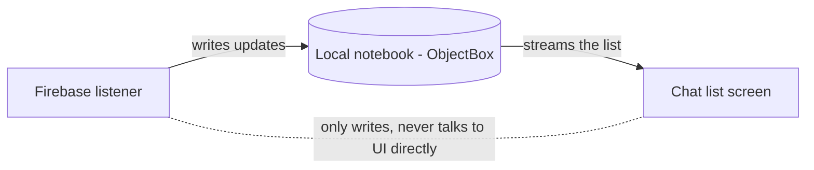

# Conversations List - Explained Simply

The plain-language version of [[Conversations List]]. How the chat list stays instant and always
up to date.

(Teaching comments only; the real source has none.)

---

## The big idea in one sentence

The list you see is read from a local notebook on your phone (so it shows instantly, even
offline), while a background courier keeps rewriting that notebook whenever the server changes.

Analogy: you read your address book (fast, always available). A helper quietly updates the
address book behind you whenever someone new writes in. You never wait for the helper.

---

## Step by step: what happens to the data

1. The screen asks for conversations: `getConversationsUseCase()` -> the repository's
   `getAllConversations()` (`data/repository/ConversationRepositoryImpl.kt:33`).

2. That function starts TWO helpers at once:
   - a local reader that streams rows straight from the ObjectBox notebook to the screen,
   - a remote listener that watches Firebase and writes any changes into the notebook.

3. The screen only ever listens to the local reader. So it paints immediately from what is already
   on the phone.

4. When Firebase has news (new message preview, a conversation removed), the remote helper writes
   it into the notebook, which makes the local reader emit again, which repaints the screen.

5. For each row, the app also fetches the other person's online dot and avatar in the background
   and adds them to the state.

---

## Picture: two sources, one screen



---

## The code, with plain-English comments

Merging the two sources (`data/repository/ConversationRepositoryImpl.kt:32`):

```kotlin
override fun getAllConversations(): Flow<List<Conversation>> = channelFlow {
    // Helper 1: keep the notebook fresh from the server.
    val remoteJob = launch {
        firestoreService.getAllConversations(userId).collect { sync ->
            sync.conversations.forEach { upsert(it) }         // write/update local rows
            if (!sync.fromCache) prune(sync.removedIds)       // delete rows the server removed
        }
    }
    // Helper 2: stream the local notebook to the screen. This is the ONLY thing the UI sees.
    val localJob = launch {
        conversationBox.query().orderDesc(...).build().asFlow()
            .map { rows -> rows.map { it.toDomain() } }
            .collect { send(it) }                             // push the list to the UI
    }
    awaitClose { remoteJob.cancel(); localJob.cancel() }      // both stop when the screen leaves
}
```

Keeping the unread badge honest (`ConversationRepositoryImpl.kt:244`):

```kotlin
// Trust whichever unread count is bigger: what the server says, or what we counted locally.
// This avoids the badge briefly showing 0 before the server catches up.
incoming.unreadCount = maxOf(serverUnread, localUnread(conversation.id, me))
```

---

## A worked example

- You are offline on the bus. You open the app: the list appears instantly from the notebook.
- Bob sends you a message. When your phone gets signal, the remote helper writes Bob's new
  preview into the notebook -> your list re-sorts Bob to the top by itself.
- You swipe Bob's row and pick "Delete for me": the app hides it for you only (writes a
  `clearedAt` marker on the server) - Bob still has the chat. "Delete for everyone" removes the
  whole conversation for both of you. See [[Conversations List]] for the exact rules.

---

## Why, in one line each

- Why read from a local notebook? So the list is instant and works offline; the network is never
  on the critical path.
- Why two helpers in one function? One keeps data fresh, one shows it; the screen only depends on
  the "show it" half, so it never blocks on the network.
- Why `max(serverUnread, localUnread)`? So the unread badge never flickers to a wrong value while
  the server is catching up.

---

## Related

[[Conversations List]] - [[Conversations List - Code]] - [[Chat and Messaging - Explained Simply]] -
[[Reading the Code - Simple Patterns]] - [[Home]]
