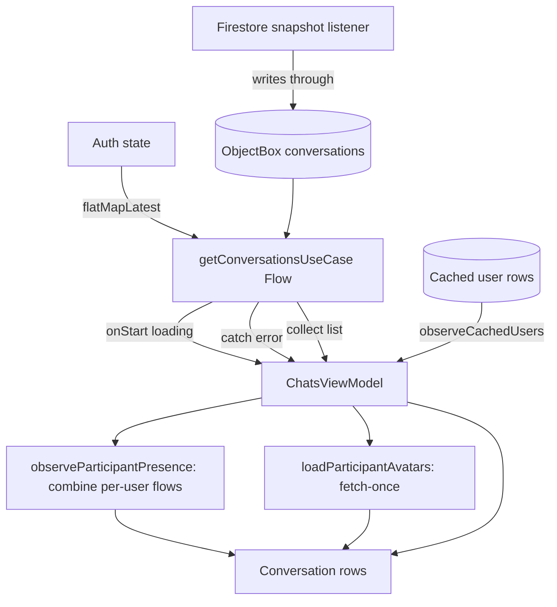

# Conversations List

The chats tab: an offline-first list of conversations with live previews, per-participant
presence and avatars, unread counts, and swipe actions including the two deletion modes. The list
scrolls under the floating top and tab bars.

## Pieces

- `ChatsViewModel` (`presentation/screens/chats/ChatsViewModel.kt:37`, formerly
  `ConversationsViewModel`) - plain `ViewModel` with a `MutableStateFlow<ConversationsUiState>`
  (the method-and-StateFlow style, see [[Presentation Layer (MVI)]]).
- Use cases (`domain/usecase/conversation/`): `GetConversationsUseCase`,
  `SyncConversationsUseCase`, `CreateConversationUseCase`, `DeleteConversationUseCase`,
  `DeleteConversationForEveryoneUseCase`, `ClearConversationForMeUseCase`,
  `MarkConversationAsReadUseCase`, `MarkConversationAsUnreadUseCase`.
- `ConversationRepositoryImpl` (`IConversationRepository`) and `ConversationReconciler` in
  `data/repository/`.
- UI: `presentation/screens/chats/` (`ChatsScreen`, `ChatsTabContent`, `ChatsList`, `ChatsEmpty`,
  `ChatsError`, `ChatsLoading`, `ConversationsListPreview`), rows in
  `presentation/components/list/` (`ConversationListItem`, `SwipeableConversationRow`).

## Loading the list

`loadConversations` (`ChatsViewModel.kt:84`) runs the conversation stream inside `flatMapLatest`
over auth state, with loading/error framing:

```kotlin
observeAuthStateUseCase()
    .flatMapLatest { user ->
        if (user == null) {
            flowOf(emptyList())
        } else {
            getConversationsUseCase()
                .onStart { _uiState.update { it.copy(isLoading = true) } }
        }
    }
    .catch { e ->
        _uiState.update {
            it.copy(
                isLoading = false,
                error = e.message?.toUiText()
            )
        }
    }
    .collect { conversations ->
        _uiState.update {
            it.copy(isLoading = false, conversations = conversations, error = null)
        }
        observeParticipantPresence(conversations)
        loadParticipantAvatars(conversations)
    }
```

The underlying stream is the local ObjectBox conversation query (offline-first, see
[[Data Layer]]), refreshed by a Firestore snapshot listener
(`FirestoreService.getAllConversations`, `data/remote/firebase/FirestoreService.kt:504`) that
also reports removed ids and cache state. `onStart` seeds the spinner; `catch` degrades to an
error state rather than crashing the collect. On every emission the ViewModel fans out to load
presence and avatars for the participants.

Why `flatMapLatest` over auth state: `ChatsViewModel` is scoped to the Activity, so it outlives a
logout. Before, its Firestore listener kept running on the old uid and could write the old
account's conversations back into ObjectBox after logout had reset it. Now signing out switches
the inner flow to `flowOf(emptyList())`, which cancels the listener and clears the list.

## Peer identity: live user rows, not frozen arrays

`Conversation.participantNames` and `participantAvatars` are written once when the conversation
is created and never rewritten. Showing them directly meant a renamed peer never updated and a
deleted account kept its old name and photo. The list now reads peers from the cached user rows:

- `observeParticipants` (`ChatsViewModel.kt:67`) collects `userRepository.observeCachedUsers()`
  into `ConversationsUiState.participants`.
- `ChatsList` (`presentation/screens/chats/ChatsList.kt`) picks the live `participant` for each
  row, falls back to the frozen arrays only until the live value arrives, and computes
  `partnerDeleted = participant?.deleted == true`. A deleted peer is named "Unknown user" via
  `resolveDisplayName(..., deleted = true)`, gets no avatar URL (a neutral silhouette), and
  `ConversationListItem` hides their presence.

## Presence and avatars per row

- `observeParticipantPresence` (`ChatsViewModel.kt:158`) cancels any previous `presenceJob`,
  collects the distinct set of other participants'
  `observeUserPresenceUseCase.observeMultiple(...)` (a `combine` of per-user presence flows, see
  [[Presence and Typing]]), and writes a `presenceMap` into state. Cancelling the prior job before
  resubscribing prevents leaking an observer for a stale participant set.
- `loadParticipantAvatars` (`ChatsViewModel.kt:113`) first seeds avatar URLs already embedded in
  the conversation (`participantAvatars`), then fetches any not-yet-known user via
  `userRepository.getUserById`, tracking `fetchedUserIds` so each user is fetched once (a failed
  fetch is retried next time).
- `observeAliases` (`ChatsViewModel.kt:75`) refreshes and observes contact aliases so a locally
  renamed contact shows the custom name.

## Scrolling under the floating bars

The list fills the whole screen and starts under the floating top bar: `ChatsList` gives the
`LazyColumn` `contentPadding(top = topInset, bottom = 116.dp or 96.dp)` depending on whether the
tab bar sits at the bottom. Because the content now begins under the bar, the pull-to-refresh
indicator is passed explicitly and padded by the same `topInset`, so the spinner appears below
the bar instead of behind it.

## Creating a conversation

`createConversation(participantId)` (`ChatsViewModel.kt:229`) calls `CreateConversationUseCase`,
which finds an existing 1:1 conversation (`FirestoreService.findExistingConversation`,
`FirestoreService.kt:411`) or creates one seeded with `visibleTo = participantIds`
(`FirestoreService.createConversation`, `:434`). Starting a conversation with a deleted account
is refused in the repository ("Cannot start a conversation with a deleted account",
`data/repository/ConversationRepositoryImpl.kt:102`-`:104`). Search-driven creation happens through `SearchResultsOverlay` (see
[[Search and Suggestions]]), which then navigates to the chat.

## Deletion: for-me vs for-everyone

Three distinct operations, mirrored at the message level in [[Chat and Messaging]]:

- `deleteForMe(conversationId)` (`ChatsViewModel.kt:197`) -> `ClearConversationForMeUseCase` ->
  `FirestoreService.clearConversationForMe` (`FirestoreService.kt:455`-`:464`): writes
  `clearedAt.{uid} = now` and removes the uid from `visibleTo`. The conversation disappears from
  this user's list and messages before the cutoff are hidden locally (`clearedAtForMe` on
  `ObxConversation`, used as the message cutoff in `MessageRepositoryImpl.cutoffFor`,
  `data/repository/MessageRepositoryImpl.kt:47`). The other participant is unaffected.
- `deleteForEveryone(conversationId)` (`ChatsViewModel.kt:205`) ->
  `DeleteConversationForEveryoneUseCase` -> deletes the conversation document for all
  participants.
- `deleteConversation(conversationId)` (`ChatsViewModel.kt:179`) -> `DeleteConversationUseCase` ->
  `FirestoreService.deleteConversation` (`FirestoreService.kt:445`) hard-deletes the document. No
  composable in `presentation/` calls this ViewModel method; the edit-chats screen reaches the same
  use case through `EditChatViewModel.deleteSelected` (`presentation/screens/editchat/EditChatViewModel.kt:56`).

`SwipeableConversationRow` surfaces for-me and for-everyone deletion (for-everyone only on
one-on-one rows, `isOneOnOne`, `ChatsList.kt:106`), plus mark read / mark unread
(`ChatsViewModel.kt:213`, `:221`) and Edit, as swipe actions.

## Refresh and errors

`refresh` (`ChatsViewModel.kt:247`) toggles `isRefreshing` around `syncConversationsUseCase()` (a
one-shot server pull, `fetchAllConversationsOnce`, `FirestoreService.kt:486`, uses
`Source.SERVER`). `clearError` resets the error field.

## Feature flag

The list's actions are individually switchable (see [[Feature Flags and Remote Config]]):
`CHAT_LIST_SWIPE_ACTIONS` is the parent of `CHAT_LIST_MARK_READ`, `CHAT_LIST_DELETE`,
`CHAT_LIST_DELETE_FOR_EVERYONE` and `CHAT_LIST_EDIT`; `CHAT_LIST_PULL_REFRESH` stands alone. Each is
enforced twice:

- UI: `SwipeableConversationRow` reads `CHAT_LIST_EDIT`, `CHAT_LIST_MARK_READ`, `CHAT_LIST_DELETE`
  and (on one-on-one rows only) `CHAT_LIST_DELETE_FOR_EVERYONE`
  (`presentation/components/list/SwipeableConversationRow.kt:77`-`:80`); an action button is shown
  only if one of its flags is on, and the row cannot be swiped at all when no action remains
  (`:81`-`:85`). `ChatsList` passes `enabled = pullEnabled` to `pullToRefresh` from
  `CHAT_LIST_PULL_REFRESH` (`presentation/screens/chats/ChatsList.kt:51`, `:58`).
- ViewModel: `ChatsViewModel.deleteForMe` (`:198`), `deleteForEveryone` (`:206`), `markAsRead` and
  `markAsUnread` (`:214`, `:222`, both on `CHAT_LIST_MARK_READ`) and `refresh` (`:248`) return early
  through `featureFlags.refuses(...)`. `EditChatViewModel.deleteSelected` and `markAllRead`
  (`EditChatViewModel.kt:57`, `:66`) check `CHAT_LIST_EDIT`. `retry()` and `createConversation`
  have no flag check.

## Why this design

- Offline-first: the list renders from ObjectBox immediately and updates live as the Firestore
  listener writes through; no blank-while-loading after first run.
- Fanning presence/avatar loading out of the list stream keeps the row data current without
  bloating the conversation documents.
- Reading peers from live user rows instead of the denormalised arrays means renames and account
  deletions reach the list without rewriting every conversation.
- `visibleTo` + `clearedAt` implement per-user deletion without server-side per-user copies of
  the conversation, and reuse the same cutoff mechanic the message stream already honours.

## Visualization



## Related

[[Chat and Messaging]] - [[Presence and Typing]] - [[Data Layer]] - [[Feature Flags and Remote Config]] -
[[Presentation Layer (MVI)]] - [[Navigation]] - [[Search and Suggestions]] - [[Settings]] -
[[Conversations List - Basic Example]]
