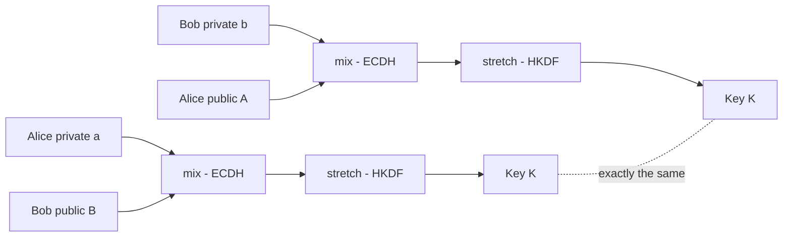
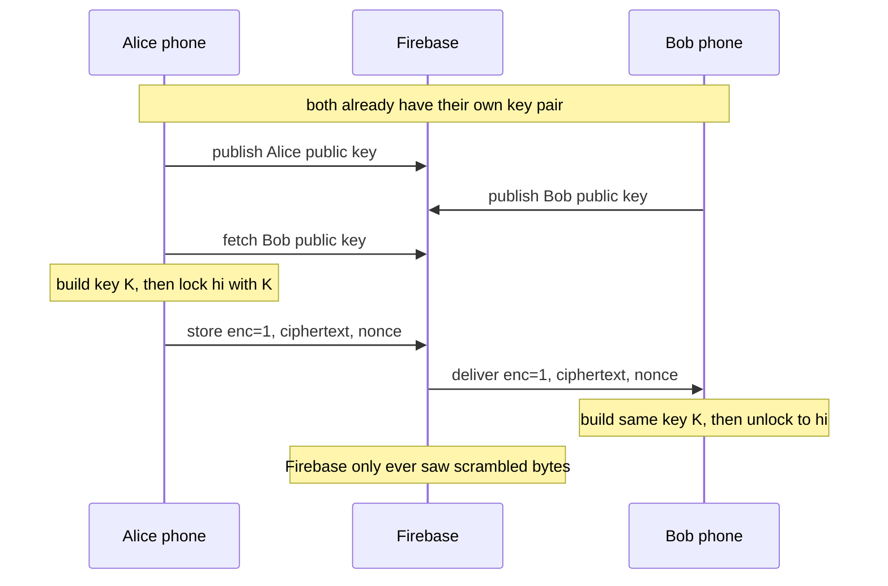

# End-to-End Encryption - Explained Simply

A beginner-friendly version of [[End-to-End Encryption]]. No crypto background needed. We follow
one message - Alice sends the word `hi` to Bob - and watch exactly what happens to the data.

(The comments in the code blocks are teaching comments for this doc only. The real source has no
comments.)

---

## The big idea in one sentence

Alice and Bob can turn a message into scrambled nonsense that only the two of them can turn back,
and the scrambling key is never sent anywhere - each phone builds the same key on its own.

Analogy: imagine Alice and Bob can each mix paint. Alice mixes her secret color with Bob's public
color. Bob mixes his secret color with Alice's public color. By a bit of math magic, both end up
with the exact same final color - without ever mailing their secret color to each other. That
final color is the key. Firebase (the mail carrier) only ever sees a locked box, never the key.

---

## Step by step: what happens to the data

Alice types `hi` and hits send. Here is the journey, with the real function names.

1. Each phone already has a key pair - a private key (secret, stays on the phone) and a public
   key (shareable). Made once and stored, in `IdentityKeyStore.getOrCreate`
   (`data/crypto/IdentityKeyStore.kt:16`). The private key is locked in the Android Keystore
   (`KeystoreKeyWrapper`) so even the phone's files do not hold it in the clear.

2. Alice needs Bob's public key. She fetches it from Firebase (where Bob published it) and caches
   it: `PeerKeyRegistry.ensurePeerKey` (`data/crypto/PeerKeyRegistry.kt:64`).

3. Alice builds the shared key K. She combines her private key with Bob's public key
   (this step is called ECDH), then runs the result through a "key stretcher" (HKDF):
   `ConversationCrypto.deriveConversationKey` (`data/crypto/ConversationCrypto.kt:25`).

4. Alice locks the message. She puts `hi` into a small package (`MessagePayload`), then encrypts
   it with key K using AES-GCM: `ConversationCrypto.encrypt`
   (`data/crypto/ConversationCrypto.kt:46`). Out comes ciphertext (scrambled bytes) plus a random
   `nonce` (a one-time number so the same text never looks the same twice).

5. Alice sends the locked box, not the message. What actually goes to Firebase is a
   `RemoteMessageDto` where the readable fields are blanked and `enc = 1`, with `ciphertext`,
   `nonce`, and which key versions were used - built in `E2eeMessageCodec.encode`
   (`data/crypto/E2eeMessageCodec.kt:38`). The word `hi` is nowhere in it.

6. Firebase stores and forwards the box. It cannot read it - it has no key.

7. Bob receives the box and builds the same key K. He combines his private key with Alice's
   public key, runs HKDF, and gets the identical K (that is the magic - swapping whose
   private/public goes in gives the same answer). Then he decrypts:
   `E2eeMessageCodec.decode` -> `decryptPayload` -> `ConversationCrypto.decrypt`
   (`data/crypto/E2eeMessageCodec.kt:94`).

8. Bob reads `hi`. If anything is wrong (missing key, tampered box), Bob's phone first fetches
   Alice's published key once more and retries; if that still fails it does not crash - it shows
   a placeholder `"Message cannot be decrypted on this device"` instead (`undecryptable`,
   `E2eeMessageCodec.kt:169`).

---

## Picture 1: both phones build the SAME key without sending it



Both paths end at the same Key K. Neither private key ever left its phone.

## Picture 2: only scrambled bytes travel



---

## The code, with plain-English comments

Building the key (`data/crypto/ConversationCrypto.kt:25`):

```kotlin
fun deriveConversationKey(myPrivateKey, peerPublicKey, myUid, peerUid, myEpoch, peerEpoch): ByteArray {
    // 1) ECDH: mix MY private key with THEIR public key.
    //    Bob doing the same with the roles swapped gets the identical "shared" value.
    val shared = X25519.computeSharedSecret(myPrivateKey, peerPublicKey)

    // 2) Sort the two user ids/epochs so BOTH phones use the same salt+label,
    //    no matter who is "me". (Without sorting, the two sides would build different keys.)
    val (loUid, hiUid) = if (myUid < peerUid) myUid to peerUid else peerUid to myUid

    val salt = sha256("$loUid|$hiUid")

    // 3) HKDF turns the raw shared value into a proper 32-byte AES key.
    return Hkdf.computeHkdf("HMACSHA256", shared, salt, "msgr-e2ee-v1|$loEpoch|$hiEpoch", 32)
}
```

Locking the message (`data/crypto/ConversationCrypto.kt:46`):

```kotlin
fun encrypt(key, plaintext, aad): EncryptedBlob {
    // A fresh random nonce every time, so encrypting "hi" twice looks different both times.
    val nonce = randomBytes(12)
    val cipher = Cipher.getInstance("AES/GCM/NoPadding")
    cipher.init(ENCRYPT_MODE, key, GCMParameterSpec(128, nonce))

    // AAD = extra facts (conversation id, message id, sender) stapled to the box but NOT hidden.
    // If anyone changes those facts, unlocking fails. It stops a box being replayed elsewhere.
    cipher.updateAAD(aad)

    return EncryptedBlob(nonce, cipher.doFinal(plaintext)) // nonce + scrambled bytes
}
```

What gets sent (`data/crypto/E2eeMessageCodec.kt:73`):

```kotlin
return plain.copy(
    text = "",                 // the readable text is WIPED
    replyToText = null,
    enc = 1,                   // "this message is encrypted"
    ciphertext = b64(blob.ciphertext), // the scrambled bytes (base64 text)
    nonce = b64(blob.nonce),
    senderEpoch = identity.epoch,      // which key VERSION Alice used
    recipientEpoch = peer.epoch,       // which key VERSION of Bob's she used
    recipientId = partnerId,
)
```

Unlocking on Bob's side (`data/crypto/E2eeMessageCodec.kt:94`):

```kotlin
suspend fun decode(dto): Message {
    if (dto.enc != 1) return dto.toDomain()  // not encrypted -> read as-is

    // Try to unlock. If it fails, refetch Alice's key once and try again. Still no? Don't crash:
    val payload = runCatching { decryptPayload(dto) }.getOrNull()
        ?: runCatching { retryWithFreshPeerKey(dto) }.getOrNull()
        ?: return undecryptable(dto)         // "Message cannot be decrypted on this device"

    return dto.copy(text = payload.text).toDomain()  // success -> the real "hi"
}
```

---

## A tiny worked example (toy numbers)

Real keys are 256-bit numbers; here are baby numbers just to feel the "same key from swapped
inputs" trick. Pretend "mixing" two numbers means multiplying them.

- Alice private = 7, Alice public = 7 (pretend). Bob private = 5, Bob public = 5.
- Alice builds: her private 7 mixed with Bob's public 5 = 7 x 5 = 35.
- Bob builds: his private 5 mixed with Alice's public 7 = 5 x 7 = 35.
- Both got 35. That 35 becomes key K. Nobody sent "35" - each computed it.

Now Alice locks `hi` with 35 (pretend lock = shift each letter by K):
- `h` and `i` scrambled with 35 -> say `R7` (garbage).
- Firebase stores `R7`. Someone snooping sees `R7` and key = unknown. Useless.
- Bob also has 35, applies the reverse -> `hi`.

Real AES-GCM is far stronger than "shift by a number", but the shape is exactly this: same key on
both ends, only garbage in the middle.

---

## What Firebase can and cannot see

| Firebase sees | Firebase does NOT see |
|---|---|
| `enc = 1` (it is encrypted) | the text `hi` |
| `ciphertext` = scrambled bytes | key K (never sent) |
| `nonce`, key version numbers | either private key |
| who sent to whom, and when | the reply text, media blur previews |

Note: metadata (who/when) is not hidden - only the content is. See the caveats in
[[End-to-End Encryption]].

---

## Four "why" questions, answered in one line each

- Why a nonce? So the same message never produces the same ciphertext twice.
- Why AAD? It staples the message's identity to the box; tampering makes unlocking fail.
- Why epochs (key versions)? So a phone can change its key later and old messages still open,
  because each message records which versions it used.
- Why the "Message cannot be decrypted on this device" placeholder? A missing or bad key should
  show a harmless, honest placeholder, never crash the chat.

---

## Related

[[End-to-End Encryption]] - [[End-to-End Encryption - Code]] -
[[Reading the Code - Simple Patterns]] - [[Chat and Messaging]] - [[Home]]
