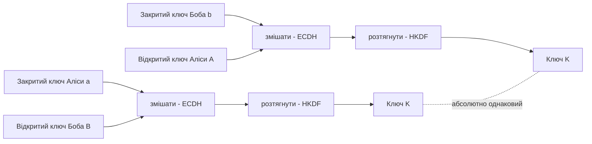
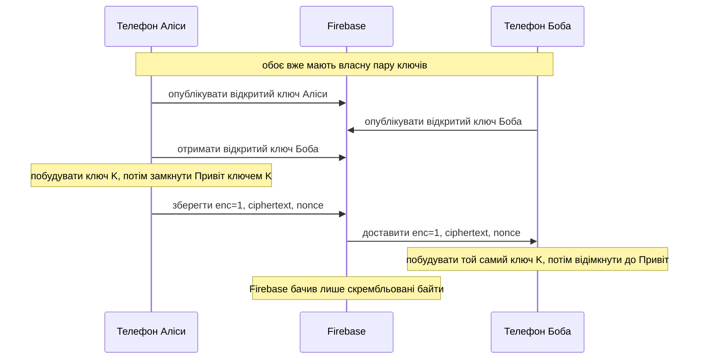

---
tags:
  - _UA
---
# Наскрізне шифрування - Простими словами

Версія [[End-to-End Encryption_UA|Наскрізне шифрування]] для початківців. Криптографічний бекґраунд
не потрібен. Ми йдемо за одним повідомленням - Аліса надсилає слово `Привіт` Бобу - і дивимося, що
саме відбувається з даними.

(Коментарі в блоках коду - навчальні, лише для цієї нотатки. У справжньому джерелі коментарів немає -
див. [[End-to-End Encryption - Code|End-to-End Encryption - Code]].)

---

## Сім слів, без математики

Далі трапляються слова на кшталт *шифр*, *nonce*, *сіль* та *X25519*. Жодне з них не складне, щойно
з'явиться повсякденний відповідник. Кожне слово - що це, аналогія і навіщо воно нам.

- **Відкритий і закритий ключ (пара).** Два числа, що йдуть у парі. Закритий - ваш секрет, ніколи не
  залишає телефон; відкритий ви роздаєте всім. *Це як відкритий навісний замок, який ви роздаєте:
  замкнути ним скриньку може будь-хто, а відчинити - лише ваш закритий ключ.* Навіщо: щоб хтось міг
  надіслати вам повідомлення, яке відкриєте тільки ви, без попередньої зустрічі для обміну секретом.

- **X25519 (рукостискання).** Математика («Діффі-Геллман»), де двоє поєднують *мій закритий + твій
  відкритий* і обоє отримують однакове секретне число - при цьому саме число ніколи не передається.
  *Це як змішування фарб: кожен додає свій таємний колір до спільного відкритого, ви обмінюєтеся, і
  обоє отримуєте однаковий відтінок; той, хто підглянув, відтворити його не може.* Навіщо: щоб
  домовитися про спільний секрет через мережу, яку сервер бачить, але не може вивідати.

- **Шифр / AES-256-GCM (скремблер).** Шифр - метод, що перетворює читабельний текст на беззмістовні
  байти й назад за допомогою ключа. AES - конкретно наш; 256 - розмір ключа (астрономічно великий);
  GCM - режим, який *ще й* виявляє підробку. *Це як скринька із замком і пломбою.* Навіщо: щоб
  приховати сам текст і довести, що його не змінили дорогою.

- **Ключ (спільний секрет).** Одне секретне число, яким і замикають, і відмикають скриньку. Тут це
  32-байтовий результат рукостискання; один ключ виконує обидві дії - це й означає «симетричний».
  *Це як ключ від дому, що є у вас і однієї довіреної людини.* Навіщо: щоб «нагодувати» шифр - без
  нього ні зашифрування, ні розшифрування.

- **Nonce («число, вжите один раз»).** Свіже випадкове значення на кожне окреме повідомлення; не
  секретне, зберігається поряд із шифротекстом. *Це як випадкова наліпка на конверті перед
  запечатуванням - надішліть «Привіт» двічі, і два конверти виглядатимуть по-різному.* Навіщо: щоб не
  витікали закономірності; повторне використання з тим самим ключем послабило б AES-GCM.

- **HKDF (блендер ключів).** Сире число з рукостискання не зовсім придатне бути ключем. HKDF проганяє
  його через «блендер» і видає чистий, рівно 32-байтовий, рівномірно-випадковий ключ. *Це як
  переплавити грубу руду на точно виточений ключ.* Навіщо: перетворити результат рукостискання на
  повноцінний ключ і вмішати контекст (див. сіль), щоб різні розмови мали різні ключі.

- **Сіль (salt).** Несекретний додатковий інгредієнт, що вмішується у «блендер»; тут будується з двох
  ідентифікаторів користувачів, тож кожна пара людей отримує окремий ключ навіть із того самого
  рукостискання. *Це як вибити назву розмови на металі, щоб жодні два ключі не збіглися випадково.*
  Навіщо: гарантувати, що ключ однієї розмови ніколи не буде вжито для іншої.

---

## Велика ідея одним реченням

Аліса й Боб можуть перетворити повідомлення на скрембльовану нісенітницю, яку розкодувати можуть лише
вони двоє, і ключ шифрування ніколи нікуди не надсилається - кожен телефон будує однаковий ключ сам.

Аналогія: уявіть, що Аліса й Боб уміють змішувати фарбу. Аліса змішує свій таємний колір із відкритим
кольором Боба. Боб змішує свій таємний колір із відкритим кольором Аліси. Завдяки математичній магії
обоє отримують абсолютно однаковий фінальний колір - жодного разу не надіславши одне одному свій
таємний колір. Цей фінальний колір і є ключем. Firebase (листоноша) завжди бачить лише замкнену
скриньку, ніколи - ключ.

---

## Крок за кроком: що відбувається з даними

Аліса вводить `Привіт` і натискає «надіслати». Ось шлях, зі справжніми назвами функцій.

1. Кожен телефон уже має пару ключів - закритий (секрет, лишається на телефоні) і відкритий (можна
   ділитися). Створюється один раз, коли в акаунта ще немає ключа, `E2eeBootstrap` і зберігається в
   `IdentityKeyStore` (`data/crypto/IdentityKeyStore.kt:12`) як невелика зв'язка з одним ключем на епоху. Закритий ключ замкнено в Android Keystore
   (`KeystoreKeyWrapper`), тож навіть файли телефона не тримають його у відкритому вигляді.

2. Алісі потрібен відкритий ключ Боба. Вона отримує його з Firebase (де Боб його опублікував) і кешує:
   `PeerKeyRegistry.ensurePeerKey` (`data/crypto/PeerKeyRegistry.kt:26`).

3. Аліса будує спільний ключ K. Вона поєднує свій закритий ключ із відкритим ключем Боба (цей крок
   зветься ECDH), потім проганяє результат через «розтягувач ключа» (HKDF):
   `ConversationCrypto.deriveConversationKey` (`data/crypto/ConversationCrypto.kt:25`).

4. Аліса замикає повідомлення. Вона кладе `Привіт` у невеликий пакунок (`MessagePayload`), потім шифрує
   його ключем K через AES-GCM: `ConversationCrypto.encrypt` (`data/crypto/ConversationCrypto.kt:46`).
   На виході - шифротекст (скрембльовані байти) плюс випадковий `nonce` (одноразове число, щоб той
   самий текст ніколи не виглядав однаково двічі).

5. Аліса надсилає замкнену скриньку, а не повідомлення. У Firebase насправді летить `RemoteMessageDto`,
   де читабельні поля стерто, `enc = 1`, разом із `ciphertext`, `nonce` і тим, які версії ключів
   використано - будується в `E2eeMessageCodec.encode` (`data/crypto/E2eeMessageCodec.kt:38`). Слова
   `Привіт` там немає ніде.

6. Firebase зберігає й пересилає скриньку. Прочитати її він не може - у нього немає ключа.

7. Боб отримує скриньку й будує той самий ключ K. Він поєднує свій закритий ключ із відкритим ключем
   Аліси, проганяє через HKDF і дістає ідентичний K (у цьому й магія - помінявши місцями, чий
   закритий/відкритий іде на вхід, отримуємо ту саму відповідь). Потім розшифровує:
   `E2eeMessageCodec.decode` -> `decryptPayload` -> `ConversationCrypto.decrypt`
   (`data/crypto/E2eeMessageCodec.kt:94`).

8. Боб читає `Привіт`. Якщо щось не так (відсутній ключ, підроблена скринька), Боб не крашиться - він
   показує заглушку `"Message cannot be decrypted on this device"` натомість (`undecryptable`,
   `E2eeMessageCodec.kt:169`).

---

## Малюнок 1: обидва телефони будують ОДНАКОВИЙ ключ, не надсилаючи його



Обидва шляхи закінчуються на тому самому ключі K. Жоден закритий ключ не покидав свій телефон.

## Малюнок 2: подорожують лише скрембльовані байти



---

## Робочий приклад: як «Привіт» змінює форму

Ті самі кроки, але видно, що стає з даними на кожній стадії. Значення - ілюстративні, це не справжній
шифротекст.

| # | Стадія | Що це виглядає як |
|---|---|---|
| 1 | Відкритий текст (те, що ви ввели) | `Привіт` |
| 2 | `MessagePayload`, серіалізований у JSON-байти | `{"text":"Привіт","replyToText":null,"media":[]}` |
| 3 | Спільний ключ AES (ніколи не надсилається) | `key = 9f2a c4b1 ... e1c0` (32 байти) |
| 4 | Свіжий випадковий nonce + AAD | `nonce = 3a f0 ... 3a` (12 байтів); `aad = "cid_42\|msg_88\|uid_alice\|TEXT"` |
| 5 | Запечатування AES-256-GCM | `ciphertext+tag = k7Yx2p...9fQ==` (непрозорий; додано 16-байтовий тег) |
| 6 | Документ у Firestore | `{ enc:1, text:"", ciphertext:"k7Yx2p...9fQ==", nonce:"OvCx...9aY=", senderEpoch:3, recipientEpoch:2 }` |

Справжній AES-GCM набагато сильніший, але форма саме така: однаковий ключ на обох кінцях, лише
беззмістовність посередині.

---

## Код, з поясненнями простою мовою

Побудова ключа (`data/crypto/ConversationCrypto.kt:25`):

```kotlin
fun deriveConversationKey(myPrivateKey, peerPublicKey, myUid, peerUid, myEpoch, peerEpoch): ByteArray {
    // 1) ECDH: змішати МІЙ закритий ключ із ЇХНІМ відкритим.
    //    Боб, роблячи те саме з поміняними ролями, отримує ідентичне значення "shared".
    val shared = X25519.computeSharedSecret(myPrivateKey, peerPublicKey)

    // 2) Відсортувати два id/епохи, щоб ОБИДВА телефони вжили однакові сіль+мітку,
    //    незалежно від того, хто "я". (Без сортування сторони побудували б різні ключі.)
    val (loUid, hiUid) = if (myUid < peerUid) myUid to peerUid else peerUid to myUid

    val salt = sha256("$loUid|$hiUid")

    // 3) HKDF перетворює сире значення shared на повноцінний 32-байтовий ключ AES.
    return Hkdf.computeHkdf("HMACSHA256", shared, salt, "msgr-e2ee-v1|$loEpoch|$hiEpoch", 32)
}
```

Замикання повідомлення (`data/crypto/ConversationCrypto.kt:46`):

```kotlin
fun encrypt(key, plaintext, aad): EncryptedBlob {
    // Свіжий випадковий nonce щоразу, тож зашифрувати "Привіт" двічі - виглядає по-різному обидва рази.
    val nonce = randomBytes(12)
    val cipher = Cipher.getInstance("AES/GCM/NoPadding")
    cipher.init(ENCRYPT_MODE, key, GCMParameterSpec(128, nonce))

    // AAD = додаткові факти (id розмови, id повідомлення, відправник), пришиті до скриньки, але НЕ приховані.
    // Якщо хтось змінить ці факти, відмикання провалиться. Це не дає "відтворити" скриньку деінде.
    cipher.updateAAD(aad)

    return EncryptedBlob(nonce, cipher.doFinal(plaintext)) // nonce + скрембльовані байти
}
```

Що надсилається (`data/crypto/E2eeMessageCodec.kt:73`):

```kotlin
return plain.copy(
    text = "",                 // читабельний текст СТЕРТО
    replyToText = null,
    enc = 1,                   // "це повідомлення зашифроване"
    ciphertext = b64(blob.ciphertext), // скрембльовані байти (текст base64)
    nonce = b64(blob.nonce),
    senderEpoch = identity.epoch,      // яку ВЕРСІЮ ключа вжила Аліса
    recipientEpoch = peer.epoch,       // яку ВЕРСІЮ ключа Боба вона вжила
    recipientId = partnerId,
)
```

Відмикання на боці Боба (`data/crypto/E2eeMessageCodec.kt:94`):

```kotlin
suspend fun decode(dto): Message {
    if (dto.enc != 1) return dto.toDomain()  // не зашифроване -> читати як є

    // Спробувати відімкнути. Провал - ще раз отримати ключ Аліси й спробувати. Знову ні? Не крашитися:
    val payload = runCatching { decryptPayload(dto) }.getOrNull()
        ?: runCatching { retryWithFreshPeerKey(dto) }.getOrNull()
        ?: return undecryptable(dto)         // "Message cannot be decrypted on this device"

    return dto.copy(text = payload.text).toDomain()  // успіх -> справжній "Привіт"
}
```

---

## Що Firebase бачить, а що ні

| Firebase бачить | Firebase НЕ бачить |
|---|---|
| `enc = 1` (воно зашифроване) | текст `Привіт` |
| `ciphertext` = скрембльовані байти | ключ K (ніколи не надсилається) |
| `nonce`, номери версій ключів | жоден із закритих ключів |
| хто кому надіслав і коли | текст відповіді, blur-прев'ю медіа |

Примітка: метадані (хто/коли) не приховуються - приховано лише вміст. Див. застереження в
[[End-to-End Encryption_UA|Наскрізне шифрування]].

---

## Чотири питання «навіщо», по одному рядку

- Навіщо nonce? Щоб те саме повідомлення ніколи не давало той самий шифротекст двічі.
- Навіщо AAD? Пришиває ідентичність повідомлення до скриньки; підробка ламає відмикання.
- Навіщо епохи (версії ключів)? Щоб телефон міг згодом змінити ключ, а старі повідомлення досі
  відкривалися, бо кожне повідомлення записує, які версії вжито.
- Навіщо заглушка «Message cannot be decrypted on this device»? Відсутній чи поганий ключ має
  показувати безневинну й чесну заглушку, а не крашити чат.

---

## Пов'язане

[[End-to-End Encryption_UA|Наскрізне шифрування]] - [[End-to-End Encryption - Code|End-to-End Encryption - Code]] -
[[Chat and Messaging_UA|Чат і обмін повідомленнями]] - [[Data Layer_UA|Шар даних]] -
[[Settings_UA|Налаштування]] - [[Home_UA|Головна]]
