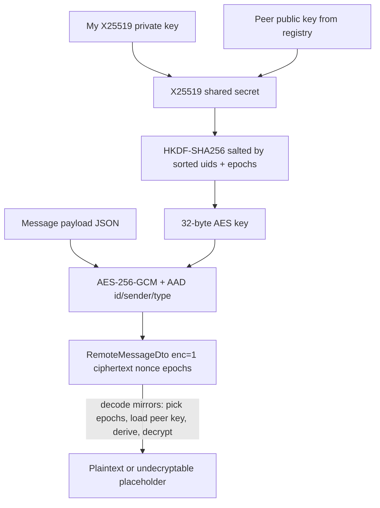

# End-to-End Encryption

Optional per-conversation E2EE for 1:1 chats, built on X25519 key agreement, HKDF key
derivation, and AES-256-GCM. Version marker in the code is `msgr-e2ee-v1`
(`data/crypto/ConversationCrypto.kt:18`). Crypto primitives come from Google Tink
(`tink-android` `1.19.0`, `gradle/libs.versions.toml:49`) plus the platform `javax.crypto`.

## Pieces (`data/crypto/`)

- `ConversationCrypto` (`ConversationCrypto.kt:13`) - the primitive layer (ECDH, HKDF, AES-GCM).
- `E2eeMessageCodec` (`E2eeMessageCodec.kt:18`) - encode/decode a `Message` to/from a
  `RemoteMessageDto`.
- `IdentityKeyStore` - this device's long-term X25519 identity key pair, epoch, and private-key
  wrapping.
- `KeyWrapper` / `KeystoreKeyWrapper` - Android Keystore wrapping of the private key at rest.
- `PeerKeyRegistry` (`PeerKeyRegistry.kt:14`) - publish/fetch/cache peer public keys.
- `E2eeBootstrap` (`E2eeBootstrap.kt:12`) - publishes this device's key at startup.
- `ParticipantResolver` / `ObxParticipantResolver` - resolves the partner uid for a conversation.
- `MediaCipher` - per-file media encryption.
- `SafetyNumber` (`SafetyNumber.kt:6`) - a comparable fingerprint of two identity keys.
- `MessagePayload` / `MediaSecret` / `ClipSecret` (`data/crypto/model/`) - the serialized
  plaintext shape; `messageAad` and the base64 helpers live in `CryptoEncoding.kt`.

DI wiring is in `di/CryptoModule.kt` (see [[Dependency Injection (Hilt)]]).

## Key agreement and derivation

`ConversationCrypto.deriveConversationKey` (`ConversationCrypto.kt:25`):

```kotlin
val shared = X25519.computeSharedSecret(myPrivateKey, peerPublicKey)
val (loUid, hiUid) = if (myUid < peerUid) myUid to peerUid else peerUid to myUid
val (loEpoch, hiEpoch) = if (myUid < peerUid) myEpoch to peerEpoch else peerEpoch to myEpoch
val salt = MessageDigest.getInstance("SHA-256").digest("$loUid|$hiUid".toByteArray())
return Hkdf.computeHkdf("HMACSHA256", shared, salt, "$INFO_PREFIX|$loEpoch|$hiEpoch".toByteArray(), KEY_SIZE)
```

- X25519 ECDH produces a shared secret from my private key and the peer's public key; both sides
  compute the same secret.
- The uids and epochs are sorted so both participants derive an identical salt and info string
  regardless of who is "me" - the key is symmetric to the pair, not to a direction.
- HKDF-SHA256 stretches the raw ECDH secret into a 32-byte AES key, salted by the pair identity
  and bound to the key-pair epochs (so rotating either side's key changes the derived key). This
  is a fresh derivation per message send/receive from cached key material, not a stored session.

## Message encryption (AES-256-GCM with AAD)

`encrypt`/`decrypt` (`ConversationCrypto.kt:46`, `:54`) use `AES/GCM/NoPadding` with a random
12-byte nonce and a 128-bit tag, and bind additional authenticated data:

```kotlin
val aad = messageAad(plain.conversationId, plain.id, plain.senderId, plain.type)
val blob = ConversationCrypto.encrypt(key, json.encodeToString(payload).toByteArray(), aad)
```

The AAD ties the ciphertext to the conversation id, message id, sender, and type
(`messageAad`, `CryptoEncoding.kt:3`; called at `E2eeMessageCodec.kt:71`), so a ciphertext cannot be replayed under a different message
identity without failing the GCM tag check.

## Encoding a message (`E2eeMessageCodec.encode`, `E2eeMessageCodec.kt:38`)

Goal: produce a `RemoteMessageDto` that carries ciphertext instead of plaintext when the
conversation is encryptable, and gracefully fall back to plaintext when it is not.

1. Call messages are never encrypted (they carry no user text) - returned as plain.
2. Resolve the partner (`ParticipantResolver.partnerOf`) and ensure a peer public key
   (`peerKeyRegistry.ensurePeerKey`); if either is missing, send plaintext - unless the message
   already has encrypted media, in which case it refuses to send stranded plaintext
   (`plainOrFail`, `:87`). A voice clip with a file key counts as encrypted media here.
3. Build a `MessagePayload` (text + reply snippet + per-item `MediaSecret` file keys, or for a
   voice clip a `ClipSecret(key, waveform)` from `Clip.toSecret()`, `:119`), derive the
   conversation key, and encrypt the JSON payload.
4. Return the DTO with cleared plaintext fields and `enc = 1`, `ciphertext`, `nonce`,
   `senderEpoch`, `recipientEpoch`, `recipientId`. BlurHashes and a clip's waveform are also
   stripped from the plaintext side and carried inside the encrypted payload. See
   [[Voice Messages]].

## Decoding (`E2eeMessageCodec.decode`, `E2eeMessageCodec.kt:94`)

If `enc != 1`, decode as plaintext. Otherwise `decryptPayload` (`:129`) works out which epochs
apply based on whether this device is the sender or recipient, loads the matching peer key
(`cachedPeerKey` then `peerKeyForEpoch`), derives the key, and decrypts. If anything fails
(missing key, wrong epoch, tag mismatch) it first refetches the peer's published key for that
epoch once (`retryWithFreshPeerKey`, throttled per peer and epoch), and if that also fails returns
an `undecryptable` placeholder message (`:169`) rather than throwing. Since 0.1.13.1 the
placeholder says what happened - "Message cannot be decrypted on this device"
(`UNDECRYPTABLE_TEXT`, `:181`) - instead of the old "Encrypted message".

## Peer key registry and epochs

`PeerKeyRegistry` (`PeerKeyRegistry.kt:14`) stores each user's public keys under Firestore
`users/{uid}/keys/{epoch}` and caches them locally as `ObxPeerKey` rows (unique on
`"uid:epoch"`, `data/local/obx/ObxPeerKey.kt:10`).
- `publishIfNeeded` (`PeerKeyRegistry.kt:20`) uploads this device's current public key/epoch if
  it is not published yet. If that epoch is already published with a different key (a
  regenerated identity restarts at epoch 1), it rotates the local identity to an epoch above the
  server's highest instead of overwriting, so peers holding the old key keep decrypting history.
- `ensurePeerKey` (`:64`) returns a cached key when fresh (< 30 min, `REFRESH_MS`), else fetches
  the latest epoch from Firestore and stores it.
- `peerKeyForEpoch` (`:78`) fetches a specific historical epoch so old messages remain
  decryptable after a rotation; `refreshPeerKey` (`:57`) forces a refetch for the decode retry.
- `setVerified` (`:90`) marks a peer key verified (used by safety-number verification).

Epochs are the rotation mechanism: a new identity key means a new epoch; keys are stored
per-epoch so re-keying does not break history. Startup publish is driven by `E2eeBootstrap`
(`E2eeBootstrap.kt:19`), which on its own `@Singleton` IO scope calls `publishIfNeeded` from
`MessengerApplication.onCreate` (`MessengerApplication.kt:108`).

## Identity keys at rest

`IdentityKeyStore` (constructed at `filesDir/e2ee`, `di/CryptoModule.kt:33`) holds the device's
long-term X25519 key pair and epoch; the private key is wrapped by `KeystoreKeyWrapper` using the
Android Keystore, so it is not stored in the clear. `getOrCreate(uid)` lazily creates the pair on
first use. Deleting the account removes the identity key file (`identity_v1_<uid>.bin`) through
`ISessionCleaner.clearOnDelete`; a plain logout keeps it (see [[Settings]]).

## Media encryption

When a conversation is encryptable, `MediaRepositoryImpl.uploadAndSend`
(`data/repository/MediaRepositoryImpl.kt:148`) generates a per-file key with
`MediaCipher.generateFileKey()`, encrypts the file before upload, and puts the key into the
message's `MediaSecret` payload (so it is itself E2E-protected). Download decrypts with that key
(`downloadMedia`, `:72`). Voice clips use the same per-file scheme through
`ClipRepositoryImpl`, with the key in `ClipSecret`. `MediaCipher.decrypt` writes to a unique
`.part` file and moves it into place atomically, so a failed decrypt never leaves a broken file
under the final name. See [[Chat and Messaging]] and [[Voice Messages]].

## Safety numbers

`SafetyNumber.compute` (`SafetyNumber.kt:11`) derives a comparable fingerprint from the two
users' identity keys: each side is hashed with SHA-512 iterated 5200 times, reduced mod 10^30,
sorted so both users see the same number, and formatted in space-separated groups of five. Two
users comparing safety numbers out of band can confirm no man-in-the-middle. Surfaced via
`SafetyNumberViewModel` / `SafetyNumberSection` on the security screen (see [[Settings]]).

## Why this design

- X25519 + HKDF + AES-GCM is a standard, well-understood E2EE construction; Tink provides
  vetted implementations of the primitives.
- Sorting uids/epochs before deriving keys makes the derivation direction-independent, so both
  clients agree without a handshake round trip.
- Per-epoch key storage plus a graceful "undecryptable" placeholder keep history readable across
  rotations and never crash the chat on a missing key.
- Refusing to downgrade to plaintext when media is already encrypted (`plainOrFail`) prevents
  accidentally leaking content that was meant to be protected.

## Caveats to verify with the maintainer

- This is a v1 scheme (`msgr-e2ee-v1`) for 1:1 conversations; group E2EE is not implemented here.
- Trust-on-first-use: keys are fetched from Firestore and cached; verification is manual via
  safety numbers. The exact rotation/epoch-bump policy beyond what the code shows was not
  captured in source - confirm before documenting it as a guarantee.

## Visualization



## Related

[[Chat and Messaging]] - [[Data Layer]] - [[Dependency Injection (Hilt)]] - [[Settings]] -
[[Notifications]] - [[Async and Reactivity]] - [[End-to-End Encryption - Basic Example]]
