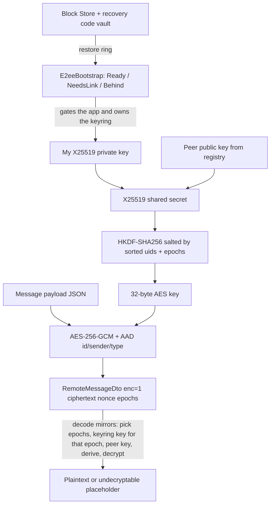

# End-to-End Encryption

Optional per-conversation E2EE for 1:1 chats, built on X25519 key agreement, HKDF key
derivation, and AES-256-GCM. Version marker in the code is `msgr-e2ee-v1`
(`data/crypto/ConversationCrypto.kt:18`). Crypto primitives come from Google Tink
(`tink-android` `1.19.0`, `gradle/libs.versions.toml:50`) plus the platform `javax.crypto`.

## Pieces (`data/crypto/`)

- `ConversationCrypto` (`ConversationCrypto.kt:13`) - the primitive layer (ECDH, HKDF, AES-GCM).
- `E2eeMessageCodec` (`E2eeMessageCodec.kt:18`) - encode/decode a `Message` to/from a
  `RemoteMessageDto`.
- `IdentityKeyStore` (`IdentityKeyStore.kt:12`) - this device's identity **keyring**: one X25519
  key pair per epoch (`IdentityKeyring`, `IdentityKeyring.kt:8`), newest used for sending, wrapped at
  rest.
- `KeyWrapper` / `KeystoreKeyWrapper` - Android Keystore wrapping of the private key at rest.
- `PeerKeyRegistry` (`PeerKeyRegistry.kt:26`) - publish/fetch/cache peer public keys.
- `E2eeBootstrap` (`E2eeBootstrap.kt:28`) - the per-account key lifecycle: decides whether this
  device is `Ready`, needs a recovery code, or is behind (`E2eeState`, `E2eeState.kt:3`).
- Backup and recovery: `BlockStoreIdentityBackup` (`BlockStoreIdentityBackup.kt:16`, Google Block
  Store), `RecoveryVault` / `RecoveryCipher` (`RecoveryVault.kt:57`, `:27`), `RecoveryCode`
  (`RecoveryCode.kt:6`), `RecoveryCodeStore` (`RecoveryCodeStore.kt:8`) and
  `UndecryptableCachePurge` (`UndecryptableCachePurge.kt:13`).
- `ParticipantResolver` / `ObxParticipantResolver` - resolves the partner uid for a conversation.
- `MediaCipher` - per-file media encryption.
- `SafetyNumber` (`SafetyNumber.kt:6`) - a comparable fingerprint of two identity keys.
- `MessagePayload` / `MediaSecret` / `ClipSecret` (`data/crypto/model/`) - the serialized
  plaintext shape; `messageAad` and the base64 helpers live in `CryptoEncoding.kt`.

DI wiring is in `di/CryptoModule.kt` (see [[Dependency Injection (Hilt)]]).

## Key agreement and derivation

`ConversationCrypto.deriveConversationKey` (`ConversationCrypto.kt:25`):

```kotlin
val shared = X25519.computeSharedSecret(myPrivateKey, peerPublicKey)
val (loUid, hiUid) = if (myUid < peerUid) myUid to peerUid else peerUid to myUid
val (loEpoch, hiEpoch) = if (myUid < peerUid) myEpoch to peerEpoch else peerEpoch to myEpoch
val salt = MessageDigest.getInstance("SHA-256").digest("$loUid|$hiUid".toByteArray())
return Hkdf.computeHkdf("HMACSHA256", shared, salt, "$INFO_PREFIX|$loEpoch|$hiEpoch".toByteArray(), KEY_SIZE)
```

- X25519 ECDH produces a shared secret from my private key and the peer's public key; both sides
  compute the same secret.
- The uids and epochs are sorted so both participants derive an identical salt and info string
  regardless of who is "me" - the key is symmetric to the pair, not to a direction.
- HKDF-SHA256 stretches the raw ECDH secret into a 32-byte AES key, salted by the pair identity
  and bound to the key-pair epochs (so rotating either side's key changes the derived key). This
  is a fresh derivation per message send/receive from cached key material, not a stored session.

## Message encryption (AES-256-GCM with AAD)

`encrypt`/`decrypt` (`ConversationCrypto.kt:46`, `:54`) use `AES/GCM/NoPadding` with a random
12-byte nonce and a 128-bit tag, and bind additional authenticated data:

```kotlin
val aad = messageAad(plain.conversationId, plain.id, plain.senderId, plain.type)
val blob = ConversationCrypto.encrypt(key, json.encodeToString(payload).toByteArray(), aad)
```

The AAD ties the ciphertext to the conversation id, message id, sender, and type
(`messageAad`, `CryptoEncoding.kt:3`; called at `E2eeMessageCodec.kt:71`), so a ciphertext cannot be replayed under a different message
identity without failing the GCM tag check.

## Encoding a message (`E2eeMessageCodec.encode`, `E2eeMessageCodec.kt:38`)

Goal: produce a `RemoteMessageDto` that carries ciphertext instead of plaintext when the
conversation is encryptable, and gracefully fall back to plaintext when it is not.

1. Call messages are never encrypted (they carry no user text) - returned as plain.
2. Resolve the partner (`ParticipantResolver.partnerOf`) and ensure a peer public key
   (`peerKeyRegistry.ensurePeerKey`); if either is missing, send plaintext - unless the message
   already has encrypted media, in which case it refuses to send stranded plaintext
   (`plainOrFail`, `:87`). A voice clip with a file key counts as encrypted media here.
3. Build a `MessagePayload` (text + reply snippet + per-item `MediaSecret` file keys, or for a
   voice clip a `ClipSecret(key, waveform)` from `Clip.toSecret()`, `:119`), derive the
   conversation key, and encrypt the JSON payload.
4. Return the DTO with cleared plaintext fields and `enc = 1`, `ciphertext`, `nonce`,
   `senderEpoch`, `recipientEpoch`, `recipientId`. BlurHashes and a clip's waveform are also
   stripped from the plaintext side and carried inside the encrypted payload. See
   [[Voice Messages]].

## Decoding (`E2eeMessageCodec.decode`, `E2eeMessageCodec.kt:94`)

If `enc != 1`, decode as plaintext. Otherwise `decryptPayload` (`:129`) works out which epochs
apply based on whether this device is the sender or recipient, loads **this device's key for the
epoch the message names** from the keyring (`identityKeyStore.keyFor(myUid, myEpoch)`, so anything
sent to an earlier key still in the ring stays readable, including this device's own sent
messages; sending always uses the newest key), loads the matching peer key (`cachedPeerKey` then
`peerKeyForEpoch`), derives the key, and decrypts. If anything fails (missing key, wrong epoch, tag
mismatch) it first refetches the peer's published key for that epoch once
(`retryWithFreshPeerKey`, `:153`, throttled per peer and epoch to once per 5 minutes), and if that
also fails returns an `undecryptable` placeholder message (`:179`) rather than throwing. The
placeholder text (`placeholderFor`, `:168`) says what happened:

- `UNDECRYPTABLE_TEXT` - "Message cannot be decrypted on this device" (`:191`), the generic case;
- `LOCKED_TEXT` - "Sent before your encryption key was reset" (`:192`), when the ring has no key
  for that epoch;
- `BEHIND_TEXT` - "Sent to a newer encryption key that this device doesn't have yet" (`:193`),
  when the message names an epoch newer than anything this device holds.

All three are listed in `PLACEHOLDERS` (`:195`), which `UndecryptableCachePurge.purge`
(`UndecryptableCachePurge.kt:18`) uses: after a key arrives (restore, start fresh, Block Store
install) it removes the cached rows of every conversation that contained a placeholder, except
unsent ones, so they are fetched and decrypted again.

## Peer key registry and epochs

`PeerKeyRegistry` (`PeerKeyRegistry.kt:26`) stores each user's public keys under Firestore
`users/{uid}/keys/{epoch}` and caches them locally as `ObxPeerKey` rows (unique on
`"uid:epoch"`, `data/local/obx/ObxPeerKey.kt:12`).
- `publishIfNeeded` (`:31`) is now a **create-if-absent** transaction that never rotates: it
  returns `Published` when the epoch document did not exist, `AlreadyPublished` when it holds the
  same key, and `Conflict` when it holds a different one (a rules refusal also counts as a
  conflict, `:60`-`:62`). `precheckPublish` (`:167`) refuses to add a new epoch to an account that
  already has keys unless the caller passes `allowNewEpoch` (used only by "start fresh"). Earlier
  versions rotated the local identity above the server's highest epoch on a clash; that behaviour
  is gone, because a second sign-in then overwrote the first device's key and cut it off silently.
- `ensurePeerKey` (`:101`) returns a cached key when fresh (< 30 min, `REFRESH_MS`, `:164`), else
  fetches the latest epoch from Firestore and stores it.
- `peerKeyForEpoch` (`:115`) fetches a specific historical epoch so old messages remain
  decryptable after a rotation; `refreshPeerKey` (`:94`) forces a refetch for the decode retry.
- `publishedKeysOnServer` (`:82`) reads the account's published keys straight from the server and
  `observeNewestKey` (`:65`) listens to the newest one - both feed the bootstrap state machine
  below.
- `setVerified` (`:127`) marks a peer key verified (used by safety-number verification); a changed
  key under the same epoch clears the verified flag (`store`, `:133`-`:137`).

Epochs are the rotation mechanism: a new identity key means a new epoch; keys are stored per-epoch
so re-keying does not break history.

## The key lifecycle: `E2eeBootstrap` and `E2eeState`

`E2eeBootstrap` (`E2eeBootstrap.kt:28`) is a `@Singleton` with its own IO scope and a mutex. It
exposes `status: StateFlow<E2eeStatus>` whose state is one of `Resolving`, `Ready`, `NeedsLink`,
`Behind` (each with `hasVault`) or `Offline` (`E2eeState.kt:3`-`:9`). `MessengerApplication`
calls `e2eeBootstrap.refresh()` at startup (`MessengerApplication.kt:118`) and the auth repository
calls it after a sign-in (`data/repository/AuthRepositoryImpl.kt:69`, `:99`). `resolveLocked`
(`E2eeBootstrap.kt:181`) decides:

1. A local ring exists -> `Ready` and a background `sync` (publish if needed, Block Store backup,
   recovery status). A device remembered as `Behind` first re-checks the server.
2. No local ring: try the Block Store backup, accepted only if it shares a key with what the
   account published; install it and purge placeholders.
3. Still none, and the account already has published keys or a recovery vault -> `NeedsLink`:
   the device waits for a recovery code (or a linked device) instead of creating a key.
4. Only an account with no published key and no vault gets a **new** identity, published as
   epoch 1; if that publish loses a race the key is discarded and the device goes to `NeedsLink`.
5. Any failure becomes `Offline` with a 5 s retry (`:426`).

A `Ready` device also watches the account's newest published key (`watch`, `:269`). If it is a key
this device does not hold it waits a 5 s grace (`BEHIND_GRACE_MS`), re-reads the server and
settles under the lock (`settle`, `:326`): keys the account contradicts or never published are set
aside (with a copy of the old key file kept), then the state becomes `NeedsLink` (no keys left),
`Behind` (older keys only) or stays `Ready`. `Behind` is persisted (`behind_v1_<uid>.bin`) so a
restart cannot let the device back in before it has the newest key.

`AppNavigation` shows `MainDisplay` only for `E2eeState.Ready`; every other state renders
`KeyRestoreScreen`, a gate like the sign-in screen
(`presentation/navigation/graph/AppNavigation.kt:43`-`:60`,
`presentation/screens/recovery/KeyRestoreScreen.kt:45`).

## Recovery: Block Store, recovery code, start fresh

- Block Store backup: after a successful sync the whole ring (newest 50 epochs, `MAX_KEYS`,
  `BlockStoreIdentityBackup.kt:49`) is saved to Google Block Store, so a reinstall on the same
  Google account can restore it without user action.
- Recovery code: `RecoveryCode.generate` (`RecoveryCode.kt:26`) makes a random secret shown as
  base32 with check symbols. `RecoveryCipher.seal` (`RecoveryVault.kt:34`) wraps the whole ring
  with AES-GCM under an HKDF key derived from the code, the uid and a random salt, and
  `RecoveryVault` stores the blob at `users/{uid}/recovery/identity` with `version` 2
  (`RecoveryVault.kt:115`-`:118`, `:142`); version 1 vaults (single key) still open as a one-key
  ring. The saved code is kept locally with a digest of the ring it wrapped
  (`RecoveryCodeStore.kt:32`, file `recovery_v1_<uid>.bin`), and the vault is re-wrapped when the
  ring changes - as a transaction that writes only while this device's code still opens the vault
  (`rewrapAsync`, `RecoveryVault.kt:74`; `rewrapVault`, `E2eeBootstrap.kt:375`).
- Restore: `restoreWithCode` (`E2eeBootstrap.kt:81`) parses the code, opens the vault, requires the
  restored newest key to match the account's published one (otherwise `Outdated`), installs the
  ring, purges placeholders and becomes `Ready`. Results are `RestoreResult` (`E2eeState.kt:21`).
- Start fresh: `startFresh` (`:110`) deletes the vault and saved code, adds an epoch one above the
  newest on the server (`IdentityKeyStore.addEpoch`, `IdentityKeyStore.kt:39`), publishes it with
  `allowNewEpoch = true` and discards it again if publishing fails. Older messages stay locked
  and other devices stop receiving new ones until they restore; the screen asks for confirmation
  first (`KeyRestoreViewModel.requestStartFresh`, `KeyRestoreViewModel.kt:59`).

UI: `KeyRestoreScreen` (gate), `RecoveryCodeScreen` / `RecoveryCodeViewModel` (create and view the
code, reached from settings and from the banner via `RecoveryCodeRoute`,
`presentation/navigation/graph/MainDisplay.kt:316`, `:374`), and a prompt dialog
(`RecoveryPromptDialog`, `MainDisplay.kt:685`).

## Identity keys at rest

`IdentityKeyStore` (constructed at `filesDir/e2ee`, `di/CryptoModule.kt:42`) holds the device's
keyring in `identity_v1_<uid>.bin` (`IdentityKeyStore.kt:129`); the bytes are wrapped by
`KeystoreKeyWrapper` using the Android Keystore, so the private keys are not stored in the clear,
and the file is written to a `.tmp` staging file and moved into place atomically
(`persist`, `:121`-`:127`), so an interrupted write cannot lose the whole ring. A key file from the
single-key format reads as a one-key ring. An unreadable file is quarantined to
`identity_v1_<uid>.rejected.bin` (`:97`, `:131`) instead of blocking restore. Installing a ring
merges it with the keys already here (`IdentityKeyring.merge`, `IdentityKeyring.kt:46`): per epoch
the key the account published wins, a ring that contradicts a published local key is refused, and
keys newer than anything published are dropped.

Deleting the account removes the keyring, the saved recovery code and the Block Store entry through
`ISessionCleaner.clearOnDelete` -> `E2eeBootstrap.forget` (`data/service/AndroidSessionCleaner.kt:63`,
`E2eeBootstrap.kt:174`); a plain logout stops the watcher and keeps the key (see [[Settings]]).

## Media encryption

When a conversation is encryptable, `MediaRepositoryImpl.uploadAndSend`
(`data/repository/MediaRepositoryImpl.kt:148`) generates a per-file key with
`MediaCipher.generateFileKey()`, encrypts the file before upload, and puts the key into the
message's `MediaSecret` payload (so it is itself E2E-protected). Download decrypts with that key
(`downloadMedia`, `:72`). Voice clips use the same per-file scheme through
`ClipRepositoryImpl`, with the key in `ClipSecret`. `MediaCipher.decrypt` writes to a unique
`.part` file and moves it into place atomically, so a failed decrypt never leaves a broken file
under the final name. See [[Chat and Messaging]] and [[Voice Messages]].

## Safety numbers

`SafetyNumber.compute` (`SafetyNumber.kt:11`) derives a comparable fingerprint from the two
users' identity keys: each side is hashed with SHA-512 iterated 5200 times, reduced mod 10^30,
sorted so both users see the same number, and formatted in space-separated groups of five. Two
users comparing safety numbers out of band can confirm no man-in-the-middle. Surfaced via
`SafetyNumberViewModel` / `SafetyNumberSection` on the security screen (see [[Settings]]).

## Why this design

- X25519 + HKDF + AES-GCM is a standard, well-understood E2EE construction; Tink provides
  vetted implementations of the primitives.
- Sorting uids/epochs before deriving keys makes the derivation direction-independent, so both
  clients agree without a handshake round trip.
- Per-epoch key storage plus a graceful "undecryptable" placeholder keep history readable across
  rotations and never crash the chat on a missing key.
- Refusing to downgrade to plaintext when media is already encrypted (`plainOrFail`) prevents
  accidentally leaking content that was meant to be protected.
- Publishing keys create-if-absent, and gating the app on `Ready`, means a second device can no
  longer silently replace the first device's key; it must prove possession of the account key (code
  or Block Store) or explicitly start fresh.

## Caveats to verify with the maintainer

- This is a v1 scheme (`msgr-e2ee-v1`) for 1:1 conversations; no group E2EE was found in the code.
- Trust-on-first-use: peer keys are fetched from Firestore and cached; verification is manual via
  safety numbers. Rotation is no longer silent: new epochs are created only by "start fresh" (or an
  account's very first key), and other devices are pushed to `Behind`/`NeedsLink` rather than
  overwritten. How the product intends multi-device linking to evolve is described in
  [[Multi-Device Encryption (Research)]], not in this note.
- E2EE is not behind a feature flag: no `FeatureFlag` entry is read in `data/crypto/` or
  `presentation/screens/recovery/` (see [[Feature Flags and Remote Config]]).

## Visualization



## Related

[[Chat and Messaging]] - [[Data Layer]] - [[Dependency Injection (Hilt)]] - [[Settings]] -
[[Notifications]] - [[Async and Reactivity]] - [[Multi-Device Encryption (Research)]] - [[Feature Flags and Remote Config]] -
[[End-to-End Encryption - Basic Example]]
