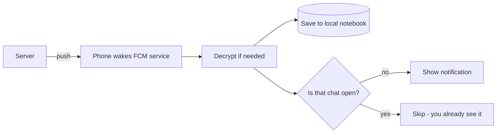

# Notifications - Explained Simply

The plain-language version of [[Notifications]]. How a push arrives, why the message is already
there when you open the app, and how the reply-from-the-notification trick works.

(Teaching comments only; the real source has none.)

---

## The big idea in one sentence

When someone messages you while the app is closed, the server rings your phone (a push), and your
phone quietly saves the message into its notebook AND shows a notification - so the chat is
already complete when you open it.

Analogy: a courier rings your doorbell and also slips the letter under the door. Even if you were
out, the letter is already inside when you get home.

---

## Step by step: a message arrives while the app is closed

1. The server sends a push. Android wakes `MyFirebaseMessagingService.onMessageReceived`
   (`data/remote/firebase/MyFirebaseMessagingService.kt:53`).

2. The app reads the push type. For a message it:
   - decrypts it if needed (see [[End-to-End Encryption - Explained Simply]]),
   - saves it into the local notebook (`persistIncomingMessage`) - this is why it is already
     there later,
   - shows a notification, unless you already have that exact chat open (it checks
     `CurrentConversationHolder`).

3. The notification is a "conversation" style card with the sender's name and avatar, and three
   buttons: Reply, Open in window (bubble), Mark read.

4. If you type a reply straight into the notification, a small background receiver
   (`NotificationReplyReceiver`) sends it using the very same `SendMessageUseCase` the chat screen
   uses, then adds your reply to the notification thread.

5. For a call push instead, the app starts the call manager (see
   [[Calls (Voice and Video) - Explained Simply]]).

---

## Picture: doorbell plus letter under the door



---

## The code, with plain-English comments

Save first, then notify (`data/remote/firebase/MyFirebaseMessagingService.kt:92`):

```kotlin
CoroutineScope(Dispatchers.IO).launch {
    val message = codec.decode(resolved)                     // unlock if encrypted
    if (message is Message.Text) {
        messageRepository.persistIncomingMessage(message)     // save locally -> already there later
    }
    if (CurrentConversationHolder.isOpen(conversationId)) return@launch  // don't ping the open chat
    ChatNotifier.notifyIncoming(context, ..., body, ...)      // otherwise show the notification
}
```

Reply-from-notification reuses the normal send path
(`presentation/notification/NotificationReplyReceiver.kt:59`):

```kotlin
val text = RemoteInput.getResultsFromIntent(intent)?.getCharSequence(KEY_TEXT_REPLY)?.toString()
// Exactly the same use case the chat screen calls - no special path.
entry.sendMessageUseCase().invoke(conversationId, text).collect { }
ChatNotifier.appendOutgoing(context, conversationId, text, now)  // add your reply to the card
```

The "is this chat already open?" flag (`presentation/notification/CurrentConversationHolder.kt`):

```kotlin
// The chat screen sets this while it is open; the push handler reads it.
fun isOpen(conversationId: String): Boolean = ref.get() == conversationId
```

---

## A worked example

- Your app is closed. Bob sends "lunch?".
- The server pushes it. Your phone wakes, decrypts it, and saves "lunch?" into the notebook.
- You are not in Bob's chat, so a notification shows with Reply / Open / Mark read.
- You tap Reply and type "yes" right in the notification -> it sends through the normal path and
  gets added to the notification thread.
- Later you open the app -> Bob's chat already contains both "lunch?" and your "yes"; nothing had
  to load.

---

## Why, in one line each

- Why save the message on arrival, not just show a toast? So the chat is complete offline - open
  the app and it is already there, no spinner.
- Why check if the chat is open? So you are not pinged about the conversation you are already
  looking at.
- Why reuse `SendMessageUseCase` for the notification reply? One send path means the reply behaves
  exactly like a normal message (local-first, retry, ticks).

---

## Related

[[Notifications]] - [[Notifications - Code]] - [[Chat and Messaging - Explained Simply]] -
[[Calls (Voice and Video) - Explained Simply]] - [[End-to-End Encryption - Explained Simply]] -
[[Home]]
