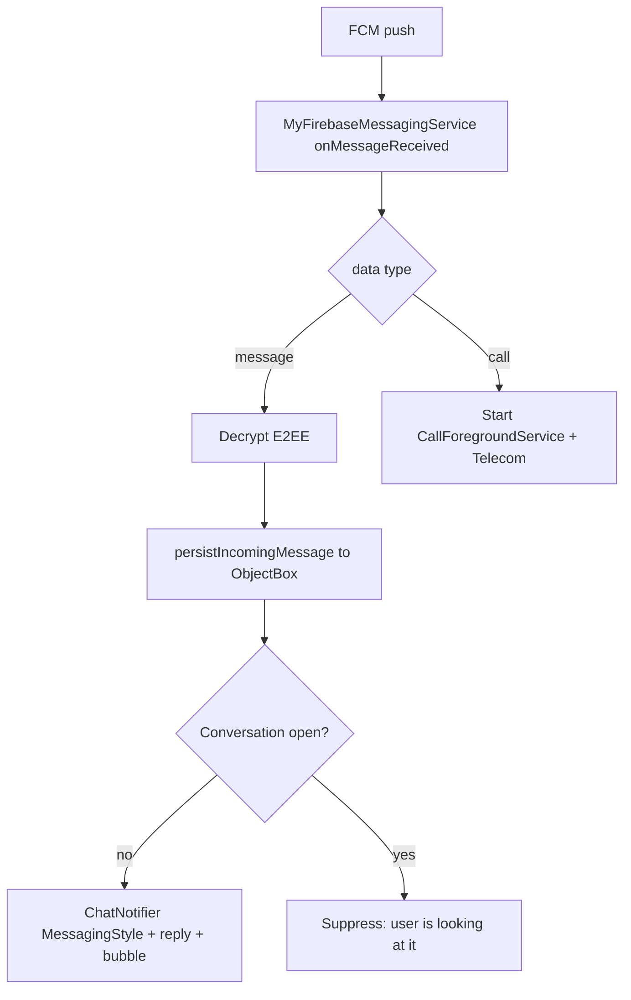

# Notifications

Push over Firebase Cloud Messaging, with offline message persistence, MessagingStyle
notifications, conversation shortcuts and bubbles, inline reply, and a separate incoming-call
path.

## Pieces

- `MyFirebaseMessagingService` (`data/remote/firebase/MyFirebaseMessagingService.kt:39`) - the
  FCM receiver.
- `ChatNotifier` (`presentation/notification/ChatNotifier.kt:33`) - builds and posts chat
  notifications.
- `ConversationShortcuts`, `NotificationChannels`, `NotificationReplyReceiver`,
  `NotificationPermission`, `CurrentConversationHolder` (`presentation/notification/`).
- `FirebaseMessagingManager`, `FcmTokenSyncer` (`data/remote/firebase/`) and `DeviceRegistry`
  (`data/device/DeviceRegistry.kt:14`), which stores the token per device.
- `BubbleActivity` (`presentation/BubbleActivity.kt`) - the activity a bubble expands into.

## Token lifecycle

The FCM token is stored **per device**, so senders (Cloud Functions, `functions/`) can target every
device a user is signed in on. `DeviceRegistry.register(uid, token)`
(`data/device/DeviceRegistry.kt:20`) writes a row under `users/{uid}/devices/{deviceId}` (name,
platform, app version, `lastSeenAt`, `fcmToken`, clears `signedOutAt`) and, for older
Cloud Function builds, also updates the legacy `fcmToken` field on the user document. It is called
from three places: on login, `AuthViewModel.syncFcmTokenForCurrentUser`
(`presentation/screens/auth/AuthViewModel.kt:323`); on rotation, `onNewToken`
(`MyFirebaseMessagingService.kt:43`); and whenever the signed-in uid changes, by
`FcmTokenSyncer.start()` (`data/remote/firebase/FcmTokenSyncer.kt:23`, called from
`MessengerApplication.onCreate`, `MessengerApplication.kt:113`). On logout
`AndroidSessionCleaner.clearOnLogout` (`data/service/AndroidSessionCleaner.kt:35`) calls
`DeviceRegistry.signOut` (removes this device's `fcmToken`, stamps `signedOutAt`), deletes the token
on the device (`FirebaseMessaging.deleteToken()`) and cancels every posted notification, so the
previous account's chats neither keep arriving nor stay in the shade (see [[Authentication]]).

## Receiving a message push

`MyFirebaseMessagingService` is constructed by the OS, so it uses a manual Hilt `@EntryPoint`
(`FcmEntryPoint`, `MyFirebaseMessagingService.kt:29`) to reach the graph - see
[[Dependency Injection (Hilt)]]. `onMessageReceived` (`:60`) ignores pushes when no user is
signed in and dispatches on `data["type"]`:

- `message` -> `handleMessagePayload` (`:81`). On an ephemeral
  `CoroutineScope(Dispatchers.IO)` (`:99`, no long-lived scope available in an OS-constructed
  service - see [[Async and Reactivity]]) it:
  1. parses the incoming DTO; if the payload is encrypted but stripped
     (`enc == 1 && ciphertext.isBlank()`), it fetches the full message from Firestore
     (`getMessageOnce`, `:101`),
  2. decrypts via the E2EE codec (`:105`) - see [[End-to-End Encryption]],
  3. persists text messages locally with `messageRepository.persistIncomingMessage` (`:107`) so
     the message is in ObjectBox even though the app was backgrounded (offline delivery), then
  4. if the conversation is not currently open (`CurrentConversationHolder.isOpen`, `:110`),
     posts a notification via `ChatNotifier.notifyIncoming`. The body is chosen in order: a voice
     or video clip gets its label (`clipLabelFor` in `IncomingMessagePayload.kt`, mapped to
     `R.string.clip_voice_message` / `clip_video_message`, `:112`-`:116`); a decrypted text its text
     (never the undecryptable placeholder); media its caption or "Media"; an encrypted message
     that could not be decrypted "New message"; otherwise the server's `preview`.
- `call` -> `handleCallPayload` (`:139`): first asks `IncomingCallGate.admit` (`:151`-`:152`), which declines the
  call when the `calls` flag is off, then starts `CallForegroundService` with an incoming
  intent and registers a Telecom incoming connection. See [[Calls (Voice and Video)]].
- anything else -> a fallback notification from the FCM `notification` block.

`CurrentConversationHolder` is set by `ChatScreenWithNav` while open
(`presentation/screens/chat/ChatScreenWithNav.kt:156`), which is how the "do not notify for the
chat I am looking at" rule works.

The server side is the `onMessageCreated` Cloud Function (`functions/src/index.ts:112`). It sends the
data push with a `preview`: a clip type maps through `CLIP_PREVIEWS` to "Voice message" /
"Video message" (`functions/src/index.ts:33`), an encrypted message gets an empty preview, and plain
text is cut to 200 characters (`:165`-`:166`). Delivery fans out to each recipient's device tokens:
`pushTargetsFor` (`index.ts:62`) reads the `devices` rows plus the legacy token, `targetsFor`
(`functions/src/push.ts:48`) skips revoked rows, keeps the most recently seen `MAX_DEVICES_PER_USER`
(10) and de-duplicates by token, `sendToTargets` (`index.ts:71`) sends in batches, and tokens FCM
reports as unregistered are removed (`staleTargets`, `push.ts:101`). A call push goes to a single
device (`ringTargets`, `push.ts:69`, `MAX_CALL_DEVICES = 1`). See [[Voice Messages]].

## Building the notification (ChatNotifier)

`ChatNotifier` (`presentation/notification/ChatNotifier.kt:33`) is a global `object` that keeps
a small per-conversation history (`ConvState`, capped at `MAX_MESSAGES = 8`) so the notification
reads as a conversation. `notifyIncoming` (`:61`) resolves an avatar `IconCompat`
(cached, else loaded from URL via Coil with a 5s timeout, else a generated monogram), appends the
message, pushes a dynamic shortcut, and posts.

`post` (`:157`) builds a `MessagingStyle` notification with a `Person` per sender, tied to the
conversation shortcut and `LocusId` (`:186`) so the system associates it with the shortcut and
can bubble it. Actions attached:
- Reply - a `RemoteInput` action (`replyAction`, `:282`) with
  `SEMANTIC_ACTION_REPLY` + generated replies, handled by `NotificationReplyReceiver`.
- Open in window - opens the conversation as a bubble (`openInWindowAction`, `:333`).
- Mark read - `SEMANTIC_ACTION_MARK_AS_READ` (`markReadAction`, `:313`).

When 2+ conversations have active notifications, `postSummary` (`:357`) posts an
`InboxStyle` group summary under `GROUP_KEY`. `appendOutgoing` (`:92`) adds the user's own reply
(sent from the notification) to the thread silently, so the notification stays in sync after an
inline reply.

## Conversation bubbles

`openAsBubble` (`ChatNotifier.kt:112`) posts a notification with `BubbleMetadata`
(`bubbleMetadata`, `:210`) pointing at `BubbleActivity`, with `setAutoExpandBubble(true)` and
`setSuppressNotification(true)`. Bubbles require a matching dynamic shortcut and `LocusId`, which
`ConversationShortcuts.push` provides. The chat opened inside the bubble is the same Compose chat
UI hosted by `BubbleActivity`, which finishes at once when nobody is signed in and closes itself
when the session ends (see [[Chat and Messaging]]).

## Channels and permission

`NotificationChannels.ensureCreated` runs from `MessengerApplication.onCreate`
(`MessengerApplication.kt:109`) and defines the channels used above
(`CHAT_MESSAGES`, `INCOMING_CALL`, `ONGOING_CALL`, `MISSED_CALLS`, `NotificationChannels.kt:15`-`:21`). `NotificationPermission` /
`NotificationPermissionGate` request the runtime notification permission once the session is
`Active` (`presentation/navigation/graph/AppNavigation.kt:68`).

## Feature flag

Four notification capabilities are flagged (see [[Feature Flags and Remote Config]]):
`notification_inline_reply`, `notification_mark_read`, `notification_shortcuts` and
`notification_bubbles` (a child of `notification_shortcuts`, so turning shortcuts off turns bubbles
off too). Because notifications are built outside any ViewModel, the checks live in the notifier and
the receiver:

- `ChatNotifier` reads each flag through `flagOn` (`ChatNotifier.kt:204`), which resolves
  `FeatureFlags` from the `UiEntryPoints` entry point and defaults to "on" if that fails: shortcuts
  are pushed only when `NOTIFICATION_SHORTCUTS` is on (`:84`); `openAsBubble` returns early without
  `NOTIFICATION_BUBBLES` (`:113`); `post` adds the Reply, Open-in-window and Mark-read actions only
  for `NOTIFICATION_INLINE_REPLY` (`:188`), `NOTIFICATION_BUBBLES` (`:191`) and
  `NOTIFICATION_MARK_READ` (`:195`).
- `NotificationReplyReceiver` re-checks at action time, after `awaitFresh()`: a Reply or Mark-read
  tap on an old notification is answered only if the flag is still on, otherwise it just refreshes
  the notification (`presentation/notification/NotificationReplyReceiver.kt:51`-`:62`).
- `MyFirebaseMessagingService` awaits a fresh config before posting (`:111`) so a message push
  uses current flag values.
- Calls arriving by push are gated by the `calls` flag through `IncomingCallGate` (see
  [[Calls (Voice and Video)]]).

## Why this design

- Persisting the decrypted message on receipt (not just showing a toast) means offline delivery:
  the message is already in ObjectBox when the user opens the app, so the chat is complete
  without waiting for a foreground sync.
- MessagingStyle + shortcuts + bubbles is the platform-native way to get inline reply, grouped
  threads, and floating conversation windows; the notifier keeps just enough history to render
  them well.
- Splitting call pushes onto the foreground-service path (not a plain notification) is what lets
  a call ring full-screen and integrate with Telecom even from a cold start.

## Visualization

## Related

[[Chat and Messaging]] - [[Calls (Voice and Video)]] - [[End-to-End Encryption]] - [[Feature Flags and Remote Config]] -
[[Dependency Injection (Hilt)]] - [[Async and Reactivity]] - [[Authentication]] -
[[Notifications - Basic Example]]
