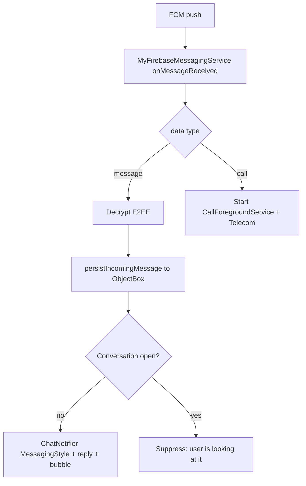

# Notifications

Push over Firebase Cloud Messaging, with offline message persistence, MessagingStyle
notifications, conversation shortcuts and bubbles, inline reply, and a separate incoming-call
path.

## Pieces

- `MyFirebaseMessagingService` (`data/remote/firebase/MyFirebaseMessagingService.kt:32`) - the
  FCM receiver.
- `ChatNotifier` (`presentation/notification/ChatNotifier.kt:30`) - builds and posts chat
  notifications.
- `ConversationShortcuts`, `NotificationChannels`, `NotificationReplyReceiver`,
  `NotificationPermission`, `CurrentConversationHolder` (`presentation/notification/`).
- `FirebaseMessagingManager`, `FcmTokenSyncer` (`data/remote/firebase/`).
- `BubbleActivity` (`presentation/BubbleActivity.kt`) - the activity a bubble expands into.

## Token lifecycle

The FCM token is written to the user's Firestore document so senders (Cloud Functions,
`functions/`) can target the device. On login, `AuthViewModel.syncFcmTokenForCurrentUser`
(`presentation/viewmodel/AuthViewModel.kt:259`) fetches and stores it; `onNewToken`
(`MyFirebaseMessagingService.kt:36`) re-syncs on rotation; `FcmTokenSyncer.start()` (from
`MessengerApplication.onCreate`) keeps it current. `FirestoreService.updateFcmToken` /
`deleteFcmToken` (`FirestoreService.kt:111`, `:122`) do the writes. On logout
`AndroidSessionCleaner.clearOnLogout` deletes the token in Firestore and on the device
(`FirebaseMessaging.deleteToken()`) and cancels every posted notification, so the previous
account's chats neither keep arriving nor stay in the shade (see [[Authentication]]).

## Receiving a message push

`MyFirebaseMessagingService` is constructed by the OS, so it uses a manual Hilt `@EntryPoint`
(`FcmEntryPoint`, `MyFirebaseMessagingService.kt:25`) to reach the graph - see
[[Dependency Injection (Hilt)]]. `onMessageReceived` (`:53`) ignores pushes when no user is
signed in and dispatches on `data["type"]`:

- `message` -> `handleMessagePayload` (`:74`). On an ephemeral
  `CoroutineScope(Dispatchers.IO)` (`:92`, no long-lived scope available in an OS-constructed
  service - see [[Async and Reactivity]]) it:
  1. parses the incoming DTO; if the payload is encrypted but stripped
     (`enc == 1 && ciphertext.isBlank()`), it fetches the full message from Firestore
     (`getMessageOnce`, `:94`),
  2. decrypts via the E2EE codec (`:98`) - see [[End-to-End Encryption]],
  3. persists text messages locally with `messageRepository.persistIncomingMessage` (`:100`) so
     the message is in ObjectBox even though the app was backgrounded (offline delivery), then
  4. if the conversation is not currently open (`CurrentConversationHolder.isOpen`, `:103`),
     posts a notification via `ChatNotifier.notifyIncoming`. The body is chosen in order: a voice
     or video clip gets its label (`clipLabelFor` in `IncomingMessagePayload.kt`, mapped to
     `R.string.clip_voice_message` / `clip_video_message`, `:104`); a decrypted text its text
     (never the undecryptable placeholder); media its caption or "Media"; an encrypted message
     that could not be decrypted "New message"; otherwise the server's `preview`.
- `call` -> `handleCallPayload` (`:131`): starts `CallForegroundService` with an incoming
  intent and registers a Telecom incoming connection. See [[Calls (Voice and Video)]].
- anything else -> a fallback notification from the FCM `notification` block.

`CurrentConversationHolder` is set by `ChatScreenWithNav` while open
(`presentation/screens/chat/ChatScreenWithNav.kt:144`), which is how the "do not notify for the
chat I am looking at" rule works.

The server side is the `onMessageCreated` Cloud Function. It sends the data push with a
`preview`: a clip type maps through `CLIP_PREVIEWS` to "Voice message" / "Video message"
(`functions/src/index.ts:19`), an encrypted message gets an empty preview, and plain text is cut
to 200 characters. See [[Voice Messages]].

## Building the notification (ChatNotifier)

`ChatNotifier` (`presentation/notification/ChatNotifier.kt:30`) is a global `object` that keeps
a small per-conversation history (`ConvState`, capped at `MAX_MESSAGES = 8`) so the notification
reads as a conversation. `notifyIncoming` (`:58`) resolves an avatar `IconCompat`
(cached, else loaded from URL via Coil with a 5s timeout, else a generated monogram), appends the
message, pushes a dynamic shortcut, and posts.

`post` (`:137`) builds a `MessagingStyle` notification with a `Person` per sender, tied to the
conversation shortcut and `LocusId` (`:165`) so the system associates it with the shortcut and
can bubble it. Actions attached:
- Reply - a `RemoteInput` action (`replyAction`, `:249`) with
  `SEMANTIC_ACTION_REPLY` + generated replies, handled by `NotificationReplyReceiver`.
- Open in window - opens the conversation as a bubble (`openInWindowAction`, `:300`).
- Mark read - `SEMANTIC_ACTION_MARK_AS_READ` (`markReadAction`, `:280`).

When 2+ conversations have active notifications, `postSummary` (`:324`) posts an
`InboxStyle` group summary under `GROUP_KEY`. `appendOutgoing` (`:87`) adds the user's own reply
(sent from the notification) to the thread silently, so the notification stays in sync after an
inline reply.

## Conversation bubbles

`openAsBubble` (`ChatNotifier.kt:96`) posts a notification with `BubbleMetadata`
(`bubbleMetadata`, `:177`) pointing at `BubbleActivity`, with `setAutoExpandBubble(true)` and
`setSuppressNotification(true)`. Bubbles require a matching dynamic shortcut and `LocusId`, which
`ConversationShortcuts.push` provides. The chat opened inside the bubble is the same Compose chat
UI hosted by `BubbleActivity`, which finishes at once when nobody is signed in and closes itself
when the session ends (see [[Chat and Messaging]]).

## Channels and permission

`NotificationChannels.ensureCreated` runs from `MessengerApplication.onCreate`
(`MessengerApplication.kt:100`) and defines the channels used above
(`CHAT_MESSAGES`, `INCOMING_CALL`, `ONGOING_CALL`). `NotificationPermission` /
`NotificationPermissionGate` request the runtime notification permission once the session is
`Active` (`presentation/navigation/graph/AppNavigation.kt:49`).

## Why this design

- Persisting the decrypted message on receipt (not just showing a toast) means offline delivery:
  the message is already in ObjectBox when the user opens the app, so the chat is complete
  without waiting for a foreground sync.
- MessagingStyle + shortcuts + bubbles is the platform-native way to get inline reply, grouped
  threads, and floating conversation windows; the notifier keeps just enough history to render
  them well.
- Splitting call pushes onto the foreground-service path (not a plain notification) is what lets
  a call ring full-screen and integrate with Telecom even from a cold start.

## Visualization

## Related

[[Chat and Messaging]] - [[Calls (Voice and Video)]] - [[End-to-End Encryption]] -
[[Dependency Injection (Hilt)]] - [[Async and Reactivity]] - [[Authentication]] -
[[Notifications - Basic Example]]
