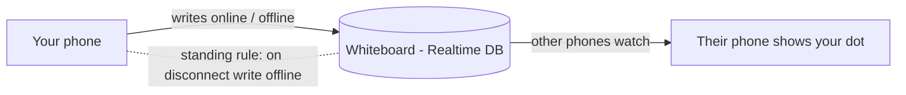

# Presence and Typing - Explained Simply

The plain-language version of [[Presence and Typing]]. How the green "online" dot and the
"typing..." bubble work - and how you still show offline if your phone dies.

(Teaching comments only; the real source has none.)

---

## The big idea in one sentence

Your phone writes "I am online" onto a shared whiteboard (Firebase Realtime Database), and it
tells the server in advance "if my connection drops, erase that for me" - so a crash still shows
you as offline.

Analogy: you write "IN" on the office whiteboard when you arrive. You also leave a standing note
with reception: "if I disappear without signing out, cross my name off." So even if you vanish,
the board becomes correct.

---

## Step by step: the online dot

1. When the app comes to the foreground, `AppLifecycleObserver.onStart` tells
   `PresenceManager.goOnline` (`data/presence/AppLifecycleObserver.kt:19`).

2. `PresenceManager` writes `state = online` to `presence/{yourId}` on the whiteboard, and sets
   up the "on disconnect" rule: if the socket drops, the server writes `offline` for you
   (`RealtimeDbService.setupOnDisconnect`, `data/remote/firebase/RealtimeDbService.kt:46`).

3. When the app goes to the background, `onStop` -> `goOffline` writes `offline`.

4. To show someone else's dot, the app watches their `presence/{theirId}` and updates the little
   dot whenever it changes (`observePresence`).

## Step by step: the typing bubble

1. As you type, the app writes a note under `typing/{chatId}/{yourId}` and refreshes it every 3
   seconds while you keep typing (so it does not spam on every keystroke; `ChatViewModel.onTextChanged`,
   `presentation/screens/chat/ChatViewModel.kt:500`).

2. Every keystroke restarts a 2-second "you stopped" timer; when it runs out (or you empty the box, or
   send) the note is cleared. The reader also ignores notes older than 6 seconds.

3. The other person watches `typing/{chatId}`, ignores their own id, and shows "typing..." if
   anyone is left.

---

## Picture: the shared whiteboard



---

## The code, with plain-English comments

The disconnect safety net (`data/remote/firebase/RealtimeDbService.kt:46`):

```kotlin
fun setupOnDisconnect(userId: String) {
    // Tell the SERVER now: if my connection drops, set me offline for me.
    // No heartbeat needed - a crash or lost signal still ends up correct.
    presenceRef.child(userId).onDisconnect().setValue(mapOf("state" to "offline", ...))
}
```

Not spamming presence writes (`data/presence/PresenceManager.kt:24`):

```kotlin
// A CONFLATED channel keeps only the LATEST requested state.
// So online -> away -> online in half a second collapses to just "online".
private val transitions = Channel<PresenceState>(Channel.CONFLATED)
```

Typing: heartbeat + idle stop (`presentation/screens/chat/ChatViewModel.kt:536`-`:552`):

```kotlin
typingHeartbeatJob = viewModelScope.launch {
    while (isActive) {               // while you keep typing, re-announce every 3 seconds
        typingService.setTyping(chatId)
        delay(3000)
    }
}
typingStopJob = viewModelScope.launch {
    delay(2000)                      // 2 seconds without a keystroke -> you stopped
    stopTyping()                     // cancels both jobs and clears the note
}
```

---

## A worked example

- You open the app -> you write "online" and leave the "on disconnect -> offline" note.
- Bob's phone is watching your presence -> Bob sees your green dot.
- You start typing to Bob -> after a short pause Bob sees "typing...".
- Your phone suddenly loses signal (no clean logout) -> the server runs your standing note and
  writes "offline" -> Bob's dot goes grey a moment later, correctly.

---

## Why, in one line each

- Why Realtime Database, not the main Firestore? It has the built-in "do this if I disconnect"
  feature, which is exactly what offline detection needs.
- Why debounce typing? So you send one "typing" signal when you pause, not one per keystroke.
- Why conflate presence changes? So quick foreground/background flips do not cause a storm of
  writes.

---

## Related

[[Presence and Typing]] - [[Presence and Typing - Code]] - [[Chat and Messaging - Explained Simply]] -
[[Authentication - Explained Simply]] - [[Reading the Code - Simple Patterns]] - [[Home]]
