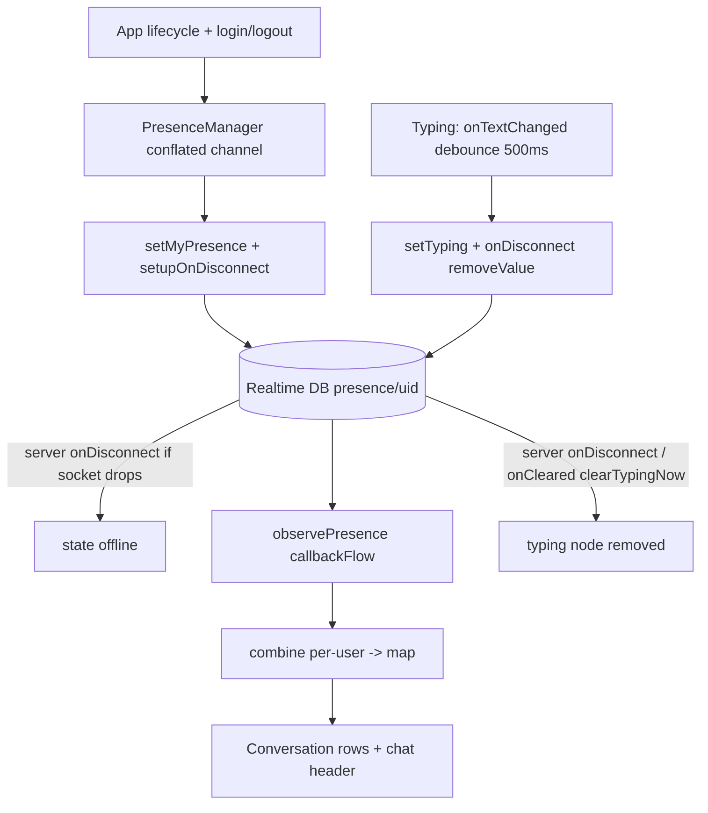

# Presence and Typing

Online/away/offline presence and per-conversation typing indicators, both over Firebase Realtime
Database (chosen over Firestore for these because RTDB has native `onDisconnect` and cheap
high-frequency writes).

## Pieces

- `RealtimeDbService` (`data/remote/firebase/RealtimeDbService.kt`) - raw RTDB reads/writes.
- `FirebasePresenceService` (`data/service/FirebasePresenceService.kt`) - `IPresenceService`.
- `FirebaseTypingService` (`data/service/FirebaseTypingService.kt`) - `ITypingService`.
- `PresenceManager` (`data/presence/PresenceManager.kt`) - drives the current user's presence
  state.
- `AppLifecycleObserver` (`data/presence/AppLifecycleObserver.kt`) - foreground/background hook.
- Use cases: `ObserveUserPresenceUseCase`, `ObserveTypingUseCase`.
- UI: `PresenceIndicator`, `TypingIndicator`.

## Presence data model

Presence is written under `presence/{uid}` in RTDB. `RealtimeDbService.setPresence`
(`RealtimeDbService.kt:37`) writes `{ state, lastSeen, lastChanged: ServerValue.TIMESTAMP }`.
The key reliability mechanism is `setupOnDisconnect` (`RealtimeDbService.kt:46`):

```kotlin
fun setupOnDisconnect(userId: String) {
    val offlineData = mapOf("state" to "offline", "lastSeen" to ServerValue.TIMESTAMP, ...)
    presenceRef.child(userId).onDisconnect().setValue(offlineData)
}
```

`onDisconnect()` is executed by the Firebase server when the client's socket drops, so a crash
or lost network still flips the user offline with a server timestamp - no client heartbeat
needed. `cancelOnDisconnect` clears it on a clean logout.

## Driving the current user's presence

`PresenceManager` (`data/presence/PresenceManager.kt:16`, `@Singleton`) turns lifecycle events
into presence writes through a conflated channel (`transitions: Channel<PresenceState>`,
`:24`). The collector (`ensureCollector`, `:77`) applies each requested state via
`presenceService.setMyPresence(state)`, skipping no-op repeats (`lastAppliedState`), and calls
`setupOnDisconnect` when going ONLINE.

Transitions:
- `goOnline` (`:30`) - ONLINE, cancels any pending offline timer.
- `goAway` (`:37`) - AWAY now, then a 5-minute timer to OFFLINE.
- `goIdleAway` (`:47`) - AWAY with no auto-offline.
- `goOffline` / `disconnect` (`:54`, `:61`) - OFFLINE / remove presence.

`Channel.CONFLATED` (`:24`) means a rapid burst of transitions collapses to the latest before it
is applied, avoiding a storm of RTDB writes on quick foreground/background flips. The manager is
called by `AuthViewModel` on login/logout (`goOnline`/`disconnect`, see [[Authentication]]) and
by `AppLifecycleObserver` on process foreground/background, wired in
`MessengerApplication.onCreate` (`MessengerApplication.kt:101`). The scope passed in is the
caller's (`viewModelScope` from auth, or the observer's), so the manager never owns a scope of
its own.

## Observing other users' presence

`FirebasePresenceService.observePresence` (`FirebasePresenceService.kt:21`) maps the RTDB
`ValueEventListener` flow into a `UserPresence(state, lastSeen)`. `observeMultiplePresence`
(`:30`) `combine`s a list of per-user flows into a single `Map<String, UserPresence>` - used by
the conversations list to light up every row (see [[Conversations List]]). In chat,
`ChatViewModel.observePartnerPresence` (`presentation/viewmodel/ChatViewModel.kt:455`) `combine`s
the presence flow with a 60s ticker so the "last seen N minutes ago" label keeps refreshing even
when presence itself has not changed. The underlying `callbackFlow` + `awaitClose` cleanup is in
[[Async and Reactivity]].

## Typing

Typing is written under `typing/{conversationId}/{uid}` in RTDB. Like presence, the node
self-heals: it is cleared whether the user leaves the chat, backgrounds the app, or the process
is killed, so a partner never gets a permanently stuck "typing...".

- Outgoing: `ChatViewModel.onTextChanged` (`presentation/viewmodel/ChatViewModel.kt:500`)
  debounces 500ms before `typingService.setTyping`, with a 5s TTL clear and an immediate clear
  on empty input. `FirebaseTypingService.setTyping` (`FirebaseTypingService.kt:28`) writes a
  timestamp node for the current user.
- Self-heal on socket drop: `RealtimeDbService.setTyping` (`RealtimeDbService.kt:79`) registers
  `onDisconnect().removeValue()` on the node *before* writing it, mirroring `setupOnDisconnect`
  for presence. A crash, lost network, or process kill makes the Firebase server remove the
  typing node. `clearTyping` (`:85`) cancels that handler before removing the node on a clean
  clear.
- Leave-the-screen clear: `ChatViewModel.onCleared` (`ChatViewModel.kt:616`) calls the
  non-suspending `typingService.clearTypingNow` (`FirebaseTypingService.kt:38` ->
  `RealtimeDbService.kt:91`). `viewModelScope` is already cancelled there, so the clear cannot be
  a suspend call launched in it; `clearTypingNow` fires `removeValue()` without awaiting and
  cancels the disconnect handler. This covers navigating out of a chat while the app stays
  connected - the case where `onDisconnect` would never fire.
- Incoming: `FirebaseTypingService.observeTyping` (`FirebaseTypingService.kt:17`) maps the RTDB
  children to the set of typing uids, filters out the current user, and defensively drops any
  node whose `timestamp` is older than 15s (`isFresh`, `:43`) - a belt for legacy stale entries
  from before the self-heal existed:
  ```kotlin
  data.entries
      .filter { it.key != currentUserId && isFresh(it.value, now) }
      .map { it.key }
      .toSet()
  ```
  `ChatViewModel.observeTyping` (`ChatViewModel.kt:485`) collects it into `isPartnerTyping` /
  `typingUsernames`, shown as the "typing..." label in the chat header.

## Why Realtime Database (not Firestore) for these

- `onDisconnect()` gives server-side cleanup for free, which Firestore does not offer - essential
  so a killed app still shows offline *and* stops showing a stale typing indicator.
- Presence and typing are high-frequency, tiny, ephemeral writes; RTDB's model is cheaper and
  lower-latency for that than Firestore document writes.
- Firestore remains the store of record for messages and conversations; RTDB is used only for
  the transient signals (presence, typing, and call signaling in [[Calls (Voice and Video)]]).

## Visualization



## Related

[[Conversations List]] - [[Chat and Messaging]] - [[Authentication]] -
[[Calls (Voice and Video)]] - [[Async and Reactivity]] - [[Data Layer]] -
[[Presence and Typing - Basic Example]]
