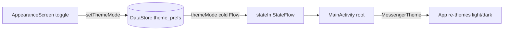

# Settings

The settings tab and its sub-screens, the persisted theme preference, and account deletion.

## Pieces

- `SettingsScreen` (`presentation/screens/settings/SettingsScreen.kt`, with
  `SettingsScreenContent`, `SettingsScaffold`, `SettingsScreenPreview`) - the settings hub, with
  shared rows in `presentation/components/common/SettingsComponents.kt`.
- Sub-screens in `presentation/screens/settings/`: `NotificationsScreen`, `PrivacyScreen`,
  `SecurityScreen`, and the folders `appearance/` (`AppearanceScreen` and its wallpaper/intensity
  pieces), `datastorage/`, `language/` and `deleteaccount/`.
- Profile: `ProfileScreen`, `EditProfileScreen`, `ChangeAccountScreen`, `ChangePhoneScreen`
  (folders under `presentation/screens/`) with `ProfileViewModel`, `EditProfileViewModel`,
  `ChangeAccountViewModel`, `ChangePhoneViewModel`.
- Theme: `AppearanceViewModel` (`presentation/viewmodel/AppearanceViewModel.kt:25`),
  `ThemePreferenceStore` (`data/local/prefs/ThemePreferenceStore.kt:27`), and the theme system
  in `presentation/screens/ui/theme/`.
- Account deletion: `DeleteAccountViewModel`, `DeleteAccountUseCase`
  (`domain/usecase/auth/DeleteAccountUseCase.kt`), `AccountDeletionService`
  (`data/remote/auth/AccountDeletionService.kt`) and the `deleteAccount` Cloud Function
  (`functions/src/index.ts:251`).

## Navigation into settings

`SettingsScreen` exposes callbacks (`onProfileClick`, `onPrivacyClick`, `onAppearanceClick`, ...)
that push the corresponding routes; each sub-screen route is registered in the nav graph
(`presentation/navigation/graph/MainDisplay.kt:324`-`:356`) and pops with `onBack`. See
[[Navigation]].

## Theme preference (DataStore)

The theme mode (SYSTEM / LIGHT / DARK) is persisted with Jetpack DataStore Preferences
(`datastore` `1.1.7`, `gradle/libs.versions.toml:46`). `ThemePreferenceStore`
(`data/local/prefs/ThemePreferenceStore.kt:27`) is a `@Singleton` over a
`preferencesDataStore(name = "theme_prefs")` that also holds the wallpaper, intensity, bar
position, text size and font (see [[Appearance and Theming]]):

```kotlin
val themeMode: Flow<ThemeMode> = context.themeDataStore.data.map { prefs ->
    prefs[themeModeKey]
        ?.let { runCatching { ThemeMode.valueOf(it) }.getOrNull() }
        ?: ThemeMode.SYSTEM
}
suspend fun setThemeMode(mode: ThemeMode) {
    context.themeDataStore.edit { prefs -> prefs[themeModeKey] = mode.name }
}
```

Goal: a durable, reactive theme setting. Reads are a cold `Flow<ThemeMode>` (DataStore emits on
every change), so the UI re-themes the moment the preference is written; unknown/legacy values
fall back to `SYSTEM` via the `runCatching`.

`AppearanceViewModel` (`presentation/viewmodel/AppearanceViewModel.kt:30`) turns that cold flow
into UI state with `stateIn`:

```kotlin
val themeMode: StateFlow<ThemeMode> = themePreferenceStore.themeMode
    .stateIn(viewModelScope, SharingStarted.WhileSubscribed(5_000), ThemeMode.SYSTEM)
```

Why `stateIn(WhileSubscribed(5_000))`: the screen needs a current value on first frame
(hence `StateFlow` with an initial `SYSTEM`), and `WhileSubscribed(5_000)` keeps the upstream
DataStore collection alive for 5s after the last subscriber leaves, so a quick recomposition or
config change does not re-open the DataStore reader. `setDarkTheme` writes back on
`viewModelScope`. The applied theme is consumed at the top of the Compose tree by `MessengerTheme`
(`presentation/screens/ui/theme/Theme.kt`), which maps `ThemeMode` to a light/dark color scheme.

## Theme system

`presentation/screens/ui/theme/` holds `Theme.kt` (the `MessengerTheme` composable and color
scheme selection), `Color.kt`, `Type.kt`, `Shape.kt`, `Dimens.kt`, `Motion.kt`, `Tokens.kt`
(design tokens), and `ThemeMode.kt` (the enum). This is standard Material 3 theming with a
project token layer on top.

## Other settings areas

- `PrivacyScreen` - phone-number visibility (`PhoneVisibility`, stored on the profile), related
  privacy toggles, and the entry to Delete account.
- `SecurityScreen` - surfaces the E2EE safety number for a contact via `SafetyNumberViewModel` /
  `SafetyNumberSection`; see [[End-to-End Encryption]].
- `NotificationsScreen` - notification preferences (channels are created at startup, see
  [[Notifications]]).
- `DataStorageScreen` - media cache / storage management (`MediaCache`, see [[Data Layer]]).
- `LanguageScreen` - app language selection.

## Deleting the account

Settings > Privacy > Delete account opens `DeleteAccountRoute`. The screen has two steps
(`DeleteAccountStep.CONFIRM`, `VERIFY`):

1. The user types `DELETE` to confirm; `DeleteAccountViewModel` refuses to continue otherwise
   (`delete_account_error_confirm`) or when the account has no phone number.
2. It sends an SMS code to the account's own number and keeps the `verificationId` in its own
   state, then re-authenticates with the code (`firebaseAuthService.reauthenticateWithPhone`).
   Firebase requires a recent sign-in before deleting a user, and this step also proves the
   person holding the phone is the one deleting.
3. It disconnects presence and runs `DeleteAccountUseCase`, which calls
   `authRepository.deleteAccount()` -> `AccountDeletionService` -> the `deleteAccount` callable.
   Only when the server confirms does it wipe the device: `sessionCleaner.clearOnDelete(uid)`
   (everything `clearOnLogout` removes plus the E2EE identity key file), Firebase sign-out, and
   `resetDB()`.

The callable (`functions/src/index.ts:251`) runs with the admin SDK because the client rules let
no device delete its own user doc, messages or published keys. It:

- tombstones `users/{uid}`: `deleted = true`, `deletedAt`, and `username`, `usernameLower`,
  `avatarUrl`, `phoneNumber` cleared, `isOnline = false`, `fcmToken` removed;
- best effort, in parallel: deletes the `keys` and `contactAliases` subcollections, the
  `avatars/{uid}/` Storage prefix, and `presence`, `calls` and `callAcks` for the uid in RTDB;
- deletes the Firebase Auth user last (an already-missing user is fine).

`firestore.rules` refuse any update to a tombstoned profile and deny deleting a user doc, so a
tombstone cannot be reverted from a device. Sign-in rejects a tombstoned profile ("This account
has been deleted."), and the session gate turns it into `SignedOut(ACCOUNT_DELETED)`, which signs
the account out on every other device. Conversation partners see the account as "Unknown user"
(see [[Chat and Messaging]] and [[Conversations List]]).

## Why this design

- DataStore (not SharedPreferences) gives a reactive `Flow` for the theme, so theme changes
  propagate through Compose without manual invalidation, and it is the current recommended
  preferences API.
- Exposing the preference as a `StateFlow` via `stateIn` gives the UI a synchronous current
  value while keeping a single reactive source of truth.
- Account deletion is server-side because only the admin SDK may remove data the rules protect
  from clients; tombstoning the profile (instead of deleting it) lets other devices and partners
  observe that the account is gone.

## Visualization



## Related

[[End-to-End Encryption]] - [[Notifications]] - [[Data Layer]] - [[Navigation]] -
[[Presentation Layer (MVI)]] - [[Async and Reactivity]] - [[Appearance and Theming]] -
[[Authentication]] - [[Settings - Basic Example]]
