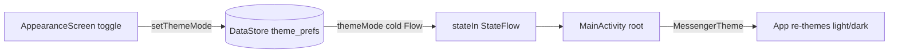

# Settings

The settings tab and its sub-screens, plus the persisted theme preference.

## Pieces

- `SettingsScreen` (`presentation/screens/SettingsScreen.kt`) - the settings hub, with
  `SettingsScaffold` and shared rows in `presentation/components/common/SettingsComponents.kt`.
- Sub-screens in `presentation/screens/settings/`: `AppearanceScreen`, `NotificationsScreen`,
  `PrivacyScreen`, `SecurityScreen`, `DataStorageScreen`, `LanguageScreen`.
- Profile: `ProfileScreen`, `EditProfileScreen`, `ChangeAccountScreen`, `ChangePhoneScreen`
  with `ProfileViewModel`, `EditProfileViewModel`, `ChangeAccountViewModel`,
  `ChangePhoneViewModel`.
- Theme: `AppearanceViewModel` (`presentation/viewmodel/AppearanceViewModel.kt:15`),
  `ThemePreferenceStore` (`data/local/prefs/ThemePreferenceStore.kt:17`), and the theme system
  in `presentation/screens/ui/theme/`.

## Navigation into settings

`SettingsScreen` exposes callbacks (`onProfileClick`, `onPrivacyClick`, `onAppearanceClick`, ...)
that push the corresponding routes; each sub-screen route is registered in the nav graph
(`presentation/navigation/navigation.kt:241`-`:260`) and pops with `onBack`. See [[Navigation]].

## Theme preference (DataStore)

The theme mode (SYSTEM / LIGHT / DARK) is persisted with Jetpack DataStore Preferences
(`datastore` `1.1.7`, `gradle/libs.versions.toml:46`). `ThemePreferenceStore`
(`data/local/prefs/ThemePreferenceStore.kt:17`) is a `@Singleton` over a
`preferencesDataStore(name = "theme_prefs")`:

```kotlin
val themeMode: Flow<ThemeMode> = context.themeDataStore.data.map { prefs ->
    prefs[themeModeKey]?.let { runCatching { ThemeMode.valueOf(it) }.getOrNull() } ?: ThemeMode.SYSTEM
}
suspend fun setThemeMode(mode: ThemeMode) {
    context.themeDataStore.edit { prefs -> prefs[themeModeKey] = mode.name }
}
```

Goal: a durable, reactive theme setting. Reads are a cold `Flow<ThemeMode>` (DataStore emits on
every change), so the UI re-themes the moment the preference is written; unknown/legacy values
fall back to `SYSTEM` via the `runCatching`.

`AppearanceViewModel` (`presentation/viewmodel/AppearanceViewModel.kt:19`) turns that cold flow
into UI state with `stateIn`:

```kotlin
val themeMode: StateFlow<ThemeMode> = themePreferenceStore.themeMode
    .stateIn(viewModelScope, SharingStarted.WhileSubscribed(5_000), ThemeMode.SYSTEM)
```

Why `stateIn(WhileSubscribed(5_000))`: the screen needs a current value on first frame
(hence `StateFlow` with an initial `SYSTEM`), and `WhileSubscribed(5_000)` keeps the upstream
DataStore collection alive for 5s after the last subscriber leaves, so a quick recomposition or
config change does not re-open the DataStore reader. `setDarkTheme` writes back on
`viewModelScope`. The applied theme is consumed at the top of the Compose tree by `MessengerTheme`
(`presentation/screens/ui/theme/Theme.kt`), which maps `ThemeMode` to a light/dark color scheme.

## Theme system

`presentation/screens/ui/theme/` holds `Theme.kt` (the `MessengerTheme` composable and color
scheme selection), `Color.kt`, `Type.kt`, `Shape.kt`, `Dimens.kt`, `Motion.kt`, `Tokens.kt`
(design tokens), and `ThemeMode.kt` (the enum). This is standard Material 3 theming with a
project token layer on top.

## Other settings areas

- `PrivacyScreen` - phone-number visibility (`PhoneVisibility`, stored on the profile) and
  related privacy toggles.
- `SecurityScreen` - surfaces the E2EE safety number for a contact via `SafetyNumberViewModel` /
  `SafetyNumberSection`; see [[End-to-End Encryption]].
- `NotificationsScreen` - notification preferences (channels are created at startup, see
  [[Notifications]]).
- `DataStorageScreen` - media cache / storage management (`MediaCache`, see [[Data Layer]]).
- `LanguageScreen` - app language selection.

## Why this design

- DataStore (not SharedPreferences) gives a reactive `Flow` for the theme, so theme changes
  propagate through Compose without manual invalidation, and it is the current recommended
  preferences API.
- Exposing the preference as a `StateFlow` via `stateIn` gives the UI a synchronous current
  value while keeping a single reactive source of truth.

## Visualization



## Related

[[End-to-End Encryption]] - [[Notifications]] - [[Data Layer]] - [[Navigation]] -
[[Presentation Layer (MVI)]] - [[Async and Reactivity]] - [[Appearance and Theming]] -
[[Settings - Basic Example]]
