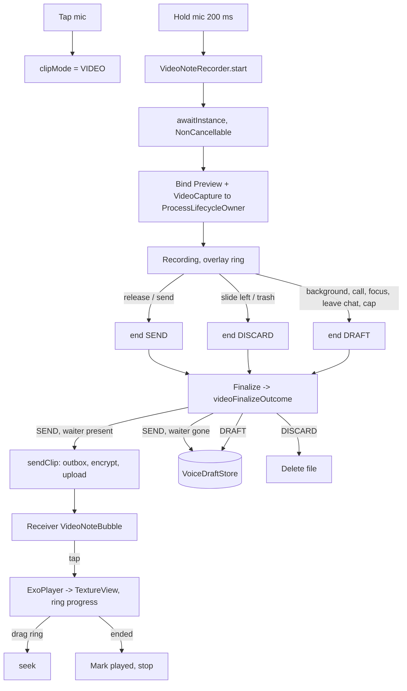

# Video Messages

Round video notes ("video circles"), added on branch `feat/voice_messages` on 2026-10-12. They
share the hold-to-record gesture, the drafts, the outbox and the player with
[[Voice Messages]]: tap the mic to switch it to a camera, hold to record a front-camera clip into
a circular preview, release to send. The receiver gets a round bubble that grows while playing,
with a progress ring on its edge that can be dragged to seek.

`path:line` refs are relative to `app/src/main/java/com/example/messenger/`.

## What

- Recording: CameraX 1.4.2 (`camera-core`, `camera-camera2`, `camera-lifecycle`,
  `camera-video`, `camera-view`; already in `gradle/libs.versions.toml` for the media picker's
  camera cell) - `ProcessCameraProvider` + `Preview` + `VideoCapture<Recorder>`, not the
  `LifecycleCameraController` used by `CameraCaptureScreen`.
- Playback: the same Media3 ExoPlayer 1.10 instance that plays voice notes
  ([[Voice Messages]]), rendering into a `TextureView`.
- Thumbnails: Coil 3 `VideoFrameDecoder` (registered globally in `MessengerApplication`) on the
  local file.
- Wire format: unchanged. `Clip.Video` (`domain/model/voicemessage/Clip.kt`), message type
  `VIDEO_CLIP`, file `chatMedia/<conversationId>/<messageId>/clip.mp4`; `firestore.rules`,
  `storage.rules`, the encryption codec and the push label already accepted it before this work.

## How we use it

### Pieces

- `VideoNoteRecorder` (`data/media/VideoNoteRecorder.kt:94`) - app-wide `@Singleton`, main-thread
  confined, exposing `StateFlow<VideoRecordState>` (`:54`): `Idle` or
  `Recording(conversationId, elapsedMs, started, locked)`.
- `VideoNoteRecordingOverlay` (`presentation/components/chat/VideoNoteRecordingOverlay.kt:37`) -
  scrim, circular `PreviewView`, elapsed ring; drawn by `ChatScreenContent` between the list and
  the composer (`presentation/screens/chat/ChatScreenContent.kt:507`).
- `VideoNoteBubble` (`presentation/screens/chat/VideoNoteBubble.kt:102`) - replaces the old
  `VideoClipPlaceholder`; used from `MessageBubble` (`presentation/screens/chat/MessageBubble.kt:220`).
- `ClipPlaybackController.attachVideo` / `detachVideo` (`data/media/ClipPlaybackController.kt:224`,
  `:229`) with `VideoViewStack` (`:73`).
- `ClipKind` (`domain/model/voicemessage/ClipKind.kt`) and `ClipRecording`
  (`data/media/VoiceRecorder.kt:55`) - the recording handed to the send path or the drafts,
  voice or video.
- `IClipRepository.cachedFile` (`data/repository/ClipRepositoryImpl.kt:138`) - the local file
  for a thumbnail, never a download.

### Switching mode

The mic button's `recordGesture` waits 200 ms after touch-down
(`presentation/components/chat/RecordGesture.kt:62`, `HOLD_TO_RECORD_MS` at `:123`). A release
inside that window is a tap: `ToggleClipMode` flips `ChatUiState.clipMode`
(`presentation/screens/chat/ChatViewModel.kt:222`), the icon crossfades Mic <-> Videocam and a hint
bubble ("Hold to record a video message. Tap to switch to voice") shows for 2 s
(`presentation/screens/chat/MessageComposer.kt:170`-`:174`). Holding past 200 ms starts recording in the
current mode. The mode is ViewModel state, so it resets to voice when the chat is reopened.

### Permissions

Video needs `CAMERA` and `RECORD_AUDIO` (`recordPermissions`,
`presentation/screens/chat/ChatScreenWithNav.kt:51`). Missing ones are requested together with
`RequestMultiplePermissions`; the rationale and "turned off, open Settings" dialogs use camera
wording when the request came from video mode (`requestedForVideo`, `:108`, `:128`).
`VideoNoteRecorder.start` checks both again and refuses without them.

### Recording

`ChatViewModel.startRecording` (`ChatViewModel.kt:257`) pauses any playing clip and calls
`videoNoteRecorder.start(conversationId)` (`VideoNoteRecorder.kt:154`). `start` refuses during a
call, without permissions or without `AUDIOFOCUS_GAIN_TRANSIENT_EXCLUSIVE`, then sets
`Recording(started = false)` and launches `bindAndRecord` (`:209`):

1. `ProcessCameraProvider.awaitInstance(context)` inside `withContext(NonCancellable)` (`:211`).
2. Front camera if present, else back.
3. `Recorder` with `QualitySelector.from(Quality.SD, lowerQualityOrHigherThan(SD))` and
   `setTargetVideoEncodingBitRate(1_200_000)`; `VideoCapture` with
   `MIRROR_MODE_ON_FRONT_ONLY`; a `Preview` whose surface provider the overlay attaches.
4. `bindToLifecycle(ProcessLifecycleOwner.get(), selector, preview, capture)`.
5. `prepareRecording` to a `recording_*.mp4` temp file with
   `setDurationLimitMillis(Clip.Video.MAX_DURATION_MS)` (2 minutes) and
   `setFileSizeLimit(38 MB)`, `withAudioEnabled()`, `start(mainExecutor, listener)`.

`VideoRecordEvent.Start` sets `started` (the overlay hides its spinner), `Status` updates
`elapsedMs` from `recordedDurationNanos`, `Finalize` calls `complete` (`:276`). The composer reuses
`RecordingBar` without a waveform (red dot, timer, slide-to-cancel) and the same lock rail as
voice; see [[Voice Messages]].

### How a recording ends

Every way out goes through `end(active, requested)` (`:266`), which records the request with
`nextVideoEnd` (`:74`) - the first request wins, except that a later cancel always wins - and
calls `recording.stop()` (or completes at once if CameraX has not started yet).
On `Finalize`, `videoFinalizeOutcome` (`:87`) decides:

| Request | Finalize | Outcome |
|---|---|---|
| `DISCARD` (slide-to-cancel, trash, logout) | any | file deleted |
| any | empty file, under 1 s, or an encoder/recorder error | file deleted |
| `SEND` (release, send, stop) | `NONE` | handed to `ChatViewModel.sendRecording` |
| none (still holding) | `DURATION_LIMIT_REACHED`, `FILE_SIZE_LIMIT_REACHED`, `SOURCE_INACTIVE` | draft |
| `DRAFT` (background, call, focus loss, leaving the chat) | usable | draft |

`stop` (`:183`) waits up to 5 s for the result. If the waiter is cancelled (the user left the
chat while CameraX was still writing) or times out, `keepUnclaimedAsDraft` (`:303`) saves an
already-delivered recording as a draft or turns the pending `SEND` into `DRAFT`
(`videoEndWithoutWaiter`, `:77`), so a clip the user chose to send is never silently lost.
`release` (`:313`) unbinds only this recorder's use cases, abandons focus and returns to `Idle`.

Interruptions match voice: `ActiveCallHolder` going active, `ProcessLifecycleOwner` dropping
below `STARTED`, focus loss, `ChatViewModel.onCleared`, and the chat screen leaving composition
(`ChatScreenWithNav.kt:164`, skipped for configuration changes).

### Drafts

`VoiceDraftStore` now stores either kind: `VoiceDraftMeta(durationMs, waveform, kind)`
(`data/media/VoiceDraftStore.kt:20`), media file `<conversationId>.<kind.extension>` in
`filesDir/voice_drafts/`. A draft from before video support has no `kind` field and decodes as
voice. `VoiceDraftBar` shows a video draft as a 36 dp round thumbnail plus "Video message".

### Sending

`sendRecording` (`ChatViewModel.kt:304`) builds `Clip.Video(durationMs, sizeBytes)` and calls
`clipRepository.sendClip`, the same outbox, encryption, size-scaled upload timeout and confirmed
Firestore write as a voice note ([[Voice Messages]]). 38 MB at most stays under the Storage
rule's 40 MB `clip.*` limit; 2 minutes at 1.2 Mbps is about 18 MB.

### The bubble

`VideoNoteBubble`:

- 200 dp idle, animating to 264 dp while it is the active clip.
- Thumbnail: `produceState` asks `videoFrame(messageId)` -> `ChatViewModel.clipVideoFrame` ->
  `cachedFile` and draws the first frame with Coil; without a local file (a received clip not yet
  played) it shows the bubble gradient.
- While active and loaded it composes `VideoNoteSurface`, a `TextureView` attached to the player.
  ExoPlayer stretches video to the view, so `centerCropScale` (`:95`) computes a
  `setTransform` matrix that crops the 4:3 frame to the square.
- Canvas ring: a white 30% track; while active a white progress arc from 12 o'clock plus a knob;
  while uploading or downloading an accent arc of `transfer.progress`.
- Centre control reuses `voiceButton(...)` from `VoiceBubble` (play, spinner, cancel-send,
  retry), hidden while playing so the picture is clear.
- Chips: duration (position while active) with the unplayed dot, and time + status.
- Gestures (`pointerInput(interactive, isActive)`): while active, a down within 28 dp of the ring
  (`isOnRing`, `:92`) consumes the gesture and seeks to `ringFraction` (`:87`, 0 at 12 o'clock,
  clockwise) on every move; any other down waits for an up shorter than the long-press timeout
  and toggles play. Non-ring drags are not consumed, so `SwipeToReply` and `LongPressMessage`
  keep working.
- The context-menu preview passes `interactive = false` and never creates a surface (`VideoNoteBubble.kt:272`; the preview call is `MessageBubble.kt:249`).

### Playback

`playClip` passes `isVideo = message.clip is Clip.Video`; `ClipPlaybackState` carries `isVideo`,
`videoWidth`, `videoHeight` (from `onVideoSizeChanged`). The controller keeps a
`VideoViewStack`: `attachVideo` puts a view on top and renders into it, `detachVideo` removes it
and, if it was the shown one, renders into the view underneath. When a video note ends,
`shouldAutoAdvance` (`:88`) is false: it is marked played and playback stops (the bubble returns
to its thumbnail) instead of continuing with the next voice note. Scrolling the bubble away
detaches its surface; the audio continues and `ClipMiniPlayer` labels it "Video message".

## Feature flag

Video notes are gated by `video_notes` (`FeatureFlag.VIDEO_NOTES`), a sibling of `voice_messages`; see
[[Feature Flags and Remote Config]] and [[Voice Messages]] for the shared recording, lock and
playback flags. Enforcement points:

- ViewModel: `ChatViewModel.requiredFlag` maps `StartRecording` to the flag of the current clip mode
  and `ToggleClipMode` to the flag of the mode it would switch to; `ClipKind.VIDEO` maps to
  `VIDEO_NOTES` (`ChatViewModel.kt:240`, `:242`, `:248`-`:252`), so with the flag off a stale UI cannot
  start the camera.
- UI: the composer reads `VIDEO_NOTES` next to `VOICE_MESSAGES` (`MessageComposer.kt:260`) and
  `availableClipMode` (`:386`) moves the button to voice if video notes are off, so the tap that
  toggles voice <-> video is only active when both are on (`:272`-`:276`).
- Shared flags apply to the video bubble too: `CLIP_PLAYBACK` and `CLIP_SEEK`
  (`presentation/screens/chat/VideoNoteBubble.kt:170`-`:171`), `RECORDING_LOCK`
  (`MessageComposer.kt:287`, `:328`; `ChatViewModel.kt:241`).
- `remoteconfig.template.json` documents `video_notes` as: off - the composer cannot switch to
  video-note mode.

## Why this choice

- `ProcessCameraProvider` over `LifecycleCameraController`: the controller cannot set the
  encoder bitrate, and the Storage rule caps clips at 40 MB. Binding to `ProcessLifecycleOwner`
  keeps the camera out of the Activity: no Activity reference is held by a singleton, and the
  camera closes with the app's visibility, which is exactly when an interruption must happen.
- `withContext(NonCancellable)` around `awaitInstance`: in CameraX 1.4.2 cancelling the awaiting
  coroutine cancels the process-wide CameraX init future (verified in the sources), which breaks
  every CameraX feature until the process dies. Releasing early must never do that.
- A singleton recorder with the same `conversationId` ownership and draft rules as
  `VoiceRecorder` keeps the two kinds interchangeable for the composer and the ViewModel.
- `TextureView` over `SurfaceView`: only a `TextureView` can be clipped to a circle by Compose
  and scaled with a matrix.
- One `ExoPlayer` for both kinds: only one clip plays at a time anyway, and audio focus, call
  pausing, speed and the mini player come for free.
- A view stack instead of a single field: two composables can legitimately hold a surface for the
  same clip during recomposition or scrolling; the stack makes ownership order-independent.
- Front-camera mirroring matches what the user saw in the preview.

## Alternatives considered / rejected

- `LifecycleCameraController` (as in `CameraCaptureScreen`): rejected for the missing bitrate
  control (default SD bitrates can exceed 40 MB in 2 minutes).
- Square-cropping the recording itself with a 1:1 `ViewPort`: not used; the frame is recorded
  4:3 and cropped at display time, which works on every device without relying on encoder crop
  support.
- Media3 `PlayerView` / `media3-ui-compose`: rejected to avoid inflating XML or adding a
  dependency for a single round surface.
- Switching cameras during a recording: CameraX persistent recording is experimental in 1.4;
  left out.
- Muted autoplay of round videos in the list (Telegram style): not built.
- Raising the 2-minute cap: rationale not yet captured - confirm with maintainer.

## Tests

- Unit: `VideoFinalizeOutcomeTest` (outcomes, `nextVideoEnd`, `videoEndWithoutWaiter`),
  `VideoNoteGeometryTest` (`ringFraction`, `isOnRing`, `centerCropScale`), `VideoViewStackTest`
  (stack hand-back, `shouldAutoAdvance`), `VoiceDraftMetaTest` (kind round trip, old drafts).
- Instrumented (run with `adb shell am instrument`, never `connectedDebugAndroidTest`):
  `RecordGestureTest` (tap toggles and never starts; hold starts and sends; slide up locks;
  slide left cancels), `VideoNoteBubbleGestureTest` (centre tap toggles, ring drag seeks, a long
  press inside the chat wrappers opens the menu, a swipe off the ring replies, a clockwise seek
  from 12 o'clock never replies), and two `VideoNoteBubble` cases in
  `ChatComponentContrastTest`.

## Visualization

## Related

[[Voice Messages]] - [[Chat and Messaging]] - [[Async and Reactivity]] - [[Data Layer]] -
[[Feature Flags and Remote Config]] - [[End-to-End Encryption]] - [[Tech Stack and Versions]] - [[Video Messages - Code]] -
[[Video Messages - Explained Simply]] - [[Video Messages - Basic Example]]
