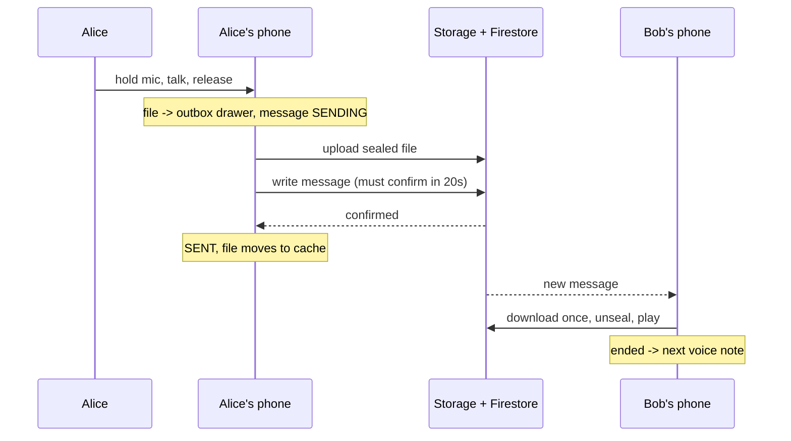

# Voice Messages - Explained Simply

The plain-language version of [[Voice Messages]]. How a voice note gets from your mouth to the
other person's ear, step by step.

(The comments in the code are teaching comments for this doc only. The real source has none.)

---

## The big idea in one sentence

You hold a button and talk; when you let go the recording is packed into a sealed envelope,
parked in a safe outbox, uploaded, and only counted as "sent" once the server confirms it.

Analogy: it is like leaving a voicemail at a post office. You record on a tape, put it in your
own drawer first (so it cannot get lost), the clerk takes it to the sorting office, and you only
tick "sent" when the sorting office stamps the receipt. If the clerk gets interrupted, the tape
stays in your drawer.

---

## Step by step: what happens to the data

Alice records "see you at eight" for Bob.

1. She presses and holds the mic. If she let go within 200 ms it would only be a tap, which
   switches the button between voice and video. Holding longer starts the recorder
   (`VoiceRecorder.start`, `data/media/VoiceRecorder.kt:152`) and the screen stays awake. A live
   waveform shows how loud she is: bars appear from the left like a tape being written, and once
   the row is full the tape slides left so the newest bar stays at the right edge.

2. She lets go. Released finger = "send". (Sliding left = throw away. Sliding up = lock, so she
   can stop holding: a small rail with a padlock sits above the mic, fills as her finger climbs,
   and the padlock clicks shut when she reaches it.)

3. If something interrupts her before she lets go - she switches apps, a call comes in, or the
   phone takes the audio away - the tape is not thrown away. It becomes a draft for that chat
   (`VoiceDraftStore`), with Send and Discard buttons, and it is still there after a restart.

4. The recording moves into the outbox drawer (`filesDir/clip_outbox`) and a "sending" message
   appears in the chat right away (`ClipRepositoryImpl.sendClip`,
   `data/repository/ClipRepositoryImpl.kt:82`).

5. The file is locked with its own key (when the chat is encrypted) and uploaded. A one-hour
   note gets far more time than a two-second one (`clipUploadTimeout`).

6. Just before telling the server "here is the message", the app double-checks that Alice did
   not delete it in the meantime. If she did, it deletes the uploaded file instead.

7. The server must confirm within 20 seconds. Confirmed -> the message is `SENT` and the file
   moves from the outbox into the normal cache. Not confirmed -> `FAILED`, with a retry button.

8. Bob's phone gets the message. When he taps play, the file is downloaded once (even if two
   things ask for it at the same time), unlocked with the key from the encrypted message, and
   played. When it ends, the next voice note in that chat plays automatically.

---

## Picture: the voice note's journey



---

## The code, with plain-English comments

How the end of the finger gesture is judged
(`presentation/components/chat/RecordGesture.kt`):

```kotlin
internal fun recordGestureEnd(locked: Boolean, slidToCancel: Boolean, released: Boolean) = when {
    locked || slidToCancel -> NONE   // locked keeps recording; slide-left already threw it away
    released -> SEND                 // a real finger lift: send it
    else -> DRAFT                    // the system cut the touch short: keep it as a draft
}
```

Never bring a deleted note back to life (`ClipRepositoryImpl.kt:317`):

```kotlin
private fun updateClip(messageId, transform) = messageBox.store.callInTx {
    val row = findRow(messageId)                                    // read the row fresh
    val current = row?.toDomain() as? Message.Clip
    if (row == null || current == null || current.deleted) return@callInTx null  // gone? stop
    transform(current).also { updated -> messageBox.put(updated.toObx()) }        // else save
}
```

---

## A worked example

- Alice records 7 seconds and releases -> sent and played by Bob.
- Alice locks a long recording and her phone rings -> the recording stops and waits as a draft in
  that chat; after the call she taps Send.
- Alice records on the subway, upload fails -> the bubble shows a retry arrow. The app is killed
  overnight; on the next launch the note is marked `FAILED` (not stuck "sending") and the file is
  still in the outbox, so retry works.
- Alice deletes a note for everyone while Bob is playing it -> Bob's playback stops and his copy
  is deleted; the file in Storage is removed too.

---

## Why the waveform looks right on every phone

Microphones differ a lot: a tablet may hear Alice ten times louder than a cheap phone. The app
used to turn loudness into bar height in a straight line, so on quiet phones every bar was
almost zero and the whole message looked like a flat line. Now it measures loudness in decibels
(the way ears hear it) and then stretches each message so its loudest moment fills the bar.
Messages that were already sent are stretched the same way when they are drawn, so old flat
ones suddenly show their real ups and downs.

```kotlin
fun normalizeWaveform(levels: List<Int>): List<Int> {
    val peak = levels.maxOrNull() ?: return levels                 // loudest moment
    if (peak <= 0 || peak >= 100) return levels.map { it.coerceIn(0, 100) }  // silent or full already
    return levels.map { (it.coerceAtLeast(0) * 100f / peak).roundToInt() }   // stretch to 100
}
```

---

## Why, in one line each

- Why an outbox? The cache can be cleared by Android; an unsent recording must not be.
- Why drafts on interruption? You did not choose to stop, so the app should not choose to throw
  it away.
- Why wait for the server's confirmation? Otherwise a note can look "sent" forever when it never
  arrived.
- Why "transient" audio focus? So your music comes back when the voice note ends.

---

## Related

[[Voice Messages]] - [[Voice Messages - Code]] - [[Voice Messages - Basic Example]] -
[[Reading the Code - Simple Patterns]] - [[End-to-End Encryption - Explained Simply]] - [[Home]]
